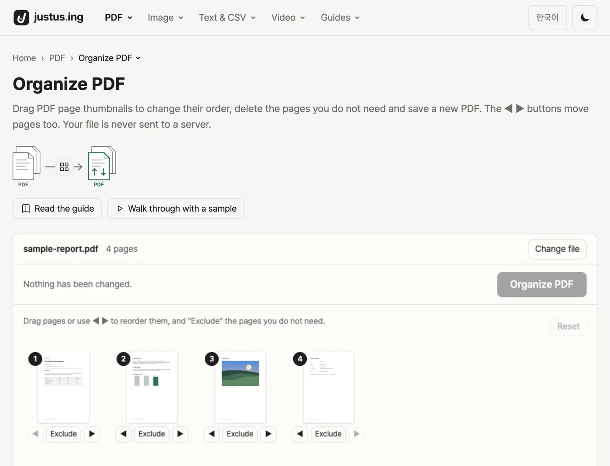
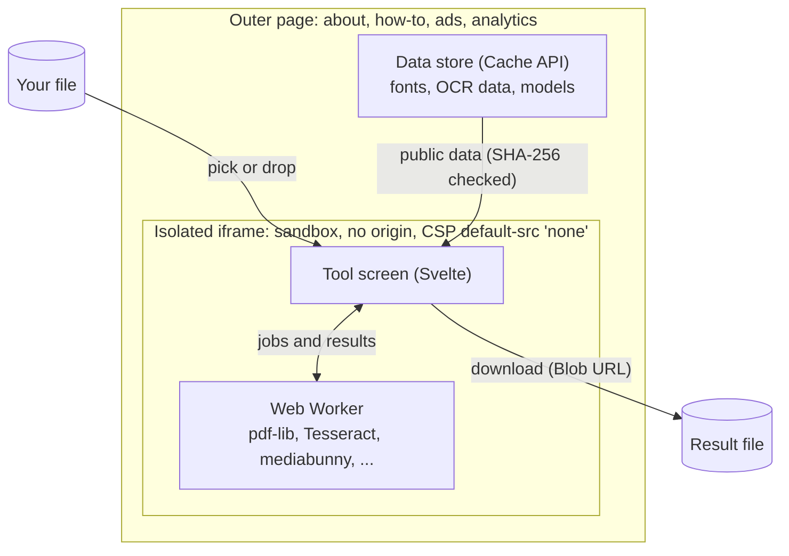

<div align="center">

<a href="https://justus.ing/en/">
  <picture>
    <source media="(prefers-color-scheme: dark)" srcset="public/brand/lockup-dark.png">
    
  </picture>
</a>

### File tools that run in your browser, no uploads

Free tools that handle your PDF, image, video and CSV files right on your own device

**[Open justus.ing →](https://justus.ing/en/)**

[](https://github.com/newbission/justusing/actions/workflows/ci.yml)
[](https://justus.ing/en/)
[](#why-is-it-safe)

[한국어](README.md) · **English**

</div>

---

## What is it?

Merge and compress PDFs, shrink photos, convert iPhone HEIC pictures, remove backgrounds, trim videos and more,
**without installing anything, signing up or uploading your files**. Everything happens inside your browser.
The site is available in Korean and English and works on computers and phones.

|              No uploads               |   No install, no sign-up   |         Free          |
| :-----------------------------------: | :------------------------: | :-------------------: |
| Your files never<br>leave your device | Open the page<br>and start | Every tool<br>is free |

<p align="center">
  <picture>
    <source media="(prefers-color-scheme: dark)" srcset="docs/readme/en-dark.webp">
    
  </picture>
</p>

## Tools

<!-- tools:start -->

There are **42 tools** right now, all free.

### [PDF](https://justus.ing/en/pdf/)

| Group          | Tools                                                                                                                                                                                                                                                                                                                                                                                                                |
| -------------- | -------------------------------------------------------------------------------------------------------------------------------------------------------------------------------------------------------------------------------------------------------------------------------------------------------------------------------------------------------------------------------------------------------------------- |
| View & extract | [View PDF](https://justus.ing/en/pdf/view/) · [PDF to Text](https://justus.ing/en/pdf/extract-text/) · [Extract Images from PDF](https://justus.ing/en/pdf/extract-images/)                                                                                                                                                                                                                                          |
| Organize pages | [Merge PDF](https://justus.ing/en/pdf/merge/) · [Split PDF](https://justus.ing/en/pdf/split/) · [Rotate PDF](https://justus.ing/en/pdf/rotate/) · [Organize PDF](https://justus.ing/en/pdf/organize/) · [N-up PDF](https://justus.ing/en/pdf/n-up/) · [Crop PDF](https://justus.ing/en/pdf/crop/)                                                                                                                    |
| Edit           | [Add Page Numbers](https://justus.ing/en/pdf/page-numbers/) · [Add Watermark to PDF](https://justus.ing/en/pdf/watermark/) · [Add Header and Footer to PDF](https://justus.ing/en/pdf/header-footer/) · [Add Image to PDF](https://justus.ing/en/pdf/add-image/) · [Sign PDF](https://justus.ing/en/pdf/sign/) · [Edit PDF](https://justus.ing/en/pdf/edit/) · [Fill PDF Form](https://justus.ing/en/pdf/fill-form/) |
| Convert        | [PDF to Image](https://justus.ing/en/pdf/to-image/) · [Image to PDF](https://justus.ing/en/pdf/from-image/) · [OCR PDF](https://justus.ing/en/pdf/ocr/)                                                                                                                                                                                                                                                              |
| Optimize       | [Compress PDF](https://justus.ing/en/pdf/compress/)                                                                                                                                                                                                                                                                                                                                                                  |
| Security       | [Unlock PDF](https://justus.ing/en/pdf/unlock/) · [Protect PDF](https://justus.ing/en/pdf/protect/) · [Edit PDF Metadata](https://justus.ing/en/pdf/metadata/) · [Redact PDF](https://justus.ing/en/pdf/redact/)                                                                                                                                                                                                     |

### [Image](https://justus.ing/en/image/)

| Group   | Tools                                                                                                                                                                                               |
| ------- | --------------------------------------------------------------------------------------------------------------------------------------------------------------------------------------------------- |
| Size    | [Compress Image](https://justus.ing/en/image/compress/) · [Resize Image](https://justus.ing/en/image/resize/) · [Compress to Target Size](https://justus.ing/en/image/target-size/)                 |
| Convert | [Convert Image](https://justus.ing/en/image/convert/) · [HEIC to JPG](https://justus.ing/en/image/heic-to-jpg/) · [Image to Text (OCR)](https://justus.ing/en/image/ocr/)                           |
| Edit    | [Stitch Images](https://justus.ing/en/image/stitch/) · [Crop & Rotate Image](https://justus.ing/en/image/crop/) · [Pixelate & Blur Image](https://justus.ing/en/image/mosaic/)                      |
| Photo   | [ID Photo Maker](https://justus.ing/en/image/id-photo/) · [Remove Image Background](https://justus.ing/en/image/remove-bg/) · [Remove Photo Location](https://justus.ing/en/image/remove-location/) |

### [Text & CSV](https://justus.ing/en/text/)

| Group    | Tools                                                        |
| -------- | ------------------------------------------------------------ |
| Encoding | [Fix CSV Encoding](https://justus.ing/en/text/csv-encoding/) |

### [Video](https://justus.ing/en/video/)

| Group             | Tools                                                                                                                                                                                            |
| ----------------- | ------------------------------------------------------------------------------------------------------------------------------------------------------------------------------------------------ |
| Edit              | [Trim Video](https://justus.ing/en/video/trim/)                                                                                                                                                  |
| Size              | [Compress Video](https://justus.ing/en/video/compress/)                                                                                                                                          |
| Convert & extract | [Video to GIF](https://justus.ing/en/video/to-gif/) · [Video Frame Capture](https://justus.ing/en/video/frame-capture/) · [Extract Audio from Video](https://justus.ing/en/video/extract-audio/) |

<!-- tools:end -->

## Why is it safe?

There is one core promise: **your files never leave your device.**
This site has no server to receive files, no upload feature and no database.
The site's [Why your files are safe](https://justus.ing/en/safety/) page explains it with pictures.

<details>
<summary><b>How the code keeps that promise</b></summary>

### 1. Everything runs in your browser

Reading and editing PDFs (pdf.js, pdf-lib), text recognition (Tesseract), photo conversion (the browser's canvas, libheif for HEIC),
face detection and background removal (MediaPipe), and trimming or re-encoding videos (mediabunny with the browser's WebCodecs)
all run in the browser on your own computer or phone. Heavy work runs in Web Workers so the page never freezes.
Result files are also built inside the browser and downloaded directly (Blob URLs). This repository has no code that
puts file contents or file names into a network request, and adding such code is against the rules.

### 2. Tools run only inside an isolated frame

To stay free, the outer page carries ads and visitor analytics. Scripts like these can usually read whatever is on
the same page. So **everything that picks, shows, processes and downloads your files lives in a separate iframe.**

- The iframe is loaded with `sandbox="allow-scripts allow-downloads"`. Without `allow-same-origin`, the browser treats it as
  **a separate document with no origin**. Ad and analytics scripts on the outer page cannot reach the file names,
  PDF text or previews inside it.
- Connections from inside the frame are blocked too. The frame's Content Security Policy starts from `default-src 'none'` and
  **only allows reading files from our own site (code, fonts, data)**. Even if tool code had a bug or someone injected code,
  the browser would block requests to the outside. Form submission is blocked as well (`form-action 'none'`).
- When you drag a file onto the page, the frame expands to cover the whole screen so the isolated frame receives it.
  A file dropped outside it anyway is intercepted before any other script on the page, so it never reaches ad scripts.

### 3. Everything the tools need comes from our own site

Libraries, workers, fonts, text recognition language data and face/background models are hosted on this site, never loaded from
an external CDN. For large downloads such as fonts, text recognition data and face/background models, the site tells you the size
and asks first. They are kept in your browser so you do not download them again, and the frame uses them **only after checking
them against the SHA-256 hash and size recorded at build time**. Even though they pass through the outer page,
data that was changed on the way is never used.

### 4. Tests check the promise every time

The E2E tests that run on every PR process real files with the tools. Each test records every request made along the way
and checks them all at the end against the same rules ([`tests/e2e/local-only.ts`](tests/e2e/local-only.ts)).

- Requests from the tool frame may only go to our own site, without a body.
- The outer page may additionally connect only to the listed analytics and ad addresses.
- A test fails if the address or body of any request (including ones to our own site) contains a test file's name, the
  header of a file format (PDF, image, font, video, audio, raw or base64) or part of a test file's contents (base64).
- This check looks for known markers, so it cannot promise to catch every possible leak. In the tool frame, where files
  are handled, the CSP above blocks connections outside our site, and this check makes sure no file rides on requests to our site.

### Check it yourself

Open your browser's developer tools (F12), go to the **Network** tab and process a file. You can see for yourself that
there is no upload request the size of your file. This repository is public, so you can verify all of the above in the code too.

### Good to know

- Ads and analytics run on the outer page. Analytics is cookieless Cloudflare Web Analytics, and ads are
  Google AdSense. See the site's [Privacy Policy](https://justus.ing/en/privacy/) for details.
- Processing speed and the largest file you can handle depend on your device and browser.
- Tools that remove content, such as Redact, explain on screen and in their FAQ what is removed and what remains.

</details>

## For developers

### Stack

| Part   | Uses                                                                                       |
| ------ | ------------------------------------------------------------------------------------------ |
| Site   | Astro (static build) + Svelte 5 (tool screens) + TypeScript strict                         |
| Work   | Web Workers, pdf.js and pdf-lib, Tesseract, MediaPipe, mediabunny with WebCodecs, and more |
| Deploy | Cloudflare Workers static assets (`wrangler.jsonc`), no server code                        |
| Checks | Prettier, `astro check` and `svelte-check`, Playwright E2E                                 |

### Architecture

The outer page (where ads and analytics live) is separate from the tool frame (where files are handled).
They exchange only content-free signals (theme, drag and drop, ...) and public data from our own site; your files never leave the frame.



### Quick start

You need Node 24 LTS and npm.

```sh
npm ci
npm run dev          # dev server http://localhost:4321 (isolation and CSP are off)
npm run build        # build the static site into dist/
npm run preview      # preview like production (isolation and CSP on) http://localhost:4322
npm run check        # type check
npm run test:e2e     # E2E against the build (run npm run build first)
```

The dev server turns off tool isolation and CSP, so after changing a tool, check it the way it is deployed
with `npm run build` and then `npm run preview` or `npm run test:e2e`.

### Further reading

The project documents are written in Korean.

- Principles, rules and workflow: [`CLAUDE.md`](CLAUDE.md), review rules: [`AGENTS.md`](AGENTS.md)
- Design notes and history for each feature: [`docs/`](docs/README.md)
- Adding a tool: create `meta.ts`, `content.ts`, `Frame.astro` and `App.svelte` in `src/tools/<category>/<name>/`
  and add one line to `src/tools/registry.ts`. The tool list above is generated from the registry by `node scripts/readme/tools.mjs`.

### Contributing

Please report problems and ideas in [Issues](https://github.com/newbission/justusing/issues).
To send code, open a PR against the `dev` branch. Every PR runs formatting, type checks, the build and E2E (including the
local-processing checks), and **code that puts file contents or file names into network requests will not be accepted.**

## Open source we use

These open source projects make it possible to run the tools in your browser. Their licenses are in each project,
and the licenses and notices that must ship with the site (fonts, libheif, mediabunny) are also served under `/data/fonts/licenses/` and `/vendor/`.

| Project                                                                                    | Used for                                         | License     |
| ------------------------------------------------------------------------------------------ | ------------------------------------------------ | ----------- |
| [pdf.js](https://github.com/mozilla/pdf.js)                                                | Viewing PDFs, drawing pages                      | Apache-2.0  |
| [@cantoo/pdf-lib](https://github.com/cantoo-scribe/pdf-lib), fontkit                       | Creating and editing PDFs, embedding fonts       | MIT         |
| [Tesseract](https://github.com/tesseract-ocr/tesseract) (tesseract.js-core, tessdata_best) | Text recognition (OCR)                           | Apache-2.0  |
| [MediaPipe](https://github.com/google-ai-edge/mediapipe) engine and models                 | Face detection for ID photos, background removal | Apache-2.0  |
| [mediabunny](https://github.com/Vanilagy/mediabunny)                                       | Reading and writing videos                       | MPL-2.0     |
| [libheif](https://github.com/strukturag/libheif) and libde265 (libheif-js)                 | Opening HEIC photos                              | LGPL-3.0    |
| Korean fonts (Pretendard, Noto, Nanum and more)                                            | Adding text to PDFs                              | SIL OFL 1.1 |
| fflate, UPNG.js, gifenc                                                                    | ZIP, PNG color reduction, GIF encoding           | MIT         |
