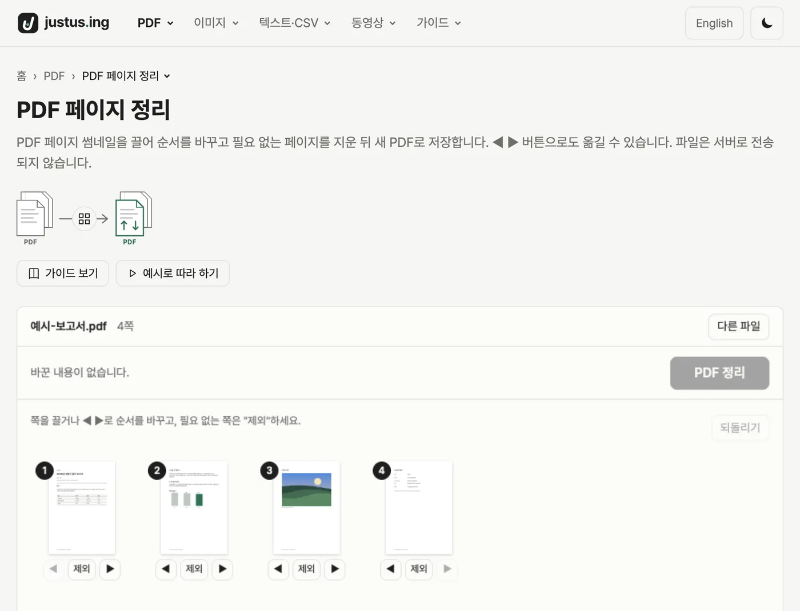
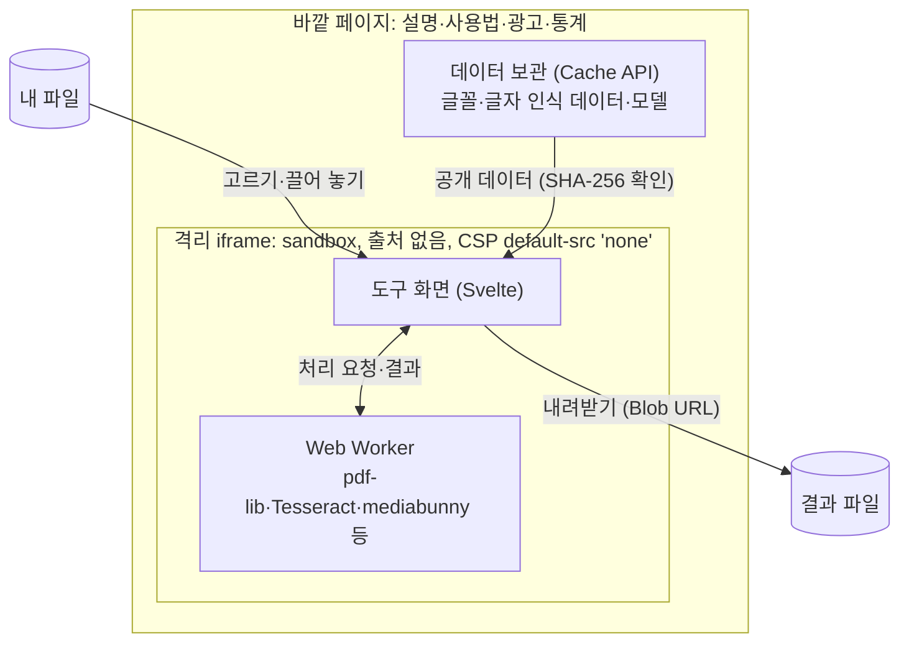

<div align="center">

<a href="https://justus.ing">
  <picture>
    <source media="(prefers-color-scheme: dark)" srcset="public/brand/lockup-dark.png">
    
  </picture>
</a>

### 업로드 없이, 브라우저에서 바로 쓰는 파일 도구

PDF·이미지·동영상·CSV 파일을 내 기기 안에서 바로 처리하는 무료 도구 모음

**[justus.ing 바로 가기 →](https://justus.ing)**

[](https://github.com/newbission/justusing/actions/workflows/ci.yml)
[](https://justus.ing)
[](#왜-안전한가요)

**한국어** · [English](README.en.md)

</div>

---

## 어떤 사이트인가요

PDF 합치기·압축, 사진 용량 줄이기, 아이폰 HEIC 변환, 배경 지우기, 동영상 자르기 같은 일을
**프로그램 설치도, 회원 가입도, 파일 업로드도 없이** 브라우저 안에서 끝내는 사이트입니다.
한국어와 영어로 쓸 수 있고, 컴퓨터와 휴대폰 모두에서 됩니다.

|             업로드 없음             |       설치·가입 없음       |             무료             |
| :---------------------------------: | :------------------------: | :--------------------------: |
| 파일이 내 기기를<br>떠나지 않습니다 | 주소를 열면<br>바로 씁니다 | 모든 도구를<br>무료로 씁니다 |

<p align="center">
  <picture>
    <source media="(prefers-color-scheme: dark)" srcset="docs/readme/ko-dark.webp">
    
  </picture>
</p>

## 어떤 도구가 있나요

<!-- tools:start -->

지금 도구 **42개**가 있고, 모두 무료입니다.

### [PDF](https://justus.ing/pdf/)

| 묶음        | 도구                                                                                                                                                                                                                                                                                                                                                                                         |
| ----------- | -------------------------------------------------------------------------------------------------------------------------------------------------------------------------------------------------------------------------------------------------------------------------------------------------------------------------------------------------------------------------------------------- |
| 보기·추출   | [PDF 보기](https://justus.ing/pdf/view/) · [PDF 글자 추출](https://justus.ing/pdf/extract-text/) · [PDF 사진 꺼내기](https://justus.ing/pdf/extract-images/)                                                                                                                                                                                                                                 |
| 페이지 정리 | [PDF 합치기](https://justus.ing/pdf/merge/) · [PDF 나누기](https://justus.ing/pdf/split/) · [PDF 회전](https://justus.ing/pdf/rotate/) · [PDF 페이지 정리](https://justus.ing/pdf/organize/) · [PDF 모아찍기 (한 장에 여러 쪽)](https://justus.ing/pdf/n-up/) · [PDF 자르기](https://justus.ing/pdf/crop/)                                                                                   |
| 편집        | [PDF 쪽 번호 넣기](https://justus.ing/pdf/page-numbers/) · [PDF 워터마크 넣기](https://justus.ing/pdf/watermark/) · [PDF 머리말·꼬리말 넣기](https://justus.ing/pdf/header-footer/) · [PDF 이미지 넣기](https://justus.ing/pdf/add-image/) · [PDF 서명 넣기](https://justus.ing/pdf/sign/) · [PDF 편집](https://justus.ing/pdf/edit/) · [PDF 양식 채우기](https://justus.ing/pdf/fill-form/) |
| 변환        | [PDF를 이미지로](https://justus.ing/pdf/to-image/) · [이미지를 PDF로](https://justus.ing/pdf/from-image/) · [PDF 글자 인식 (OCR)](https://justus.ing/pdf/ocr/)                                                                                                                                                                                                                               |
| 최적화      | [PDF 압축](https://justus.ing/pdf/compress/)                                                                                                                                                                                                                                                                                                                                                 |
| 보안        | [PDF 암호 해제](https://justus.ing/pdf/unlock/) · [PDF 암호 걸기](https://justus.ing/pdf/protect/) · [PDF 문서 정보 고치기](https://justus.ing/pdf/metadata/) · [PDF 가리기 (영구 삭제)](https://justus.ing/pdf/redact/)                                                                                                                                                                     |

### [이미지](https://justus.ing/image/)

| 묶음        | 도구                                                                                                                                                                                 |
| ----------- | ------------------------------------------------------------------------------------------------------------------------------------------------------------------------------------ |
| 용량·크기   | [이미지 압축](https://justus.ing/image/compress/) · [이미지 크기 조절](https://justus.ing/image/resize/) · [이미지 용량 맞추기](https://justus.ing/image/target-size/)               |
| 변환        | [이미지 형식 변환](https://justus.ing/image/convert/) · [HEIC JPG 변환](https://justus.ing/image/heic-to-jpg/) · [이미지 글자 추출 (OCR)](https://justus.ing/image/ocr/)             |
| 편집        | [이미지 이어 붙이기](https://justus.ing/image/stitch/) · [이미지 자르기·회전](https://justus.ing/image/crop/) · [이미지 모자이크](https://justus.ing/image/mosaic/)                  |
| 사진 다듬기 | [증명사진 만들기](https://justus.ing/image/id-photo/) · [이미지 배경 제거](https://justus.ing/image/remove-bg/) · [사진 위치 정보 지우기](https://justus.ing/image/remove-location/) |

### [텍스트·CSV](https://justus.ing/text/)

| 묶음   | 도구                                                          |
| ------ | ------------------------------------------------------------- |
| 인코딩 | [CSV 한글 깨짐 고치기](https://justus.ing/text/csv-encoding/) |

### [동영상](https://justus.ing/video/)

| 묶음      | 도구                                                                                                                                                                           |
| --------- | ------------------------------------------------------------------------------------------------------------------------------------------------------------------------------ |
| 편집      | [동영상 자르기](https://justus.ing/video/trim/)                                                                                                                                |
| 용량      | [동영상 용량 줄이기](https://justus.ing/video/compress/)                                                                                                                       |
| 변환·추출 | [동영상을 GIF로](https://justus.ing/video/to-gif/) · [동영상 장면 캡처](https://justus.ing/video/frame-capture/) · [동영상 소리 추출](https://justus.ing/video/extract-audio/) |

<!-- tools:end -->

## 왜 안전한가요

핵심 약속은 하나입니다. **파일이 내 기기를 떠나지 않습니다.**
이 사이트에는 파일을 받을 서버도, 업로드 기능도, 데이터베이스도 없습니다.
사이트의 [파일이 안전한 이유](https://justus.ing/safety/)에서 그림과 함께 볼 수 있습니다.

<details>
<summary><b>그 약속을 코드로 어떻게 지키는지 자세히 보기</b></summary>

### 1. 모든 처리는 내 브라우저 안에서

PDF 읽고 고치기(pdf.js, pdf-lib), 글자 인식(Tesseract), 사진 변환(브라우저 canvas, HEIC는 libheif),
얼굴 찾기·배경 지우기(MediaPipe), 동영상 자르기·다시 저장(mediabunny와 브라우저 WebCodecs)이 모두
내 컴퓨터·휴대폰의 브라우저에서 돕니다. 무거운 처리는 Web Worker에서 돌려 화면이 멈추지 않습니다.
결과 파일도 브라우저 안에서 만들어 바로 내려받습니다(Blob URL). 파일 내용이나 파일 이름이 담긴 네트워크 요청을
만드는 코드는 이 저장소에 없고, 넣지 않는 것이 규칙입니다.

### 2. 도구는 격리된 칸 안에서만 돈다

무료로 운영하기 위해 바깥 페이지에는 광고와 방문 통계 스크립트가 있습니다. 이런 스크립트는 보통 같은 페이지의
화면 내용을 읽을 수 있습니다. 그래서 **파일을 고르고, 보고, 처리하고, 내려받는 영역 전체를 따로 떨어진 iframe에 넣었습니다.**

- iframe은 `sandbox="allow-scripts allow-downloads"`로 띄웁니다. `allow-same-origin`이 없어서 브라우저는 이 칸을
  **출처가 없는 별개의 문서**로 다룹니다. 바깥 페이지의 광고·통계 스크립트는 칸 안의 파일 이름, PDF 글자,
  미리보기에 접근할 수 없습니다.
- 칸 안에서 다른 곳으로 연결하는 것도 막혀 있습니다. 칸 문서의 보안 정책(CSP)은 `default-src 'none'`에서 시작해
  **우리 사이트의 파일(프로그램·글꼴·데이터)을 읽는 것만** 허용합니다. 도구 코드에 실수가 있거나 누가 코드를 끼워 넣더라도,
  브라우저가 외부로 보내는 요청을 막습니다. 양식 제출(`form-action 'none'`)도 막혀 있습니다.
- 파일을 화면에 끌어다 놓을 때는 칸이 화면 전체로 넓어져 격리된 칸이 파일을 받습니다. 그래도 바깥에 놓인 파일은
  페이지의 다른 스크립트보다 먼저 가로채 버려서 광고 스크립트에 넘어가지 않습니다.

### 3. 필요한 프로그램은 모두 우리 사이트에서

라이브러리, 워커, 글꼴, 글자 인식 언어 데이터, 얼굴·배경 모델을 외부 CDN에서 불러오지 않고 이 사이트에 직접 올려 둡니다.
글꼴·글자 인식·얼굴·배경 데이터처럼 큰 파일은 처음 한 번 받을 때 크기를 먼저 알리고 동의를 받습니다.
다음 방문에 다시 받지 않도록 브라우저에 보관하는데, 칸은 받은 데이터를 **빌드 때 적어 둔 SHA-256 값과 크기로 확인한 뒤에만** 씁니다.
바깥 페이지를 거쳐 받더라도 중간에 바뀐 데이터는 쓰지 않습니다.

### 4. 테스트가 약속을 매번 확인

PR마다 도는 E2E 테스트는 도구들로 실제 파일을 처리합니다. 테스트마다 그동안 나간 요청을 전부 기록해 두었다가,
끝날 때 같은 기준([`tests/e2e/local-only.ts`](tests/e2e/local-only.ts))으로 저절로 확인합니다.

- 도구 칸의 요청은 우리 사이트로 가는, 본문 없는 요청뿐이어야 합니다.
- 바깥 페이지는 정해 둔 방문 통계·광고 주소로만 더 연결할 수 있습니다.
- 모든 요청(우리 사이트로 가는 요청 포함)의 주소와 본문에 테스트 파일의 이름, 파일 형식의 첫머리(PDF·이미지·글꼴·동영상·소리,
  그대로 또는 base64), 테스트 파일 내용의 일부(base64)가 들어 있으면 실패합니다.
- 이 검사는 알려진 표시를 찾는 방식이라, 모든 유출을 다 잡는다고 보장하지는 않습니다. 파일이 오갈 수 있는
  도구 칸은 위 CSP가 우리 사이트 밖으로의 연결을 막고, 이 검사가 우리 사이트로 가는 요청에 파일이 실리지 않는지 봅니다.

### 직접 확인하는 방법

브라우저 개발자 도구(F12)의 **네트워크** 탭을 연 채로 파일을 처리해 보세요. 파일 크기만 한 업로드 요청이 없다는 것을
직접 볼 수 있습니다. 이 저장소는 공개되어 있어 위 내용을 코드로도 확인할 수 있습니다.

### 알아 둘 점

- 광고와 방문 통계는 바깥 페이지에서 동작합니다. 방문 통계는 쿠키 없는 Cloudflare Web Analytics이고, 광고는
  Google AdSense입니다. 자세한 내용은 사이트의 [개인정보처리방침](https://justus.ing/privacy/)에 있습니다.
- 처리 속도와 다룰 수 있는 파일 크기는 내 기기의 성능과 브라우저를 따릅니다.
- 가리기처럼 내용을 지우는 도구는 무엇이 남고 무엇이 지워지는지 각 도구의 화면과 FAQ에 밝혀 두었습니다.

</details>

## 개발자를 위해

### 스택

| 부분   | 쓰는 것                                                                   |
| ------ | ------------------------------------------------------------------------- |
| 사이트 | Astro(정적 빌드) + Svelte 5(도구 화면) + TypeScript strict                |
| 처리   | Web Worker, pdf.js·pdf-lib, Tesseract, MediaPipe, mediabunny·WebCodecs 등 |
| 배포   | Cloudflare Workers 정적 배포 (`wrangler.jsonc`), 서버 코드 없음           |
| 검사   | Prettier, `astro check`·`svelte-check`, Playwright E2E                    |

### 구조

바깥 페이지(광고·통계가 있는 곳)와 도구 칸(파일을 다루는 곳)이 나뉘어 있습니다.
둘은 내용 없는 신호(테마·끌어 놓기 등)와 우리 사이트의 공개 데이터만 주고받고, 사용자 파일은 칸 밖으로 나가지 않습니다.



### 빠른 시작

Node 24 LTS와 npm이 필요합니다.

```sh
npm ci
npm run dev          # 개발 서버 http://localhost:4321 (격리·CSP가 꺼져 있음)
npm run build        # dist/에 정적 사이트 생성
npm run preview      # 배포와 같은 방식(격리·CSP 켜짐)으로 미리보기 http://localhost:4322
npm run check        # 타입 검사
npm run test:e2e     # 빌드 결과로 E2E (먼저 npm run build)
```

개발 서버는 도구 격리와 CSP가 꺼져 있어서, 도구를 고치면 `npm run build` 뒤 `npm run preview`나
`npm run test:e2e`로 실제 배포 상태에서 확인합니다.

### 더 읽을거리

- 원칙·규칙·작업 방식: [`CLAUDE.md`](CLAUDE.md), 리뷰 기준: [`AGENTS.md`](AGENTS.md)
- 기능별 설계와 기록: [`docs/`](docs/README.md)
- 새 도구 추가: `src/tools/<카테고리>/<이름>/`에 `meta.ts`·`content.ts`·`Frame.astro`·`App.svelte`를 만들고
  `src/tools/registry.ts`에 한 줄 더합니다. 위 도구 목록은 `node scripts/readme/tools.mjs`가 레지스트리에서 만듭니다.

### 기여

문제 제보와 제안은 [Issues](https://github.com/newbission/justusing/issues)에 남겨 주세요.
코드를 보낼 때는 `dev` 브랜치로 PR을 열어 주세요. PR마다 포맷·타입 검사·빌드·E2E(로컬 처리 약속 검사 포함)가 돌고,
**파일 내용·파일 이름이 네트워크 요청에 실리는 코드는 받지 않습니다.**

## 사용한 오픈소스

도구는 아래 오픈소스 덕분에 브라우저 안에서 돕니다. 허가서는 각 프로젝트에 있고, 함께 나눠 줘야 하는 허가서와 고지
(글꼴, libheif, mediabunny)는 사이트의 `/data/fonts/licenses/`·`/vendor/` 아래에도 둡니다.

| 프로젝트                                                                                   | 쓰는 곳                        | 허가서      |
| ------------------------------------------------------------------------------------------ | ------------------------------ | ----------- |
| [pdf.js](https://github.com/mozilla/pdf.js)                                                | PDF 보기·쪽 그리기             | Apache-2.0  |
| [@cantoo/pdf-lib](https://github.com/cantoo-scribe/pdf-lib), fontkit                       | PDF 만들기·고치기, 글꼴 넣기   | MIT         |
| [Tesseract](https://github.com/tesseract-ocr/tesseract) (tesseract.js-core, tessdata_best) | 글자 인식(OCR)                 | Apache-2.0  |
| [MediaPipe](https://github.com/google-ai-edge/mediapipe) 엔진·모델                         | 증명사진 얼굴 찾기, 배경 제거  | Apache-2.0  |
| [mediabunny](https://github.com/Vanilagy/mediabunny)                                       | 동영상 읽기·쓰기               | MPL-2.0     |
| [libheif](https://github.com/strukturag/libheif)·libde265 (libheif-js)                     | HEIC 사진 열기                 | LGPL-3.0    |
| 한글 글꼴 (Pretendard, Noto, 나눔 등)                                                      | PDF에 글자 넣기                | SIL OFL 1.1 |
| fflate, UPNG.js, gifenc                                                                    | ZIP, PNG 색 줄이기, GIF 만들기 | MIT         |
