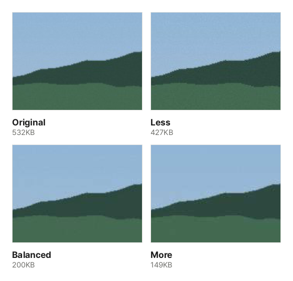

"Attachments cannot exceed 10 MB." "Files must be 5 MB or smaller." Hitting a size limit with a PDF is common. This guide explains why PDFs get big and how to shrink them right in your browser, without uploading the file anywhere.

## Why are PDFs big?

A PDF contains text, lines and shapes, fonts and photos. Almost always, **photos** take up most of the space.

- Text and lines are short instructions like "draw this letter here", so even dozens of pages are only a few hundred KB.
- Photos store every pixel, so a single phone photo can add several MB.
- In a scanned document, every page is a photo. That is why 20 scanned pages can reach tens of MB.

So the key to a smaller PDF is to **leave the text alone and re-save only the photos at a sensible size**.

## Steps

1. Open [Compress PDF](/en/pdf/compress/).
2. Click "Choose PDF file" or drag the PDF onto the screen. The bar shows the current size.
3. Choose how much to shrink. If you are not sure, choose **Balanced**.
4. Click "Compress PDF". PDFs with many photos take a while, and the bar shows the progress, like "Shrinking photos… 3/12".
5. When it is done, you see "old size → new size (N% smaller)". Click "Download" to get the file with "_compressed" added to its name.

If it is still too big, switch to **More** and click "Compress PDF" again. The original stays untouched, so you can try as many times as you like.

## Which level should I choose?

| Level    | When                                        | Photos                         |
| -------- | ------------------------------------------- | ------------------------------ |
| Less     | Photo quality matters, or you will print it | Almost unchanged               |
| Balanced | Sending by email or chat, reading on screen | Hard to tell apart on screen   |
| More     | Strict upload limits                        | May look blurry when zoomed in |

These are real results from this tool: a sample photo PDF compressed at each level, with the same spot cropped and enlarged. In this photo the difference is hard to see even zoomed in, while the file shrank to about 40% of the original with **Balanced** and about 30% with **More**. Photos with fine texture or text in them show the difference more at **More**.

In a scanned document the text is part of the photo, so **More** can blur small print. Start with **Balanced** for scans and check that small text is still readable in the downloaded file.

## When it will not shrink

"Could not make it smaller" means the PDF has almost no photos to shrink. Documents saved straight to PDF from Word or similar apps are mostly text and lines and are already compact. Try these instead:

- **Keep only the pages you need**: if you only need to submit a few pages, use [Split PDF](/en/pdf/split/) to pull them out.
- **Send it in parts**: if the limit is per email, split the PDF into two or three files and send them separately.
- **Shrink the photos first**: if you made the PDF from photos, shrink them with [Compress Image](/en/image/compress/) and then rebuild the PDF with [Image to PDF](/en/pdf/from-image/).

## What changes when I compress?

- **Text**: nothing. You can still search and copy it.
- **Photos**: resized to a sensible size and saved again as JPG. Photos that would not get smaller are left as they are.
- **Unused data**: old content left behind by repeated edits is removed.
- **Passwords**: open a protected PDF with its password and compress it; the result has no password. Use [Protect PDF](/en/pdf/protect/) to add one again.

## Do I have to upload my file?

No. Many online compressors upload your file to a server, shrink it there and send it back. These tools do all the work inside your browser, so the PDF never leaves your device. You can safely shrink contracts or ID copies that you would rather not upload anywhere. Speed depends on your device, and devices with several CPU cores shrink several photos at the same time.
