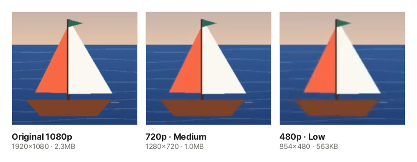

A single minute of phone video easily passes 100 MB. Email attachments are usually limited to 25 MB, and chat apps and submission systems have limits too, so you often cannot send a video as it is. This guide explains what decides a video's size and how to shrink it inside your browser without uploading it.

## Steps

1. Open [Compress Video](/en/video/compress/).
2. Click "Choose a video file" or drag a video onto the page.
3. Choose a resolution. For videos watched on phones or laptops, **720p** is plenty.
4. Choose a quality (high, medium or low), or click "By target size" and enter a size in MB if you have a limit. The bar shows the expected size.
5. Click "Compress", wait, and click "Download".

## Video size is bitrate × length

A video holds dozens of frames per second. Storing each frame whole would be far too large, so a codec (such as H.264) stores only what changed from the previous frame and drops detail the eye barely notices. **The amount of data used per second is called the bitrate**, and it almost entirely decides the file size.

> Size (MB) ≈ bitrate (Mbps) × length (seconds) ÷ 8

Phones record 1080p at roughly 10 to 20 Mbps. One minute at 10 Mbps is 10 × 60 ÷ 8 = 75 MB. Saving the same minute again at 2 Mbps gives 15 MB.

## Why lowering the resolution saves so much

Keeping the same quality needs more data for more pixels. Going from 1080p (1920×1080) to 720p (1280×720) leaves less than half the pixels (44%), and 480p (854×480) about a fifth. That is why dropping one resolution step does far more for the size than changing the quality level.

These are real results from compressing the sample video with this tool, cropped at the same spot. At phone screen size, 720p is hard to tell from the original, and 480p only looks a little softer when enlarged.

## How is a target size met?

With "By target size", the formula above is used in reverse to set the bitrate. For example, to fit a two-minute video into 25 MB you can use 25 × 8 ÷ 120 ≈ 1.7 Mbps, and what remains after the sound (usually 0.1 to 0.2 Mbps) goes to the picture.

Encoders spend more data on busy scenes and less on calm ones, so the result can land a little above or below the target. If you have a hard limit, aim **about 10% lower**. If the bitrate is too low for the resolution, the quality drops sharply; when the tool warns you, lowering the resolution one step works better.

## When it does not get much smaller

- **Videos already saved small**: videos received through chat apps and screen recordings already use a low bitrate, so there is little left to remove. If the result is not smaller, the tool tells you instead of offering the file. Try a lower resolution.
- **Very long videos**: cut out just the part you need with [Trim Video](/en/video/trim/) first; the size shrinks with the length.
- **When only the sound matters**: for lecture recordings where the picture is not needed, [Extract Audio from Video](/en/video/extract-audio/) gives a far smaller file.

## Which browsers does it work in?

This tool saves the video again with the video encoder built into your browser (WebCodecs). It works in recent Chrome, Edge and Safari and in Firefox on desktop, and it can take about as long as the video. Computers are much faster than phones.

- The result is saved as **H.264 MP4**, which opens everywhere. If the browser cannot save H.264, it saves VP9 in WebM and tells you beforehand.
- iPhone HEVC (H.265) videos need a browser that can decode HEVC. If your device or browser cannot, the page tells you.
- Your video is never uploaded, so even large files start right away with no upload time.
