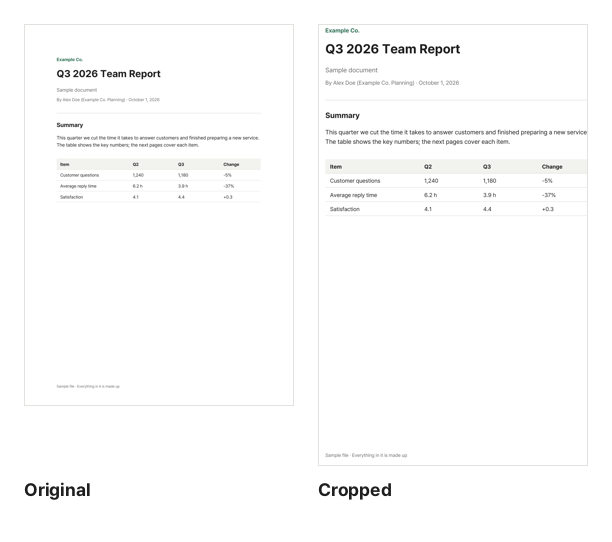

Open a paper or textbook PDF made for A4 or Letter on a phone, and the whole page shrinks to fit the screen, leaving the text tiny. A good part of the screen is spent on margins. Cropping them away makes the text take up more of the screen, so you can read without constantly zooming and scrolling sideways.

## Steps

1. Open [Crop PDF](/en/pdf/crop/).
2. Click "Choose PDF file" or drag the PDF onto the page.
3. The bright rectangle on the page is the area to keep. Drag the corner circles to resize it and the middle to move it. With a keyboard, use the arrow keys.
4. Choose "This page" or "All pages" and click "Crop PDF".
5. When it is done, click "Download". Click "Reset" to start over.

## Choosing the area to keep

- **Check several pages**: the same area stays in place as you move between pages with the ‹ › buttons. Look at the page with the widest text, pages where figures or tables stick out into the margin, and pages with page numbers, and make sure nothing gets cut.
- **Leave a little room**: cropping right up to the text makes it touch the screen edge, which is harder to read. Keep a small margin.
- **Scanned books**: odd and even pages often have their inner margin on opposite sides. Look at both and choose an area that fits the text on each.

The original and the actual cropped result are shown at the same width. The text looks larger by as much margin as was removed, and the narrower the screen, the bigger the difference.

## "All pages" or "This page"

- **All pages**: keeps the same relative area on every page. Best for papers and e-books where every page has the same layout. Pages of a different size, or rotated pages, get the same proportions based on how they look on screen.
- **This page**: crops only the page you are looking at. Useful for showing one part of a drawing or poster.

To crop pages differently, crop one page with "This page", then open the downloaded PDF and crop the next one. With many pages that gets tedious, so it is usually better to find one area that works for every page.

## The cropped-out parts stay in the file

Every PDF page has a visible area setting, the CropBox, that says "show only this part". Crop PDF shrinks only this area and leaves the page content alone. That is why it is fast and keeps the quality, but the text and images outside the area are **only hidden and remain in the file**. Another program can reset the visible area and show them again.

Do not crop to get rid of names, ID numbers or account details. To actually remove content from the file, use [Redact PDF](/en/pdf/redact/).

## Printing cropped PDFs

A cropped PDF has smaller pages, so what you get on paper depends on your print settings.

- With "Fit to page" (the name varies), the kept area is scaled up to the paper, so text can print larger than in the original.
- With "Actual size", it prints at its original scale and the rest of the sheet stays blank.

If you need a printout, printing the original is the safer bet because the page layout stays as designed. Keep the cropped copy for reading on screen. Your original file is not changed.

## Common problems

**The file did not get smaller.** The cropped-out parts are still in the file, so the size barely changes. To make it smaller, use [Compress PDF](/en/pdf/compress/).

**Can I hide the dark borders on a scan?** Yes. Dark edges or lid shadows outside the area you keep will no longer show. If pages are sideways, turn them upright first with [Rotate PDF](/en/pdf/rotate/).

**My phone app still shows margins.** Some viewers add their own space between pages, and a few programs ignore the visible area setting. Try another PDF viewer.

## Why no upload?

Changing the visible area is a light job that your browser handles in moments. There is no need for a server, so your PDF never leaves your device.
