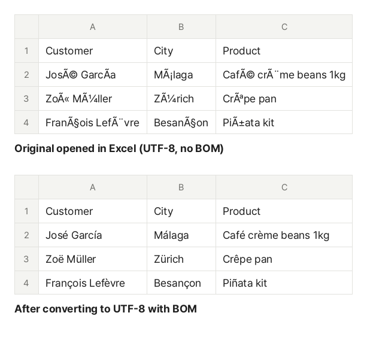

You export an order list or a contact list as CSV, double-click it, and Excel shows `José GarcÃa` instead of `José García`, or `’` where an apostrophe should be. Another CSV, made by older software, opens fine in Excel but is full of `�` in Google Sheets or Numbers. In both cases the file is not broken: **the way the text was written (the encoding) and the way it is being read do not match.**

## Why does it happen?

A computer stores each character as bytes. The rule for turning characters into bytes is called an encoding. Two kinds are common in CSV files:

| Encoding              | Letters like é, ü, ñ                       | Common sources                                                |
| --------------------- | ------------------------------------------ | ------------------------------------------------------------- |
| UTF-8                 | 2 bytes (more for Asian scripts and emoji) | Web apps, Macs, Google Sheets, most modern exports            |
| Windows-1252 ("ANSI") | 1 byte                                     | Older Windows programs, Excel's plain "CSV (Comma delimited)" |

A CSV file has no place to say which encoding it uses, so the program that opens it has to guess. **Excel on Windows reads a CSV without a marker in the system code page**, which is Windows-1252 on English and Western European systems. A UTF-8 `é` is two bytes (C3 A9), and read one byte at a time those become `Ã` and `©`, so `José` turns into `José`. Plain English letters and digits are the same bytes in both encodings, which is why only some characters break.

It also works the other way: a Windows-1252 file opened somewhere that expects UTF-8 (Google Sheets, Numbers, many web tools) has bytes that are not valid UTF-8, and those show as `�`.

The same thing happens with other languages. Korean, Japanese and Chinese CSVs are often saved in CP949, Shift_JIS or GBK, and come out as random symbols when read the wrong way.

## The BOM tells Excel "this is UTF-8"

A UTF-8 file can start with a three-byte marker (EF BB BF) called a byte order mark, or BOM. When Excel sees it, it reads the CSV as UTF-8. So for a CSV that people will open in Excel, **UTF-8 with a BOM is the safest choice**. Google Sheets and Numbers open UTF-8 with a BOM without trouble too.

Some programs and scripts that do not expect a BOM may see an invisible character in front of the first column name, so the first header no longer matches. For files you upload to an app or read with code, UTF-8 without a BOM is often the better fit.

## How to fix the file

1. Open the [Fix CSV Encoding](/en/text/csv-encoding/) tool.
2. Click "Choose CSV files" or drag the files onto the screen. You can add several at once.
3. The original encoding of each file is detected, and the preview shows how it opens now next to how it will look after converting. Check that the "After converting" table looks right. If not, pick the original encoding yourself.
4. Choose how to save it. For files you will open in Excel, keep the default "UTF-8 with BOM (for Excel)".
5. Click "Convert" and then "Download". Several files come as one ZIP with "Download all".

This is a sample order list (UTF-8, no BOM) read as Windows-1252 the way Excel reads it, and the file converted by this tool. Only the accented letters were wrong, and they come back after converting.

## Which format should I choose?

- **UTF-8 with BOM (for Excel)**: files that people open in Excel with a double-click. Pick this if you are not sure
- **UTF-8 (no BOM)**: files you upload to web services or read with code. Opening this directly in Excel garbles accented letters again
- **CP949 (Korean)**: for older Korean systems that only accept CP949 (EUC-KR). Characters it cannot hold, such as emoji and many accented letters, become `?`, and the tool tells you how many and where

## Opening the file correctly in Excel without changing it

For a file or two, you can also choose the encoding in Excel's import:

1. In a blank workbook, go to **Data → From Text/CSV** and pick the file.
2. In the preview, set **File Origin** to "65001: Unicode (UTF-8)". The text now looks right.
3. Click **Load**.

Menu names may differ slightly between Excel versions. When you save the sheet back to CSV, choose **CSV UTF-8 (Comma delimited)** in "Save As" to get UTF-8 with a BOM. The plain "CSV (Comma delimited)" option saves in the system code page, which can break in other programs.

You can also fix a file with Windows Notepad: open it, choose "Save As", and set the encoding to "UTF-8 with BOM". Very large files are hard to open in Notepad, though.

## Still not right?

- **Still garbled after converting**: the original encoding was probably guessed wrong. Switch the original encoding in the preview until the "After converting" table looks right. For Japanese or Chinese files, try Shift_JIS, GBK or Big5
- **`�` remains**: the original file already contains damaged bytes. If no encoding shows it correctly, download it again from wherever it came from
- **Leading zeros disappear (ZIP codes, phone numbers)**: this is not an encoding problem. Excel turns anything that looks like a number into a number. In the "From Text/CSV" import, click "Transform Data" and set that column's data type to Text to keep the zeros
- **All rows run together on one line**: files made on a Mac or Linux (LF line breaks) can look like this in very old programs. Choose "CRLF (Windows)" line breaks when you save
