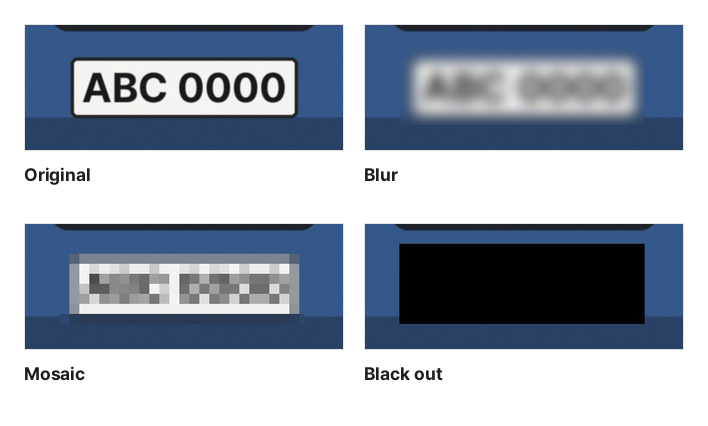

A photo for a marketplace listing may show a shipping label, a photo of a parked car may show its license plate and a contact number, and a chat screenshot may still show someone's name and phone number. You should hide this before posting. Some ways of hiding, however, only look hidden, so pick the method that fits what you are hiding.

## The three methods

With [Pixelate & Blur Image](/en/image/mosaic/), you choose one of three methods for each area.

- **Blur**: mixes the pixels in the area softly with their neighbors. It looks natural, but the original shape stays faintly visible
- **Mosaic**: splits the area into square blocks and fills each block with the average color of its pixels. Bigger blocks leave less information
- **Black out**: turns every pixel in the area black. None of the original pixels remain

These are actual results from hiding the plate in the sample photo with this tool at the same strength (the default, 5). With blur, the number and shape of the characters still show through.

## Blur and fine mosaic can be recovered

Blur does not erase pixels; it mixes them by a fixed rule. If the rule can be guessed, the calculation can be run in reverse to get close to the original, which is what sharpening software does. Text is especially easy because its font and size are fixed.

Mosaic is not safe with small blocks either. When the font is known, as in a screenshot, candidate characters can be pixelated the same way and compared until the pattern matches. Public tools exist that read pixelated passwords this way. Treat blocks smaller than one character as unsafe.

So choose like this:

| What to hide                                          | Suitable method                                     |
| ----------------------------------------------------- | --------------------------------------------------- |
| License plates, phone numbers, ID numbers, accounts   | Black out                                           |
| Names and barcodes or QR codes on labels and receipts | Black out (a barcode can also carry order details)  |
| Faces of people in the background                     | Mosaic with big blocks (high strength) or black out |
| Things that only need to be less noticeable           | Blur                                                |

When you use mosaic, draw the area generously around the text and raise the strength. This tool sets the block size from the shorter side of the area (strength 5 is one eighth of it), and the actual block size of the selected area is shown in pixels next to the slider.

## Check before you post

- **Post the result file**: the hidden result is downloaded as a new file. The original you chose is unchanged, so pick the file whose name ends in "\_mosaic"
- **Nothing cropped is left behind**: in 2023, the photo editor on some phones and a screenshot program were found to leave the cropped-out part at the end of the file, so the cropped content could be recovered. This tool redraws the photo at full size, so the hidden areas contain only the new pixels, and extra data attached to the original is not copied
- **Photo information**: phone photos may contain the place where they were taken. This tool redraws the photo, so location, date and device details are not kept in the result. To remove only the location without hiding anything, use [Remove Photo Location](/en/image/remove-location/)
- **Other clues in the photo**: look for text reflected in glass or mirrors, signs and building names in the background, and other labels on the side of a parcel. Hiding one spot does not help if the same information shows up somewhere else

It does not find faces or license plates automatically. What needs hiding differs in every photo, and checking as you draw keeps you from missing one. For personal information in a PDF, [Redact PDF](/en/pdf/redact/) also removes the hidden text from the file.

Opening, hiding and saving all happen in this browser, and the photo is never uploaded anywhere.
