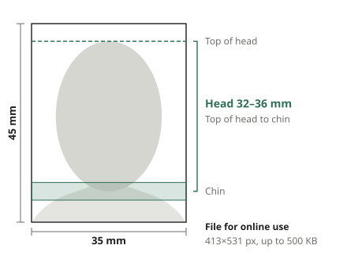

When you renew a Korean passport online or add a photo to an application, you may need to fit a photo studio file or a photo taken at home to the required size. This guide explains the Korean passport and resident ID photo rules and how to crop a photo to fit them.

## Photo rules

The Korean passport photo rules published by the Ministry of Foreign Affairs are:

- Size: 35 mm wide × 45 mm tall
- Head length: 32–36 mm from the top of the head to the chin
- Background: white
- Photos with a removed or replaced background, or heavy retouching, are not accepted

Korean resident ID card photos are also 35×45 mm and must be a front-facing upper-body photo taken within the last six months. City and community center guides say a photo taken to passport rules can also be used for the ID card, so fitting the passport rules covers both.

Head length is wrong more often than the size. If the face is too small or too large in the frame, you may be asked to retake the photo even when the size is right. Head length includes the hair, so the top of the head must not be cut off.

## File size for online applications

Online passport applications take the photo as a file. The file rules are 413×531 pixels and at most 500 KB, as JPG or PNG. 413×531 pixels is 35×45 mm printed at 300 DPI, so the file also prints sharply.

Phone photos are much larger, so they are scaled down. But if the face area of a photo is smaller than 413×531 pixels after cropping, it has to be enlarged and looks blurry. Use a photo in which the face is large.

## Taking the photo at home

Cropping can fix the size, but the background, light and pose are set when you take the photo. They cannot be fixed later, so get them right then.

- **In front of a white wall**: Stand in front of a plain white wall or a large sheet of white paper. Standing a little away from the wall leaves less shadow behind you
- **Light from the front**: Face a window so the light falls evenly on your face. Light from the side darkens one half of the face
- **Camera at eye level, a little away**: Holding a phone close makes the nose look bigger and changes the shape of the face. Standing about 1 m away and zooming 2x gives a more natural face
- **Look straight ahead, with room above the head and down to the shoulders**: Do not tilt your head, and look straight at the camera. Leave room above the head and down to the shoulders so the photo can be cropped

## Cropping a photo to size

Put a photo into the [ID Photo Maker](/en/image/id-photo/) and it finds the face, crops it so the head is 34 mm long (the middle of the range) and straightens the tilt so both eyes are level. You get a 413×531 JPG. The photo is processed only in your browser and never uploaded.

1. Add the photo. The first time, use "Download data" to get the face finding data. You can also fit the frame yourself without it
2. In the preview, check that the top of the head is on the dashed line and the chin is inside the green band
3. If it is off, drag the photo or use "Larger", "Smaller" and the direction buttons, then click "Download JPG"

The face is never retouched. The background changes only when you pick a color under "Background", and passport rules do not accept photos with a removed or composited background, so keep "Original" for a passport. Changing the background is for places without such rules, like job applications.

## Troubleshooting

- **"The top of the head could not be found"**: If the background has a pattern or the hair is close to the background color, the top of the head is estimated from the face proportions. Check in the preview that the top of the head is on the dashed line and adjust it yourself
- **"The background may not be white"**: You see this when the top corners of the photo are not white. If you took the photo against a gray wall or in shade, retaking it against a white wall is the safest choice. For photos that are not for a passport, you can change the background to white
- **The photo looks mirrored**: Phone front cameras show a mirror image on screen but may save the photo unmirrored. Use "Flip horizontally" to match how you really look
- **"The original photo is small, so it is enlarged"**: The face area is smaller than 413×531 pixels. Use a photo taken closer or zoomed in

The checks on screen are for reference. The office you submit to decides whether a photo is accepted, so also check its instructions.
