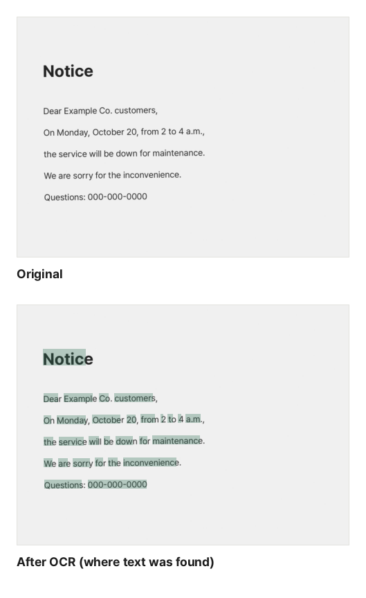

Press Ctrl+F in a PDF made with a scanner or a phone and nothing is found, because each page is a single picture. OCR (optical character recognition) reads the text in the picture and adds invisible text on top of the page. The page looks the same, but you can search, copy and use read-aloud.

## Is my PDF a scan?

Open the PDF and try to drag across some text. If no text is selected and the whole page gets selected like a picture, it is a scan. If [PDF to Text](/en/pdf/extract-text/) finds no text at all, it is a scan too.

## Steps

1. Open [OCR PDF](/en/pdf/ocr/).
2. Click "Choose PDF file" or drag the scanned PDF onto the screen.
3. Choose the languages to recognize (English, Korean). Choosing only the languages in the document is faster and more accurate.
4. The first time, click "Download data". The button shows how much will be downloaded.
5. Click "Recognize text" and wait. You can see which page is being read.
6. Click "Download PDF" for a searchable PDF, or "Download TXT" for the text alone.

This is the actual result of OCR on the sample scan, with the places that received text shaded green. The page looks the same, and an invisible text layer on top lets you search and copy the text.

## The data is downloaded once

Reading text needs a recognition engine and language data.

| Download           | Size         |
| ------------------ | ------------ |
| Recognition engine | about 2.9 MB |
| English data       | about 3.0 MB |
| Korean data        | about 1.6 MB |

Once downloaded, it is kept in this browser and ready next time. Other browsers, devices and private windows need to download it again, and clearing browser data removes it. If the stored copy is removed, we ask again instead of downloading silently. If data charges are a concern, download it over Wi-Fi.

## Tips for better accuracy

- **Scan clearly**: about 300 DPI in black and white or grayscale works best. Take phone photos straight on, without shadows.
- **Keep pages straight**: skewed scans cause mistakes. Turn sideways pages upright first with [Rotate PDF](/en/pdf/rotate/).
- **Match the language**: choose English only for English documents.
- **Hard cases**: handwriting, very small text, text under stamps or table lines, and vertical writing may have mistakes.

The recognized text is added invisibly, so mistakes do not change how the page looks. They can show up in search and copied text, though, so check important content.

## Pages that already have text

With "Skip pages that already have text" on (the default), pages whose text can already be selected, such as pages saved from Word, are not read again. This saves time on PDFs that mix scanned and digital pages, and avoids adding the same text twice.

## If it takes a long time

Each page is drawn at high resolution and read character by character, so it takes a few seconds per page. Several pages are read at once, depending on your CPU. Phones are slower and may stop if they run out of memory, so use a computer for documents with dozens of pages. If the result is large, shrink it with [Compress PDF](/en/pdf/compress/).

## Why isn't anything uploaded?

Scanned documents often contain sensitive things like contracts, IDs and medical records. This tool runs the recognition engine inside your browser, so your PDF and the recognized text never leave your device. The only downloads are the public engine and language data, the same for everyone.
