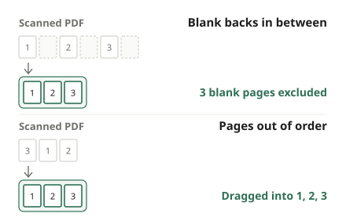

Scans rarely come out exactly right. Turn on double-sided scanning and every single-sided sheet gets a blank page after it; feed the paper in the wrong order and pages end up mixed up; and a sheet or two goes in upside down. Here is how to fix all of that in the PDF itself, without scanning again.

## Steps

1. Open [Organize PDF](/en/pdf/organize/).
2. Click "Choose PDF file" or drag the scanned PDF onto the page.
3. Looking at the thumbnails, "Exclude" pages you do not need and move pages that are out of order.
4. Click "Organize PDF", then "Download" when it is done.

Your original file is not changed; you download the result as a new PDF. Click "Reset" to go back to where you started.

## Removing blank backs

A double-sided scan creates a page for the back of every sheet, even when it is empty. Scan ten single-sided sheets that way and half of the twenty pages can be blank.

- Click "Exclude" on a blank page. It is dimmed and left out of the result. If you excluded the wrong one, click "Restore".
- The tool does not find blank pages for you. Pick them by eye from the thumbnails.
- A back with very faint writing or a stamp can look blank in a small thumbnail. If you are not sure, keeping the page is the safer choice.
- Check the summary at the top (for example, "Keeping 10 of 20 pages") to confirm the page count.

## Fixing the page order

- **Drag** a page to where it belongs, or use the **◀ ▶** buttons to move it one step. This works with the keyboard too.
- The number at the top left of each page is its position in the new PDF. When you are done, follow the numbers from 1 to check.
- A cover that ended up at the back, or a few swapped pages, takes seconds. If dozens of pages are completely jumbled, you would have to move them one by one, and rescanning with the paper in the right order may be quicker.
- To bring several separate scans together, combine them first with [Merge PDF](/en/pdf/merge/) and then organize the result here.

## Upside-down pages: use Rotate

Organize only handles order and removal. For pages that are upside down or on their side, use [Rotate PDF](/en/pdf/rotate/) and turn just those pages with ↺ or ↻. If every page is sideways, "All ↻" fixes them in one click. Rotation only changes the orientation setting, so quality is not affected.

## What to do next

Each page of a scan is a photo, so the file is large and the text cannot be searched or copied. If that matters, continue with:

1. **Text recognition**: [OCR PDF](/en/pdf/ocr/) adds an invisible text layer on top of each page, so you can search with Ctrl+F and copy text. Recognition works best on upright pages, so finish rotating first.
2. **Compression**: if the file is over an email or upload limit, shrink the photos with [Compress PDF](/en/pdf/compress/). Compression re-saves only the photos and leaves the text alone, so running OCR first and compressing afterwards lets OCR read the pages at full quality.

## Common problems

**It says "Nothing has been changed."** If the order is the same and no page is excluded, there is nothing to save.

**It says "All pages are excluded."** Restore at least one page you want to keep.

**Will quality drop?** No. Pages are not redrawn; the original content is copied as it is.

**The PDF is password-protected.** Enter the password when you open it. The result has no password.

## Why no upload?

Scanned papers are often sensitive: contracts, ID copies, medical records. This tool organizes the file inside your browser, so your PDF never leaves your device.
