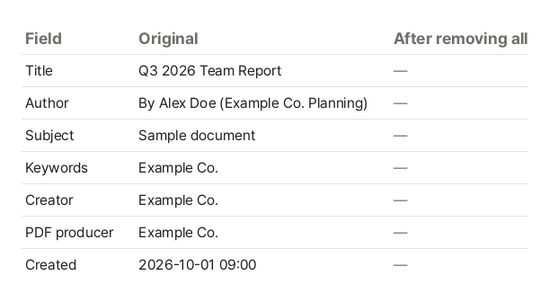

Besides the pages, a PDF carries "document information": title, author, subject and keywords, plus the apps used to make it and when it was created and modified. It does not show on the page, so it is easy to send without noticing, but anyone can read it in their PDF viewer's "Document properties".

## What it can contain

| Information        | Example                                           |
| ------------------ | ------------------------------------------------- |
| Author             | The user name on a work computer, or a real name  |
| Created with       | The word processor and its version                |
| PDF made with      | The PDF converter                                 |
| Created / modified | When the document was first made and last changed |
| Title              | The title of an older document it was copied from |

If a document was made by editing an older one, the title may still name a previous client.

## Steps

1. Open [Edit PDF Metadata](/en/pdf/metadata/).
2. Click "Choose PDF file" or drag a PDF onto the screen.
3. The current title, author, subject and keywords appear in the fields, with the apps and dates listed below.
4. Edit what you want to change. Leave a field empty to remove it.
5. Click "Save", then "Download".

## Remove all hidden information

For documents you send outside, turn on "Remove all document info" before saving. It removes the title and author as well as the apps and dates. The pages do not change.

Phone photos placed in a PDF may still carry where they were taken and camera details (EXIF). These are removed too (JPEG photos, without recompressing them). Information inside JPEG 2000 photos, small images written directly into page content, JPEGs wrapped in another compression (rare), and attached files stays as it is.

What the file needs to work is also kept: attachment names and descriptions, paths in links to other files, information inside XFA forms, and a signature drawn visibly in a signature field (name and date).

Names and numbers written on the pages are page content, not document info, so this does not remove them. Use [Redact PDF](/en/pdf/redact/) for those.

This is the sample report's document info read straight from the file before and after removing everything with this tool. The author's name, company and creation date, which never showed on screen, are gone too.

## When a good title helps

PDFs published on a website can show their title in the browser tab and in search results. Give them a clear title such as "Q3 2026 report" instead of relying on the file name.

## Why isn't anything uploaded?

Files you clean up like this are usually important documents about to be sent out. This tool works inside your browser, and your file never leaves your device.
