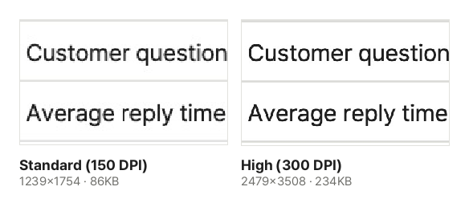

Some chat apps do not preview PDFs, and they can be awkward to open on a phone. Blogs and social media need images, and sometimes you just want one page in a slide deck. This guide shows how to turn PDF pages into JPG or PNG images.

## Steps

1. Open [PDF to Image](/en/pdf/to-image/).
2. Click "Choose PDF file" or drag the PDF onto the screen.
3. Choose which pages to convert.
   - **Extract all**: every page becomes an image.
   - **Extract selected**: only the pages you click in the page view.
4. Choose the format (JPG or PNG) and quality, then click "Convert to images".
5. Click "Download". One image downloads as an image; several come as one ZIP file.

Images are named with page numbers, like `name_1.jpg` and `name_2.jpg`. With 10 or more pages the numbers are zero-padded, like `name_01.jpg`, so they sort in order.

## JPG or PNG?

| Format | Strength                  | Best for                                    |
| ------ | ------------------------- | ------------------------------------------- |
| JPG    | Small files               | Sending by chat or email, pages with photos |
| PNG    | Crisp text edges, no loss | Text-heavy pages, images you will edit      |

A PNG of the same page can be several times larger than a JPG. Choose JPG for sending and PNG for keeping or editing.

## Which quality (DPI)?

DPI is how many dots are drawn per inch. Higher numbers mean bigger, sharper images.

- **Standard (150 DPI)**: an A4 page becomes about 1240×1754 pixels. Plenty for viewing on screen and sharing.
- **High (300 DPI)**: an A4 page becomes about 2480×3508 pixels. Choose it for printing or zooming into small text. It has four times the pixels, and the file is usually two to four times larger, depending on the page.

Very large pages, such as drawings or posters, are scaled down slightly to a size the browser can draw.

This is the same spot enlarged to the same size from the actual results at both qualities. Zoomed in, the 300 DPI text is smoother. For this page, the file grew from 86 KB to 234 KB, about 2.7 times.

## Good to know

- **Password-protected PDFs** can be converted after you open them with the password. The images have no password, so store them carefully.
- **Whole pages are drawn as they look.** Each image shows the page exactly as it appears on screen. To pull out only the photos inside a PDF at their original quality, use [Extract Images from PDF](/en/pdf/extract-images/).
- **To go the other way** and put images into a PDF, use [Image to PDF](/en/pdf/from-image/).
- If the images are too big, shrink them with [Compress Image](/en/image/compress/) or [Resize Image](/en/image/resize/).

## Where does my file go?

Nowhere. Opening the PDF, drawing the pages and saving the images all happen inside your browser. Many pages can take a while, depending on your device.
