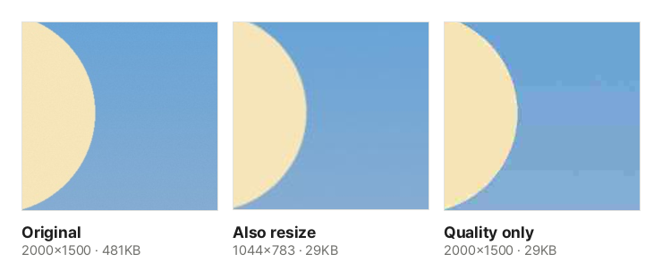

Online government forms, job applications and school submissions often say "photos must be 200 KB or less" or "attachments up to 1 MB". A phone photo today is 3–8 MB, so it will not go through as it is. Rather than compressing again and again, it is cleaner to know what decides the file size and fit it in one go.

## Steps

1. Open [Compress to Target Size](/en/image/target-size/).
2. Click "Choose image files" or drag the photos onto the screen. You can add many at once.
3. Choose the target size. For a value that is not listed, choose "Custom" and enter a number and unit.
4. Click "Fit to size". The list shows the new file size, the width and height, and the quality used for each image.
5. For one image, click "Download". For several, click "Download all" to get one ZIP.

## Quality and pixel count decide the size

Two things decide the size of a photo (JPG) file.

- **Quality**: JPG makes files small by dropping detail the eye barely notices. How much it drops is the quality. Phones usually save at a very high quality, so lowering it to around 90% already saves a lot.
- **Pixel count**: the more pixels across and down, the more there is to store. Halving the width and height leaves a quarter of the pixels, and the file shrinks by about as much.

So the tool first saves at quality 92%, and if that is too big it searches lower qualities for the **highest quality that fits** under the target. The highest one is chosen because, as long as the file fits, higher quality looks better.

## Lower quality only, or resize too?

When the target is very small, quality alone runs out. Around 20% quality, the way JPG stores a photo in small squares starts to show: smooth areas like the sky get square blotches and fine patterns smear.

These are actual results of fitting the sample photo to 30 KB with this tool. Both files are the same size, but the one resized to 1044×783 was saved at quality 74% and looks clean, while the one that kept its dimensions dropped to quality 16% and shows blotches in the sky. Fitting the same photo to 20 KB is impossible without resizing: at the lowest quality it only gets down to 23 KB. That is why the default, **Also resize if needed**, lowers quality only to 60% and then reduces the width and height and searches again.

Sometimes the dimensions are fixed. If there is a separate size rule, like a 413×531 passport photo for an online application, choose **Keep dimensions, lower quality only**. Quality can then go down to 10%, and if the photo still does not fit you are told so. Small photos like 413×531 usually fit without lowering quality much.

## Is 1 KB 1,000 or 1,024 bytes?

There are two ways to count file sizes. Some count 1 KB as 1,000 bytes (macOS Finder, for example) and some as 1,024 bytes (Windows File Explorer, for example). You cannot tell which one a submission site uses.

This tool fits to **1 KB = 1,000 bytes and 1 MB = 1,000,000 bytes**. That is the stricter one, so the file fits whichever way it is measured. In return, screens that count 1,024 show the result slightly below the target. A photo fitted to 200 KB showing as about 195 KB in File Explorer is normal.

## What about screenshots and PNGs?

PNG images such as screenshots and drawings have no quality setting, so they shrink differently.

- **Save as JPG (recommended)**: most submission forms accept JPG, so this is the default. JPG has no transparency, so transparent areas turn white, and the list says "transparent areas white".
- **Same format**: PNGs fit by using fewer colors, from 256 down, and keep their transparency. A photo saved as PNG is far larger than as JPG, so it may not fit a small target.

## Good to know

- **Keep the original.** Shrinking an already shrunk photo adds more loss each time. If you need a different target, start again from the original.
- **Photos already under the target are kept as they are**, because saving them again would only lower the quality. When downloading several, these go into the ZIP unchanged.
- **Location data**: photos saved again keep no location or date data. Photos kept as they are keep the original data, so use [Remove Photo Location](/en/image/remove-location/) if you need to strip it.
- **Nothing is uploaded.** Everything, including the search for the right quality, runs in your browser, and several images are fitted at once to match your CPU cores.
