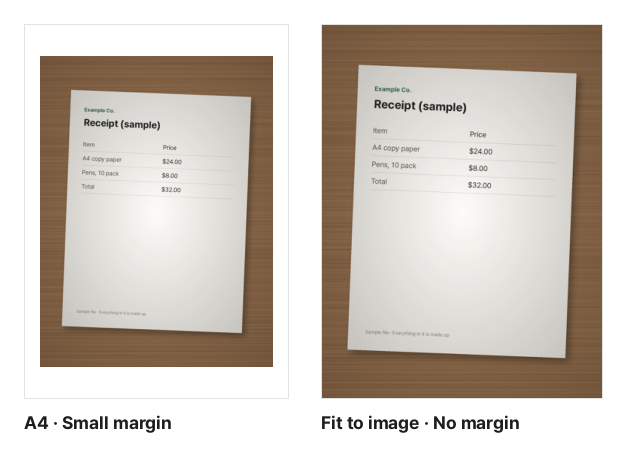

"Please upload your proof of address as a PDF." "Submit all receipts in a single PDF." "Scan your handwritten homework and hand it in." You do not need a scanner for any of this; your phone camera is enough. This guide shows how to turn those photos into one PDF that is easy for the recipient to read.

## Good photos are half the job

Converting to PDF does not make a photo any sharper. The quality of the result is decided almost entirely when you take the picture.

- **Use plenty of light.** In dim light the phone brightens the image and small text turns to mush. Daylight near a window works best.
- **Avoid shadows.** Shooting straight down often puts the shadow of your phone and hand on the page. Do not stand with the light behind you, and lean slightly to one side.
- **Keep it square.** Hold the phone parallel to the paper and let the page fill most of the screen. At an angle the page turns into a trapezoid and the text at the far end gets smaller.
- **Use a dark background.** White paper on a white desk has no clear edge. A dark surface makes the page outline stand out.
- **Turn off the flash.** On glossy or laminated paper the flash leaves a white glare in the middle.
- **Zoom in right away.** Check that the smallest text is readable. Retaking a blurry shot on the spot is the quickest fix.

Cropping away everything outside the page, with your camera's document scanning mode or your photo app's crop tool, gives a cleaner result.

## Steps

1. Open [Image to PDF](/en/pdf/from-image/).
2. Click "Choose image files" and select all the photos at once, or drag them onto the screen.
3. Arrange the list. Each image becomes one page, starting from the top.
4. Choose the page size and margin, then click "Create PDF".
5. When it is done, click "Download". The file is named after the first image in the list.

Portrait photos will not end up sideways. The orientation stored in each photo is read, so pages go in the way they look on your screen.

## Getting the order right

- **Drag** a row to where it belongs, or move it one step at a time with the **↑ ↓** buttons.
- Remove a wrong photo with **×**, and add a forgotten one with "Add images".
- Photos are not always picked in the order you took them, so glance over the thumbnails in the list before creating the PDF.

## Choosing page size and margin

| Page size    | When                                                  | Result                                                                                                                                          |
| ------------ | ----------------------------------------------------- | ----------------------------------------------------------------------------------------------------------------------------------------------- |
| Letter       | Documents for US-style paper, or likely printing      | Every page is Letter size; wide photos get a landscape page                                                                                     |
| A4           | Documents for countries that use A4                   | Same as Letter, on A4 paper                                                                                                                     |
| Fit to image | The image itself is the work, like art or screenshots | Each page follows the size of its image. With "No margin" there are no blank edges; with "Small margin" a border of about half an inch is added |

For photos of documents, choose the **paper size your recipient uses**. Even if the photos differ slightly in size, every page in the PDF will be the same size, which looks tidy and prints correctly. Each photo is centered without changing its proportions, and photos smaller than the paper are not stretched.

For the margin, choose "No margin" or "Small margin" (about half an inch). If the document will be printed, "Small margin" is safer because many printers cannot print right to the edge. If it will only be read on screen, "No margin" makes the text a little larger.

These are actual results from the same document photo. On the left the photo is scaled to fit an A4 page; on the right the page is the same size as the photo.

## Common problems

**The PDF is too big.** A single phone photo can be several MB, so ten of them can reach tens of MB. To keep quality, this tool avoids recompressing JPG and PNG files where it can. Only photos with an orientation tag (such as portrait phone shots) are turned upright and saved again once at high quality. If you hit an upload limit, you have two options:

- Shrink the finished PDF with [Compress PDF](/en/pdf/compress/). PDFs made from photos often get much smaller. For document photos, start with **Balanced** and check that small text is still readable.
- Or shrink the photos first with [Resize Image](/en/image/resize/) or [Compress Image](/en/image/compress/), then create the PDF.

**"This image cannot be opened."** The format is not supported or the file is damaged. iPhone HEIC photos can be added as they are, even in Chrome or Edge (the page loads a HEIC reader and opens them inside your browser). Images that cannot be opened are left out of the PDF.

**The text looks blurry.** In most cases the photo itself was blurry; converting to PDF does not blur it. Retaking the photo with the tips above is the surest fix.

**The page is crooked.** This tool does not straighten or crop photos. Crop and rotate them in your photo app first, then add them again.

## Your document photos stay on your device

Bank statements, IDs and receipts contain addresses, account numbers and other personal details. This tool builds the PDF inside your browser, so the photos never leave your device. Shooting details stored in photos, such as location and camera (EXIF), are left out too, so the recipient cannot see where the photo was taken.
