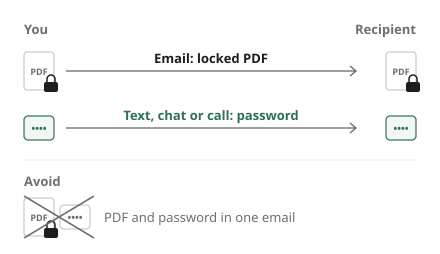

Tax forms, pay slips, signed contracts: sooner or later you need to email a PDF that shows an ID number, a date of birth or a bank account. Email goes to the wrong address now and then, and it sits in inboxes and shared folders for years. With an open password on the PDF, anyone who gets the file without the password cannot read it.

## Steps

1. Open [Protect PDF](/en/pdf/protect/).
2. Click "Choose PDF file" or drag the PDF onto the screen.
3. Enter the same password in "New password" and "Confirm password". If they differ, you see "The two passwords do not match." and the button stays disabled.
4. Click "Protect PDF".
5. When it is done, click "Download". The file name ends in "_protected", and the PDF asks for the password when opened.

Before sending, open the downloaded file yourself to check that it asks for the password and opens correctly with it.

## Send the password a different way

The most common mistake is **putting the password in the same email** as the file. If that email goes astray, the file and the password travel together and the protection is worthless.

- Send the file by email and the password by **text message, chat or phone**.
- If you exchange files with the same person often, you can agree on a rule in advance. Avoid anything others can easily find out, such as a birthday or phone number.
- Mention in the email that the password is coming separately, so the recipient is not confused.

## Choosing a good password

Whoever has the PDF can try passwords as many times as they like. Unlike a bank app, nothing locks after a few wrong guesses, so **length** matters most.

- **Avoid short numbers.** Four or six digits have so few combinations that a program can try them all quickly.
- **Make it long.** Three or four unrelated words strung together are easy to remember and still long.
- **Do not reuse a password.** You are giving this one to someone else, so it must not match your email or bank password.
- **Use a new one for each file.** A password you have shared once can spread further than you intended.

## How is the file locked?

It uses **AES-256** encryption from the PDF standard, the strongest method PDFs support. The whole content is stored encrypted, so it cannot be read without the password. With a long enough password, even someone who has the file has no practical way in.

This tool sets an **open password**. There are no separate settings for permissions such as printing or copying text. A password decides who can read the document, so assume anyone you give it to can read everything in it.

## How does the recipient open it?

They do not need to install anything. Adobe Acrobat Reader, browsers such as Chrome, Edge and Safari, and most phone PDF viewers show a password prompt when the file is opened. Very old PDF programs may not understand AES-256. If the recipient cannot open the file, suggest updating their PDF app or opening it in a browser.

## Common problems

**I forgot the password.** The PDF cannot be opened. The password is not stored anywhere, so we cannot recover it for you. Keep the original, unprotected PDF on your own device so you can protect it again with a new password.

**I want to change the password of a protected PDF.** Enter the current password when you open the file, then set a new one. The new PDF only opens with the new password.

**The password disappeared after I edited the file.** Results from other tools, such as [Merge PDF](/en/pdf/merge/) or [Compress PDF](/en/pdf/compress/), have no password. If you need several steps, do everything else first and add the password **last**.

**It says the PDF is digitally signed.** If a PDF carries a digital signature, the signature is no longer valid in the file this tool saves. When the signature matters, send the original.

## Your password never leaves your device

Uploading a document to a website just to add a password means handing the personal data you want to protect to a server you know nothing about. This tool adds the password inside your browser, so neither the file nor the password you type ever leaves your device.
