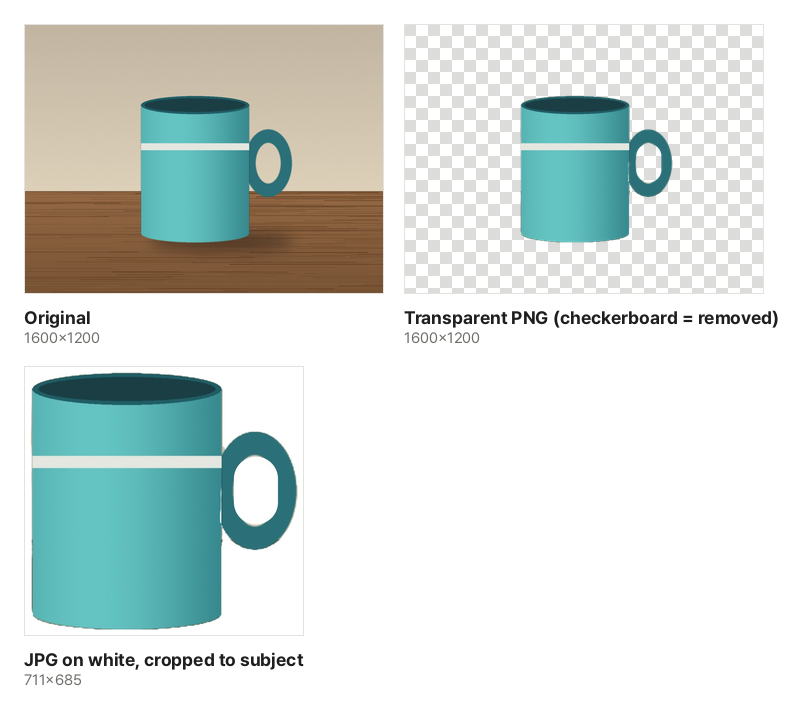

Product photos for an online store, people to place on slides, pet stickers: sometimes you need just the subject without its background. This used to mean tracing the outline by hand in a drawing program. Today a recognition model does the tracing, but knowing how it works makes it easy to tell which photos will work and how to fix the result.

## How a computer separates subject and background

[Remove Image Background](/en/image/remove-bg/) gives every pixel a value from 0 to 1 for how likely it belongs to the subject you clicked. The black-and-white picture of these values is called a mask; likely areas are kept and unlikely ones are made transparent.

- **It starts from where you click**: It begins as if you clicked the middle of the photo, keeping the subject there. Click another subject to keep it too; the results for every click are combined
- **It separates a smaller copy and applies it to the original**: The model looks at a reduced copy of the photo. The mask is scaled up to the original size and applied to the original photo, so the kept pixels and the image size stay as they were
- **The edge is a band a few pixels wide**: Because separation happens on a smaller copy, the edge can be off by a few pixels in the original. The "Edges" controls below shrink or grow this band

These are real results from this tool on the sample photo (a mug on a table). The body was kept automatically, and the handle was added with one more click. The inside of the handle loop shows the wall behind it, so it was kept too and removed with "Erase".

## Photos that work, photos that are hard

Work well

- The subject is large in the photo
- The subject and background differ in color or brightness (dark clothes in front of a white wall, a deep-colored bowl on a light table)
- Subjects with clear outlines: people, products such as dishes, shoes and bags, sitting animals, potted plants

Hard

- **Hair and fur tips**: Fine hair blends into the background and would need a separate transparency for every strand. This tool finds a boundary, so tips get smoothed over or slightly cut
- **See-through objects such as glass or plastic film**: The background shows through, so the model does not treat them as the subject. The result cannot keep them semi-transparent either; each area is kept or removed
- **Parts the same color as the background**: The shoulder of a white shirt in front of a white wall has no visible edge and may be removed with the background
- **Objects with holes**: Where the background shows inside the subject (a handle loop, gaps in a chair back), it tends to be grouped with the subject and kept

When shooting, use a plain background and leave a little space between subject and background (so the shadow does not stick to it). The result gets much cleaner.

## Transparent PNG or JPG on white?

| Where you use it                                          | Download                                | Why                                                                  |
| --------------------------------------------------------- | --------------------------------------- | -------------------------------------------------------------------- |
| Slides, documents, design apps, stickers                  | Transparent PNG                         | No rectangular edge shows on any background                          |
| Online store and marketplace product photos               | JPG on white                            | Many stores recommend white backgrounds, and JPG is smaller than PNG |
| Places that need a set background color (forms, profiles) | JPG with that color under "Other color" | JPG cannot store transparency, so the color is painted in beforehand |

JPG has no transparency, so transparent areas saved as JPG get filled with black or white depending on the program. That is why this tool saves a PNG for a transparent background and a JPG for a color background. "Crop to subject" keeps only the area around what is kept, so a product fills the frame.

## Fixing the edges

- **Bits of background remain**: Choose "Erase" and paint over them. The brush size is a share of the photo's long side, so it feels the same on large photos
- **Part of the subject is cut off**: If it is a separate piece (a handle, something held in a hand), click it to add it. If only a little is missing, paint it with "Restore"
- **A thin line of background color around the edge**: Move "Shrink · Grow" to the left to pull the edge inward. If the subject's edges are cut, move it to the right
- **The edge looks hard on a new background**: Raising "Soften" blurs the edge over a few pixels so it blends in. Too much lets the old background color show around the edge; 1 or 2 is usually right

When you are done, compare with "Show original" to check nothing is missing, and place the PNG on both a dark and a light background. If a thin outline shows on one of them, shrink one more step.

## Doing many photos at once

When you have several similar photos, such as product shots, adding them all at once is faster. Each photo is separated in advance as if you had clicked its middle, and the results are shown in a list. Instead of opening every photo, pick out the ones that went wrong and click "Fix" on them.

- **Add photos with the subject in the middle**: The advance separation uses the center of each photo. If a subject sits to one side, the list will show the wrong thing kept; open that photo and click the subject
- **One set of settings, with exceptions**: Edges and background apply to every photo, so product shots get the same background color in one go. Choose "Set this photo separately" only for a photo that needs a different background. Brush strokes and clicked points are remembered for each photo
- **Split the work on a phone**: Saving reads each photo again at full size and keeps every result in memory until they are zipped together. A transparent PNG of a 12-megapixel photo is around 10 MB, so dozens of large photos at once can run a phone out of memory. Download about 10 at a time, or pick a smaller format such as a JPG on white

The first time, the object separation engine and model are downloaded once and kept in this browser. Separating and saving all happen on this device, and your photo is never uploaded. To fit a face to passport size, use the [ID Photo Maker](/en/image/id-photo/).
