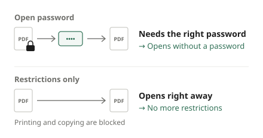

Pay slips from work and statements from banks, card issuers or insurers often arrive as password-protected PDFs. The password is something you know, like your date of birth or the last digits of an account number, but typing it every time gets old, and it gets in the way when you want to combine the files or open them in another app. This guide shows how to enter the password once and save a copy that opens without it.

## Steps

1. Open [Unlock PDF](/en/pdf/unlock/).
2. Click "Choose PDF file" or drag the PDF onto the screen.
3. When you see "This PDF is password-protected. Enter the password.", type it in "PDF password" and click "Open".
4. When you see "The password worked. Saves a copy without a password.", click "Unlock PDF".
5. When it is done, click "Download". The file name ends in "_unlocked", and the new PDF opens without a password.

Pages, text and images stay exactly as they were, with no loss of quality. Only the protection is removed.

## What is the password?

It depends on who sent it, but the email or cover letter usually tells you. Common choices are:

- Your date of birth in a fixed format, such as DDMMYYYY or MMDDYY
- The last few digits of an account, card or employee number
- Part of your postcode or surname

If you see "The password is incorrect.", check the instructions in the email again. This tool does not guess passwords; the file only opens with the right one.

## PDFs that only block printing or copying

Some PDFs open without asking for anything, yet the print button is greyed out or text cannot be copied. These have **permission restrictions** but no open password. They open straight away, and the tool says "This PDF has restrictions such as no printing or copying. Saves a copy without them." Click "Unlock PDF" to get a copy without the restrictions.

If a PDF has neither, you see "This PDF has no password or restrictions." and the button stays disabled, since there is nothing to remove.

## Make sure you are allowed to unlock it

- **Only use it on your own files, or files you have the right to handle.** Your own pay slips and statements sent to you are exactly what it is for.
- Print and copy restrictions may have been set on purpose. Do not use this to strip restrictions from paid material or copyrighted work and pass it around.
- A file whose password you do not know cannot be opened with this tool.

## Store the unlocked copy carefully

Statements come with a password for a reason. Pay, spending and insurance details are not something you want strangers to see, and once the password is gone, anyone who gets the file can open it.

- Keep unlocked copies **on your own device**. Think twice before putting them in shared folders or chat apps that sync to many devices.
- If you need to send one to someone, add a new password of your own with [Protect PDF](/en/pdf/protect/).
- To collect several months of statements into one file, use [Merge PDF](/en/pdf/merge/). It can open each protected file with its own password, so you do not need to unlock them first.

## Common problems

**"Could not unlock."** The file may be damaged, or it may use an encryption method this tool does not support. Try downloading the file again from the sender.

**It says the PDF is digitally signed.** Some official documents and certificates carry a digital signature that proves they are genuine. That signature is no longer valid in the unlocked copy, so submit the original wherever the signature matters.

**It keeps asking for the password.** Check that a leading zero has not been dropped and that upper and lower case match. On phones, auto-capitalization can turn the first letter into a capital.

## The password you type stays with you

You do not need to upload a statement and its password to a website to unlock it. This tool opens and saves the file inside your browser, so neither the document nor the password leaves your device, and the password is gone when you close the page.
