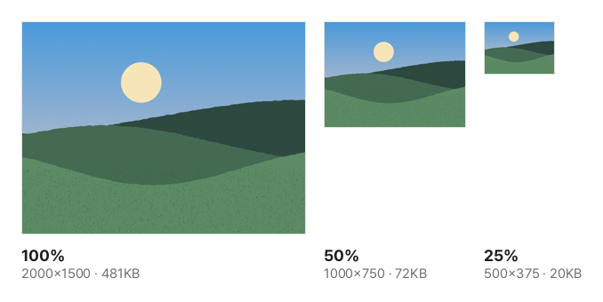

"Profile photos must be 400×400." "Product images should be 1000 px wide." "Attachments up to 1920 px on the long side." Uploading images often means matching a size. This guide shows how to resize images in your browser without installing anything.

## Image size and file size

An image is a grid of tiny dots called pixels. A 4000×3000 photo has 12 million of them.

- Halve the width and height and you get **a quarter** of the pixels. The file shrinks by about as much.
- Screens need fewer pixels than you might think. A whole laptop screen is usually about 1920 px wide.
- Enlarging a small image cannot create detail that is not there, so it gets blurry.

So simply resizing for where the image is going often solves file size problems too.

These are actual results of resizing the sample photo. Halving the width and height leaves a quarter of the pixels, and for this photo the file went from 481 KB to 72 KB.

## Steps

1. Open [Resize Image](/en/image/resize/).
2. Click "Choose image files" or drag the images onto the screen. You can add many at once.
3. Choose how to set the size and enter the values (see below).
4. Check the new size of each image in the list, such as "1200×900 → 600×450".
5. Click "Resize images". For one image, click "Download"; for several, click "Download all" to get a ZIP.

The new size is added to each file name, for example `photo_600x450.jpg`.

## By percentage

Choose "By percentage" and enter a percentage of the original size. 50% halves the width and height, 200% doubles them (up to 400%). This is handy for shrinking photos of different sizes by the same amount.

## By width and height

Choose "By width and height" and enter the size in pixels. Whether **Keep aspect ratio** is on changes the result.

**With Keep aspect ratio on (default)**

The image is fitted **inside** the width and height you enter, keeping its shape.

- With 1920 by 1920, landscape photos become 1920 wide and portrait photos 1920 tall. It is the same as "1920 px on the long side".
- Fill in only the width, and the image is fitted to that width with the height following the ratio.

This is the most common way to bring many images under "N px on the long side".

**With Keep aspect ratio off**

Enter both the width and the height, and the image is made **exactly** that size. If the shape differs from the original, it looks stretched or squeezed. Nothing is cropped, so for a different shape such as a square profile photo, crop the photo to that shape first.

## Quality and format

- Images are saved in their original format (JPG, PNG or WebP). iPhone HEIC photos are saved as JPG, because browsers cannot save HEIC.
- JPG and WebP are saved at high quality, so nothing changes visibly besides the size.
- PNG is saved without loss, and transparent areas stay transparent.
- Big reductions are done in several smaller steps so fine lines do not break up or look jagged.

To shrink the file further, use [Compress Image](/en/image/compress/) after resizing.

## Staying safe

Images are processed only inside your browser and are never uploaded. Because each photo is redrawn and saved again, EXIF data such as location is not kept. Results larger than 16384 px on a side or 64 million pixels in total may be too big for the browser to draw, so they are blocked in advance.
