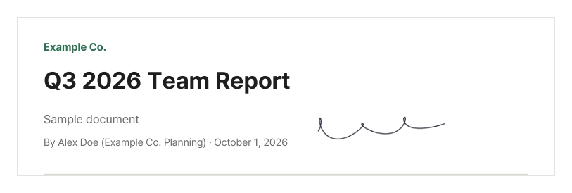

When a contract or consent form arrives as a PDF, printing it, signing it and scanning it back is a chore, even more so without a printer. This guide shows how to put your signature straight onto the PDF and send it.

## Steps

1. Open [Sign PDF](/en/pdf/sign/).
2. Click "Choose PDF file" or drag the PDF onto the screen.
3. Draw your signature in the white box with a mouse or your finger and click "Done". If you do not like it, click "Clear" and draw again.
4. Drag the signature on the page to where you want to sign. Drag the circle at its lower right to resize it, and use the ‹ › buttons to change pages.
5. Click "Sign PDF", then "Download" when it is done.

## For a cleaner signature

- Drawing with a finger or stylus on a **phone or tablet** feels more natural than a mouse.
- Draw it **large**, using the whole box, then shrink it on the page for smoother lines.
- A drawn signature has a transparent background, so it does not cover the text or the signature line beneath it.

This is the actual result of a mouse-drawn signature, made smaller and placed next to the author line. The signature goes in as an image with a transparent background, so it does not cover text or lines underneath.

## Using your paper signature

To use the signature you normally write, sign a sheet of white paper, take a photo, and choose it with "Upload signature image".

- Take the photo in good light, without shadows.
- The photo's background (the paper) is included too. A PNG with a transparent background blends in better.
- Cropping the photo down to just the signature makes it easier to place.

## The same signature on every page

Choose **All pages** to put the signature in the same spot on every page. If the signature line is in a different place on each page, sign one page, download the file, open it again and sign the next.

For images that are not signatures, such as stamps or company logos, [Add Image to PDF](/en/pdf/add-image/) is a better fit.

## Is this signature legally valid?

This tool adds a **picture of your signature**, much like signing a printout with a pen and scanning it. It is different from a **digital signature** made by certificate-based e-signature services, which cryptographically proves who signed and when and shows whether the file was changed later.

A signature picture is often enough for everyday forms, but for important contracts, check first which method the other party accepts.

## Is my signature stored anywhere?

No. Your signature and the PDF are only used on this device and are never sent to or stored on a server. When you close the page, the signature is gone. That is why you can use it without leaving your signature on someone else's server.

To keep others from opening the signed file, you can add a password with [Protect PDF](/en/pdf/protect/) before sending it.
