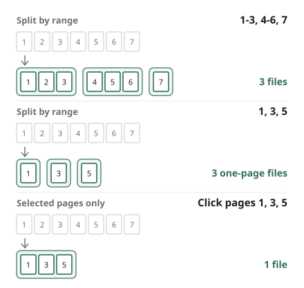

Sometimes the recipient wants only part of a PDF: "upload just the first page of your certificate", "send me chapter 3 of the report". Sending the whole file can hit an upload limit or share pages they do not need to see. This guide shows how to pull out only the pages you need, and how to pick the right way to split.

## Steps

1. Open [Split PDF](/en/pdf/split/).
2. Click "Choose PDF file" or drag the PDF onto the page.
3. Choose how to split. On small screens the options are labeled "Range", "Each page" and "Selected".
4. In the page grid, check which file each page goes to, then click "Split PDF".
5. When it is done, click "Download".

## Which option should I choose?

- **Selected pages only**: when you want the pages you need in **one file**. Click pages to select them, and they are collected into a single PDF. This is the easiest way to put scattered pages, say 2, 7 and 10, together. Pages keep their original order.
- **Split by range**: when you want to cut one file into **several chunks**, such as separating a batch scan of several forms, or splitting a textbook by chapter.
- **Split every page**: when **every page** needs to be its own file, such as payslips or student reports with one person per page.

## Writing page ranges

With "Split by range", each comma-separated range becomes one file.

- `1-3` → one file with pages 1 to 3. `1~3` works too.
- `7` → a one-page file with page 7.
- `5-` → page 5 to the end; `-3` → the first page to page 3.
- `1-3, 4-6, 7` → three files.

One thing trips people up: `1, 3, 5` does not make one file with pages 1, 3 and 5. It makes **three one-page files**. To collect scattered pages into one file, use "Selected pages only". Ranges may overlap, and pages not in any range are left out.

Page numbers here count pages inside the PDF file. In documents with a cover or table of contents, they can differ from the numbers printed on the pages, so check the thumbnails in the grid before you type.

## Several files come as one ZIP

If there are several results, you get **one ZIP file** instead of a pile of separate downloads. Unzip it to find PDFs named with their range, such as "name_1-3.pdf". "Split every page" adds the page number to each file name. "Selected pages only" always makes one file, so you get the PDF directly.

## Common problems

**It says "There is no page …".** A range goes past the last page. Check the page count in the message and fix the range.

**The split files are still big.** In a scan, every page is a photo, so even a few pages can be large. If there is a size limit, shrink the result with [Compress PDF](/en/pdf/compress/).

**I also want to change the page order.** Splitting keeps the original order. To reorder or remove pages, use [Organize PDF](/en/pdf/organize/); to join pages with another PDF, use [Merge PDF](/en/pdf/merge/).

**The PDF is password-protected.** Enter the password when you open it and you can split it. The split files have no password; to protect them again before sending, use [Protect PDF](/en/pdf/protect/).

**Will quality drop?** No. Pages are not redrawn; the original content is copied as it is, so text and photos stay identical.

## Why no upload?

You are cutting out a few pages to send, so there is no reason to hand the whole document to someone else's server first. This tool splits the file inside your browser, and your PDF never leaves your device.
