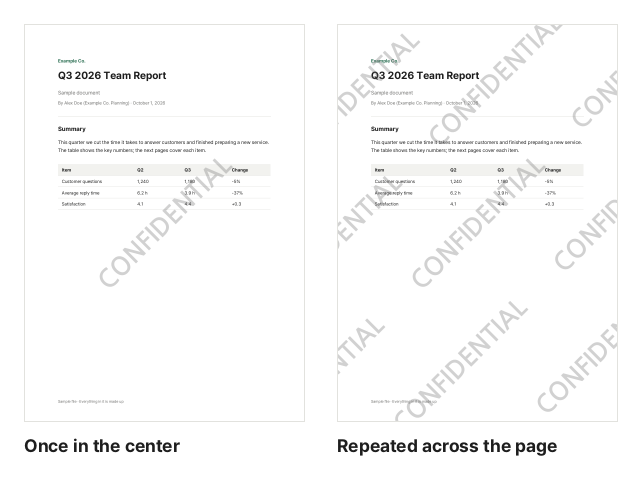

A large "CONFIDENTIAL" over an internal document, "For XYZ Bank only" over a copy of your ID, or "DRAFT" over a document under review makes its purpose clear and discourages reuse elsewhere. This guide shows how to add a text watermark to every page of a PDF.

## Steps

1. Open [Add Watermark to PDF](/en/pdf/watermark/).
2. Click "Choose PDF file" or drag the PDF onto the screen.
3. Type your watermark in "Watermark text".
4. Choose a font from the list below. For a font you have not used before, click "Download".
5. Choose the layout, angle, size, opacity and color. The page preview updates right away.
6. Click "Add watermark", then "Download".

## Why download a font?

Putting text into a PDF needs a font file, so the font is downloaded once.

- Each font is 0.1–2.3 MB, and the size is shown in the list before you download.
- Downloaded fonts are **kept in this browser**, so next time you can choose them right away.
- Other browsers, devices and private windows need to download them again, and clearing browser data removes them. If that happens, the list tells you to download again.
- Only **the characters used in the watermark** are embedded, not the whole font, so the result usually grows by a few dozen KB.

To use a font you already have, such as a company font, choose a TTF, OTF or WOFF file with "Upload my font" at the bottom of the list. An uploaded font is only used on that page and is not kept.

## Which style works best?

| Setting | Choice                  | When                                                     |
| ------- | ----------------------- | -------------------------------------------------------- |
| Layout  | Once in the center      | Mark the purpose while keeping the document easy to read |
| Layout  | Repeat across the page  | Discourage screenshots or cropping out parts             |
| Angle   | Diagonal / Horizontal   | Diagonal overlaps the body text less noticeably          |
| Opacity | Light / Medium / Strong | Light for printing, medium for screen use                |

Gray is the safest color; choose red when it needs to stand out.

These are actual results with CONFIDENTIAL on the sample report (default angle, size and opacity). The repeated layout leaves the text on any part of the page someone cuts out, but the content is a little harder to read.

## Making the watermark harder to remove

A watermark is text placed over the page, so someone with a PDF editor could remove it. To make that harder:

- **Repeat across the page**, so it cannot be erased or cropped out in one spot.
- After adding the watermark, add a password with [Protect PDF](/en/pdf/protect/) so only the intended recipient can open it.
- Include the recipient or a date (for example, "For XYZ Bank only, Oct 2026") so you can trace a copy that turns up elsewhere.

The original file is not changed, so keep an unwatermarked copy safe.

## Need page numbers too?

For multi-page documents, add numbers with [Add Page Numbers](/en/pdf/page-numbers/). Just put the watermarked file into the page number tool.

## Is my file safe?

Both the PDF and the font are handled only inside your browser, and the PDF is never sent anywhere. Downloading a font only fetches this site's public font file; nothing about your document is sent with it.
