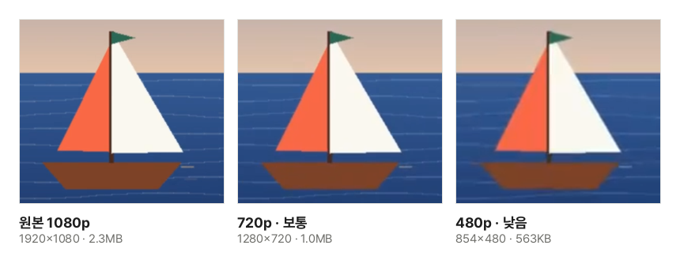

휴대폰으로 1분만 찍어도 동영상은 100MB를 쉽게 넘습니다. 메일 첨부는 보통 25MB, 메신저나 제출 시스템도 용량 제한이 있어 그대로는 보낼 수 없을 때가 많습니다. 이 글에서는 동영상 용량이 무엇으로 정해지는지 알아보고, 서버에 올리지 않고 브라우저 안에서 줄이는 방법을 설명합니다.

## 줄이는 순서

1. [동영상 용량 줄이기](/video/compress/) 도구를 엽니다.
2. "동영상 파일 선택"을 누르거나 동영상을 화면으로 끌어다 놓습니다.
3. 해상도를 고릅니다. 휴대폰·노트북으로 볼 영상이면 **720p**면 충분합니다.
4. 화질(높음·보통·낮음)을 고르거나, 보낼 곳의 제한이 있으면 "목표 용량으로"를 눌러 MB를 적습니다. 막대에 예상 용량이 보입니다.
5. "줄이기"를 누르고 기다린 뒤 "받기"를 누릅니다.

## 동영상 용량은 비트레이트 × 길이

동영상은 1초에 수십 장의 장면을 담습니다. 장면마다 그대로 저장하면 너무 커서, 앞 장면과 달라진 곳만 적고 사람 눈이 잘 알아채지 못하는 세부를 덜어 내는 방식(코덱, 예: H.264)으로 줄여 저장합니다. 이때 **1초에 쓰는 데이터 양을 비트레이트**라고 부르고, 동영상 용량은 거의 이것으로 정해집니다.

> 용량(MB) ≈ 비트레이트(Mbps) × 길이(초) ÷ 8

휴대폰은 1080p에서 초당 10~20Mbps 안팎으로 넉넉하게 찍습니다. 1분이면 10Mbps × 60초 ÷ 8 = 75MB입니다. 같은 1분을 2Mbps로 다시 저장하면 15MB가 됩니다.

## 해상도를 낮추면 많이 줄어드는 이유

같은 화질을 지키려면 화소가 많을수록 데이터가 많이 필요합니다. 1080p(1920×1080)를 720p(1280×720)로 낮추면 화소 수가 절반 이하(44%), 480p(854×480)면 5분의 1 정도가 됩니다. 그래서 해상도를 한 단계 낮추는 것이 화질 단계를 바꾸는 것보다 용량에 훨씬 크게 듣습니다.

견본 동영상을 이 도구로 줄인 실제 결과에서 같은 장면을 잘라 본 것입니다. 휴대폰 화면 크기로 볼 때는 720p와 원본의 차이를 알아보기 어렵고, 480p는 크게 키우면 가장자리가 조금 흐려집니다.

## 목표 용량은 어떻게 맞추나요?

"목표 용량으로"를 고르면 위의 식을 거꾸로 써서 비트레이트를 정합니다. 예를 들어 2분짜리 동영상을 25MB에 넣으려면 25 × 8 ÷ 120 ≈ 1.7Mbps를 쓸 수 있고, 여기서 소리 몫(보통 0.1~0.2Mbps)을 뺀 만큼을 화면에 씁니다.

인코더는 움직임이 많은 장면에 데이터를 더 쓰고 적은 장면에 덜 쓰므로 결과가 목표보다 조금 크거나 작을 수 있습니다. 제한이 정해져 있다면 **10% 정도 작게** 적으세요. 비트레이트가 해상도에 비해 너무 낮으면 화질이 크게 떨어지니, 도구가 경고하면 해상도를 한 단계 낮추는 편이 낫습니다.

## 잘 줄어들지 않을 때

- **이미 작게 저장된 영상**: 메신저로 받은 영상이나 화면 녹화는 이미 비트레이트가 낮아 더 줄일 여지가 적습니다. 도구는 원본보다 커지면 받기를 내주지 않고 알려 줍니다. 해상도를 낮춰 보세요.
- **너무 긴 영상**: 줄이기 전에 [동영상 자르기](/video/trim/)로 필요한 부분만 남기면 용량이 길이만큼 줄어듭니다.
- **소리만 필요할 때**: 강의 녹화처럼 화면이 필요 없다면 [동영상 소리 추출](/video/extract-audio/)로 소리만 뽑는 것이 훨씬 작습니다.

## 어떤 브라우저에서 되나요?

이 도구는 브라우저에 든 동영상 인코더(WebCodecs)로 다시 저장합니다. 크롬·엣지·Safari 최신판과 컴퓨터용 파이어폭스에서 되고, 동영상 길이만큼 걸릴 수 있습니다. 휴대폰보다 컴퓨터가 훨씬 빠릅니다.

- 결과는 어디서나 열리는 **H.264 MP4**로 저장합니다. 브라우저가 H.264로 저장하지 못하면 VP9 WebM으로 저장하고 미리 알립니다.
- 아이폰의 HEVC(H.265) 영상은 브라우저가 HEVC를 풀 수 있어야 합니다. 기기·브라우저에 따라 안 되면 화면에 알립니다.
- 동영상은 서버로 올라가지 않으므로 큰 파일도 올리는 시간 없이 바로 시작합니다.
