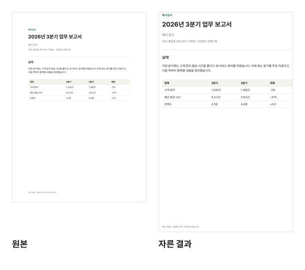

A4 크기로 만든 논문이나 교재 PDF를 휴대폰으로 보면 쪽 전체가 화면에 맞춰 줄어들어 글자가 깨알처럼 작아집니다. 화면의 상당 부분은 위아래·양옆 여백이 차지합니다. 여백을 잘라 내면 같은 화면에 글자가 차지하는 부분이 커져, 확대하고 옆으로 밀지 않아도 읽기 편해집니다.

## 자르는 순서

1. [PDF 자르기](/pdf/crop/) 도구를 엽니다.
2. "PDF 파일 선택"을 누르거나 PDF를 화면으로 끌어다 놓습니다.
3. 쪽 위의 밝은 사각형이 남길 영역입니다. 모서리 동그라미를 끌어 크기를 정하고, 가운데를 끌어 자리를 옮깁니다. 키보드로는 화살표 키를 씁니다.
4. "이 쪽만" 또는 "모든 쪽"을 고르고 "PDF 자르기"를 누릅니다.
5. 완료되면 "다운로드"로 받습니다. 다시 하려면 "처음대로"를 누릅니다.

## 남길 영역 잘 고르기

- **여러 쪽을 넘겨 보며 정하기**: ‹ › 버튼으로 쪽을 넘겨도 같은 영역이 그대로 이어집니다. 본문이 가장 넓은 쪽, 그림이나 표가 여백까지 튀어나온 쪽, 쪽 번호가 있는 쪽을 넘겨 보며 아무것도 잘리지 않는지 확인하세요.
- **조금 넉넉하게**: 글자에 바짝 붙여 자르면 화면 가장자리에 글자가 닿아 오히려 읽기 불편합니다. 약간의 여백을 남기는 편이 좋습니다.
- **책을 스캔한 PDF**: 홀수 쪽과 짝수 쪽의 안쪽 여백이 반대쪽에 있는 경우가 많습니다. 두 쪽을 모두 넘겨 보고 양쪽 본문이 다 들어가는 영역을 고르세요.

원본과 여백을 잘라 낸 실제 결과를 같은 폭으로 놓았습니다. 잘라 낸 여백만큼 글자가 커 보이고, 화면이 좁을수록 차이가 큽니다.

## "모든 쪽"과 "이 쪽만"

- **모든 쪽**: 모든 쪽에서 같은 비율의 영역을 남깁니다. 논문·전자책처럼 쪽마다 배치가 같은 문서에 알맞습니다. 크기가 다르거나 돌려 놓은 쪽에서도 화면에 보이는 모습 기준으로 같은 비율이 적용됩니다.
- **이 쪽만**: 지금 보고 있는 쪽 하나만 자릅니다. 도면이나 포스터에서 한 부분만 보여 줄 때 씁니다.

쪽마다 다른 영역으로 자르려면 "이 쪽만"으로 한 쪽을 자르고, 받은 PDF를 다시 열어 다른 쪽을 자르면 됩니다. 쪽이 많으면 번거로우니, 가능하면 모든 쪽에 맞는 영역 하나를 찾는 편이 낫습니다.

## 잘라 낸 부분은 파일에 남습니다

PDF의 각 쪽에는 "이 부분만 보여 줘라"라는 보이는 영역(CropBox) 정보가 있습니다. PDF 자르기는 이 영역만 줄이고 쪽 내용은 건드리지 않습니다. 그래서 화질이 그대로이고 빠르지만, 잘라 낸 부분의 글자와 그림은 **보이지 않을 뿐 파일 안에 그대로 남아 있습니다.** 다른 프로그램으로 보이는 영역을 되돌리면 다시 보입니다.

이름·주민번호·계좌번호처럼 남에게 보이면 안 되는 내용을 없애려고 자르기를 쓰면 안 됩니다. 그럴 때는 가린 내용을 파일에서 실제로 지우는 [PDF 가리기 (영구 삭제)](/pdf/redact/)를 쓰세요.

## 인쇄할 때 주의

자른 PDF는 쪽 크기 자체가 작아집니다. 인쇄하면 프린터 설정에 따라 결과가 다릅니다.

- "용지에 맞춤"을 고르면 남긴 영역이 종이에 맞게 확대되어, 글자가 원본보다 크게 인쇄될 수 있습니다.
- "실제 크기"를 고르면 원래 크기로 인쇄되고 남는 종이는 빈 여백이 됩니다.

인쇄용이라면 원본을 인쇄하는 편이 쪽 배치가 원래대로 나와 안전합니다. 자른 파일은 화면으로 볼 용도로 따로 두세요. 원본 파일은 바뀌지 않습니다.

## 자주 생기는 문제

**파일 크기가 줄지 않습니다.** 잘라 낸 부분이 파일에 남아 있기 때문에 크기는 거의 그대로입니다. 용량을 줄이려면 [PDF 압축](/pdf/compress/)을 쓰세요.

**스캔본 테두리의 검은 자국도 지울 수 있나요?** 가장자리의 검은 테두리나 덮개 자국은 남길 영역 밖으로 빼면 보이지 않게 됩니다. 쪽이 옆으로 누워 있다면 먼저 [PDF 회전](/pdf/rotate/)으로 세우세요.

**휴대폰 앱에서 여전히 여백이 보입니다.** 보기 앱이 쪽 사이에 자체 여백을 두거나, 드물게 보이는 영역 정보를 따르지 않는 프로그램도 있습니다. 다른 PDF 보기 앱으로 열어 보세요.

## 왜 업로드하지 않나요?

보이는 영역 정보만 바꾸는 가벼운 작업이라 브라우저만으로 금방 끝납니다. 서버에 올릴 필요가 없으니 PDF가 기기를 떠나지 않습니다.
