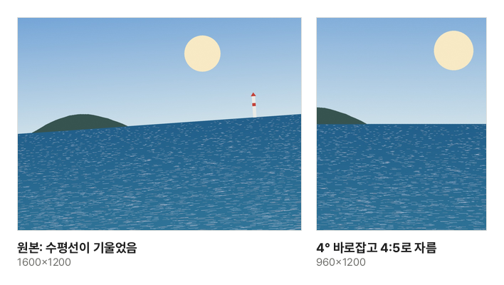

바다나 건물 사진을 찍고 보면 수평선이 살짝 기울어 있는 경우가 많습니다. 몇 도만 기울어도 사진 전체가 불안해 보입니다. 올릴 곳마다 알맞은 비율도 달라서, 인스타그램에 올리면 양옆이 잘리고 프로필 사진은 얼굴이 가장자리로 밀려나기도 합니다. 수평을 먼저 맞추고 올릴 곳의 비율로 직접 자르면 원하는 부분을 남길 수 있습니다.

## 순서: 돌리기 → 기울기 → 자르기

[이미지 자르기·회전](/image/crop/)에서는 다음 순서로 하면 다시 고칠 일이 적습니다.

1. **방향 바로잡기**: 사진이 옆으로 누워 있으면 "왼쪽으로 90°"나 "오른쪽으로 90°"로 세웁니다. 거울처럼 뒤집힌 셀카는 "좌우 뒤집기"로 바로잡습니다
2. **수평 맞추기**: 기울기 바로잡기 막대를 움직여 수평선이나 건물 모서리가 화면의 가로·세로 선과 나란해지게 맞춥니다. 0.1° 단위로 움직이고, 방향키로도 조금씩 바꿀 수 있습니다
3. **자르기**: 비율을 고르고 밝은 칸을 끌어 남길 곳에 둡니다

자를 영역은 돌리고 뒤집을 때 사진과 함께 움직이므로, 먼저 잘라 두었어도 다시 맞출 필요가 없습니다.

견본 사진을 이 도구로 4° 바로잡고 4:5로 자른 실제 결과입니다.

## 기울기를 바꾸면 가장자리가 잘리는 이유

네모난 사진을 돌리면 네 귀퉁이에 빈 삼각형이 생깁니다. 빈 곳을 흰색이나 검은색으로 채우면 티가 나기 때문에, 이 도구는 돌린 만큼 사진을 키워 틀을 빈틈없이 채웁니다. 그래서 가장자리가 조금씩 잘립니다.

잘리는 양은 돌린 각도에 따라 커집니다. 4:3 사진을 2°만 돌리면 가로·세로가 5%쯤 줄어든 만큼만 남지만, 10°를 돌리면 20% 가까이 잘려 나갑니다. 사진 끝에 꼭 남겨야 할 것이 있다면 꼭 필요한 만큼만 돌리세요. 수평선을 맞출 때는 화면에 그려진 3등분 선에 수평선을 대어 보면 쉽습니다.

## 어떤 비율로 자를까

| 비율 | 쓰는 곳                                                     |
| ---- | ----------------------------------------------------------- |
| 1:1  | 프로필 사진, 정사각형 게시물, 쇼핑몰 상품 목록 사진         |
| 4:5  | 인스타그램 세로 게시물 (피드에서 가장 크게 보입니다)        |
| 9:16 | 스토리·릴스·쇼츠처럼 휴대폰 화면을 꽉 채우는 세로 영상·사진 |
| 16:9 | 유튜브 썸네일, 발표 자료, 모니터 배경 화면                  |
| 3:2  | 일반 카메라 사진 비율, 4×6인치(10×15cm) 인화                |
| 4:3  | 휴대폰 기본 사진 비율, 발표 자료(예전 화면 비율)            |

비율만 맞추면 올릴 곳에서 잘리지 않습니다. 정확한 화소 수(예: 1080×1350)가 필요하면 먼저 비율로 자른 뒤 [이미지 크기 조절](/image/resize/)에서 크기를 바꾸세요. 크게 늘리면 흐려지므로, 자른 결과가 필요한 크기보다 작다면 덜 잘라서 영역을 넓히는 편이 낫습니다.

## 사진이 어떤 곳에서만 옆으로 누워 보일 때

휴대폰은 사진을 찍을 때 화소를 늘 같은 방향으로 저장하고, 기기를 어떻게 들었는지는 사진 안의 방향 정보(EXIF Orientation)에 따로 적어 둡니다. 휴대폰 갤러리나 대부분의 브라우저는 이 정보를 읽어 바로 세워 보여 주지만, 오래된 프로그램이나 일부 사이트는 이 정보를 무시해서 사진이 옆으로 누워 보입니다.

이 도구는 방향 정보를 적용해 바로 세운 모습 그대로 다시 저장합니다. 결과 파일에는 방향 정보가 없고 화소 자체가 바로 서 있으므로 어디서 열어도 같은 방향으로 보입니다. 돌리거나 자를 필요가 없어도 열고 바로 받기만 하면 됩니다.

## 저장할 때 알아 둘 것

- **형식**: 처음에는 원래 형식(JPG·PNG·WebP)으로 고릅니다. 사진은 JPG가 알맞고, 화질 손실이 전혀 없어야 하면 PNG로 받으세요
- **화질**: 다시 저장하므로 JPG·WebP는 아주 조금 손실이 생길 수 있습니다(화질 92%). 기울기를 바꾸면 화소를 새로 계산해 아주 약간 부드러워집니다
- **촬영 정보**: 다시 그려 저장하므로 촬영 위치·날짜·기기 같은 정보는 결과에 남지 않습니다. 사진을 올리기 전에 위치 정보를 지우는 효과도 있습니다

사진을 열고, 돌리고, 잘라 저장하는 모든 과정은 이 브라우저 안에서 이루어지고 사진은 어디에도 올라가지 않습니다.
