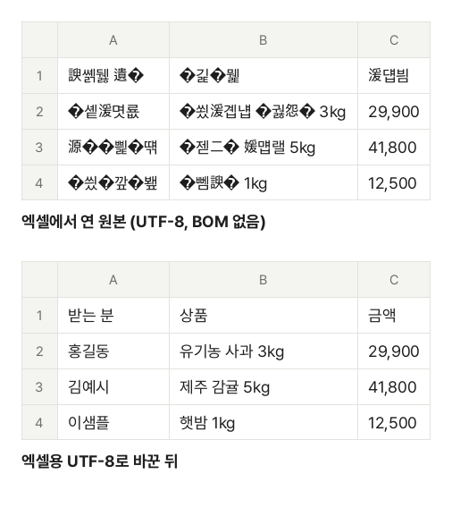

쇼핑몰 주문 목록이나 회원 명단을 CSV로 내려받아 엑셀에서 두 번 눌러 열었더니 숫자와 영문은 멀쩡한데 한글만 `媛쒖씤`, `二쇰Ц踰덊샇` 같은 글자로 나올 때가 있습니다. 반대로 은행 거래내역 CSV는 엑셀에서는 잘 열리는데 맥이나 구글 시트에서는 `�`로 가득합니다. 둘 다 파일이 망가진 것이 아니라 **글자를 적은 방식(인코딩)과 읽는 방식이 다르기 때문**입니다.

## 왜 깨질까요?

컴퓨터는 글자를 바이트(숫자)로 바꿔 저장합니다. 이 규칙을 인코딩이라고 하는데, 한글 CSV에는 주로 두 가지가 쓰입니다.

| 인코딩               | 한글 한 글자 | 주로 쓰는 곳                                          |
| -------------------- | ------------ | ----------------------------------------------------- |
| UTF-8                | 3바이트      | 요즘 웹 서비스, 맥, 구글 시트, 프로그램이 내보낸 파일 |
| CP949 (EUC-KR, ANSI) | 2바이트      | 한국어 윈도우의 예전 프로그램, 은행·관공서 시스템     |

CSV 파일에는 "이 파일은 어떤 인코딩으로 적었다"고 적어 두는 자리가 따로 없습니다. 그래서 여는 프로그램이 짐작해야 합니다. **한국어 윈도우의 엑셀은 표시가 없는 CSV를 CP949로 읽습니다.** UTF-8로 3바이트씩 적은 한글을 2바이트씩 끊어 읽으니, 예를 들어 `개인`(EA B0 9C EC 9D B8)이 `媛쒖씤`이 됩니다. 영문과 숫자는 두 인코딩에서 같은 바이트라 멀쩡히 보입니다.

반대로 CP949 파일을 UTF-8로 읽는 곳(구글 시트, 맥의 Numbers 등)에서는 UTF-8 규칙에 맞지 않는 바이트가 나와 `�`로 바뀝니다.

## BOM: 엑셀에게 "UTF-8입니다"라고 알려 주는 표시

UTF-8 파일 맨 앞에 3바이트(EF BB BF)짜리 표시를 붙일 수 있는데, 이것을 BOM이라고 합니다. 엑셀은 이 표시가 있으면 CSV를 UTF-8로 읽습니다. 그래서 엑셀에서 열 CSV는 **"UTF-8 + BOM"으로 저장하는 것이 가장 확실**합니다. 구글 시트·Numbers도 BOM이 있는 UTF-8을 문제없이 엽니다.

다만 BOM을 모르는 일부 프로그램이나 코드에서는 첫 칸 이름 앞에 보이지 않는 글자가 붙어 첫 열 이름이 맞지 않을 수 있습니다. 엑셀이 아닌 곳에 올릴 파일은 BOM 없는 UTF-8이 맞는 경우가 많습니다.

## 파일을 고치는 순서

1. [CSV 한글 깨짐 고치기](/text/csv-encoding/) 도구를 엽니다.
2. "CSV 파일 선택"을 누르거나 파일을 화면으로 끌어다 놓습니다. 여러 개를 한 번에 넣을 수 있습니다.
3. 파일마다 원래 인코딩을 자동으로 알아내고, 미리보기에 지금 열리는 모습과 바꾼 뒤의 모습을 함께 보여 줍니다. "바꾼 뒤" 표의 한글이 바르게 보이는지 확인합니다. 이상하면 원본 인코딩을 직접 골라 봅니다.
4. 저장 형식을 고릅니다. 엑셀에서 열 파일이면 기본값 "엑셀용 UTF-8 (BOM 포함)"을 그대로 둡니다.
5. "변환하기"를 누르고 "다운로드"로 받습니다. 여러 파일은 "모두 받기"로 ZIP 하나로 받습니다.

견본 주문 목록(BOM 없는 UTF-8)을 엑셀처럼 CP949로 읽은 모습과, 이 도구로 바꾼 파일을 읽은 실제 결과입니다. 숫자는 그대로이고 한글만 깨졌다가 바로잡힙니다.

## 어떤 저장 형식을 고를까요?

- **엑셀용 UTF-8 (BOM 포함)**: 엑셀에서 두 번 눌러 열 파일. 잘 모르겠으면 이것을 고르세요
- **UTF-8 (BOM 없음)**: 웹 서비스에 올리거나 프로그램·코드로 읽을 파일. 엑셀에서 바로 열면 다시 깨집니다
- **CP949 (EUC-KR)**: "EUC-KR 파일만 올릴 수 있습니다"처럼 예전 인코딩만 받는 시스템에 올릴 파일

CP949는 한글 11,172자와 영문, 한자 일부만 담을 수 있습니다. 이모지(🙏)나 일부 외국 글자는 저장할 수 없어 `?`로 바뀝니다. 도구는 바뀐 글자 수와 처음 몇 개의 글자·줄 번호를 알려 주니, 그 글자를 지워도 되는지 확인하고 올리세요.

## 파일을 고치지 않고 엑셀에서 바로 여는 방법

파일이 한두 개라면 엑셀의 가져오기 기능으로 인코딩을 골라 열 수도 있습니다.

1. 빈 통합 문서에서 **데이터 → 텍스트/CSV에서**를 누르고 파일을 고릅니다.
2. 미리보기 창의 **파일 원본**에서 "65001: 유니코드(UTF-8)"를 고르면 한글이 바르게 보입니다.
3. **로드**를 누릅니다.

엑셀 버전에 따라 메뉴 이름이 조금 다를 수 있습니다. 엑셀에서 고친 표를 다시 CSV로 저장할 때는 "다른 이름으로 저장"에서 **CSV UTF-8(쉼표로 분리)**을 고르면 BOM이 있는 UTF-8로 저장됩니다. 그냥 "CSV(쉼표로 분리)"를 고르면 CP949로 저장되어 다른 곳에서 깨질 수 있습니다.

윈도우 메모장에서도 고칠 수 있습니다. 파일을 메모장으로 열고 다른 이름으로 저장하면서 인코딩을 "UTF-8(BOM)"으로 고르면 됩니다. 다만 큰 파일은 메모장에서 열기 어렵습니다.

## 그래도 이상할 때

- **바꾼 뒤에도 깨진다**: 원래 인코딩을 잘못 짐작했을 수 있습니다. 미리보기에서 원본 인코딩을 바꿔 가며 "바꾼 뒤" 표가 바르게 보이는 것을 고르세요. 일본어·중국어 파일은 Shift_JIS, GBK, Big5를 골라 볼 수 있습니다
- **`�`가 남는다**: 원본 파일 자체에 이미 깨진 바이트가 들어 있는 경우입니다. 다른 인코딩으로 읽어도 바르게 나오지 않으면 파일을 내보낸 곳에서 다시 받아야 합니다
- **010으로 시작하는 번호의 0이 사라진다**: 인코딩 문제가 아니라 엑셀이 숫자처럼 보이는 칸을 숫자로 바꾸기 때문입니다. 위의 "텍스트/CSV에서" 가져오기 창에서 "데이터 변환"을 눌러 그 열의 데이터 형식을 텍스트로 바꾸면 0이 남습니다
- **줄이 한 줄로 붙어 보인다**: 맥·리눅스에서 만든 파일(줄바꿈 LF)을 아주 오래된 프로그램에서 열 때 생길 수 있습니다. 저장할 때 줄바꿈을 "CRLF (윈도우)"로 고르세요
