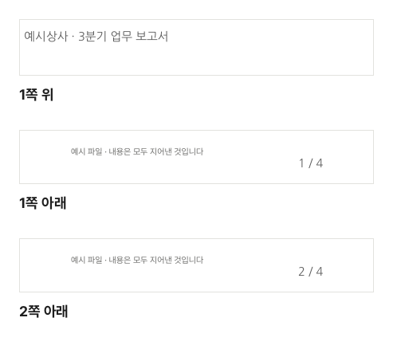

여러 파일을 합쳐 만든 보고서, 여러 쪽짜리 견적서나 제출 서류는 쪽마다 위에 문서 이름, 아래에 쪽 번호가 있어야 정리돼 보이고 인쇄했을 때 순서가 섞여도 바로 맞출 수 있습니다. 이 글에서는 PDF의 모든 쪽 위·아래에 글자를 넣는 방법을 설명합니다.

## 넣는 순서

1. [PDF 머리말·꼬리말 넣기](/pdf/header-footer/) 도구를 엽니다.
2. "PDF 파일 선택"을 누르거나 PDF를 끌어다 놓습니다.
3. "머리말 (쪽 위)"과 "꼬리말 (쪽 아래)"에 글자를 적고, 각각 왼쪽·가운데·오른쪽 정렬을 고릅니다. 둘 중 하나만 적어도 됩니다.
4. 아래 글꼴 목록에서 글꼴을 고릅니다. 처음 쓰는 글꼴은 "받기"를 누릅니다.
5. 쪽 미리보기에서 위치를 확인하고 "머리말·꼬리말 넣기"를 누른 뒤 "다운로드"로 받습니다.

## 자리표시로 쪽 번호와 날짜 넣기

글자 안에 아래 자리표시를 쓰면 쪽마다 알맞은 값으로 바뀝니다.

| 자리표시 | 바뀌는 값    | 예            |
| -------- | ------------ | ------------- |
| {쪽}     | 그 쪽의 번호 | 3             |
| {전체}   | 전체 쪽 수   | 10            |
| {날짜}   | 오늘 날짜    | 2026. 10. 15. |

자주 쓰는 모양은 이렇습니다.

- 꼬리말 가운데: `{쪽} / {전체}` → "3 / 10"
- 꼬리말 가운데: `- {쪽} -` → "- 3 -"
- 머리말 오른쪽: `주식회사 저스트 · 견적서`
- 꼬리말 오른쪽: `출력일 {날짜}` → "출력일 2026. 10. 15."

머리말에 회사·문서 이름을, 꼬리말 가운데에 `{쪽} / {전체}`를 적어 넣은 실제 결과입니다. 한 번 적은 글이 쪽마다 1 / 4, 2 / 4로 채워집니다.

## 표지에는 넣고 싶지 않다면

"첫 쪽(표지)에는 넣지 않기"를 켜면 첫 쪽에는 아무것도 넣지 않습니다. 쪽 번호는 그래도 첫 쪽부터 세므로 둘째 쪽에 "2"가 들어갑니다. 표지를 1쪽으로 치는 보통의 문서 방식과 같습니다.

## 본문과 겹치지 않게 하려면

머리말·꼬리말은 쪽 가장자리에서 약 10mm 안쪽에 들어갑니다. 스캔한 문서처럼 여백이 거의 없는 PDF는 본문과 겹칠 수 있습니다.

- 미리보기에서 ‹ › 로 여러 쪽을 넘겨 보며 겹치는 쪽이 없는지 확인하세요.
- 크기를 **작게**로 바꾸면 덜 겹칩니다.
- 색을 **회색**으로 두면 겹쳐도 본문이 더 잘 읽힙니다.

## 쪽 번호만 필요하다면

글자 없이 숫자만 넣을 거라면 [PDF 쪽 번호 넣기](/pdf/page-numbers/)가 더 간단합니다. 글꼴을 받지 않아도 되고 몇 가지 모양 중에 바로 고를 수 있습니다. 문서 위에 "대외비" 같은 글자를 크게 겹치고 싶다면 [PDF 워터마크 넣기](/pdf/watermark/)를 쓰세요.

## 글꼴과 파일

한글을 PDF에 넣으려면 한글 글꼴이 필요해 처음 한 번 글꼴을 받습니다. 받은 글꼴은 이 브라우저에 보관되어 다음부터는 바로 쓰고, PDF에는 쓴 글자만 들어가 파일이 거의 커지지 않습니다. PDF는 브라우저 안에서만 처리되고 어디로도 전송되지 않습니다.
