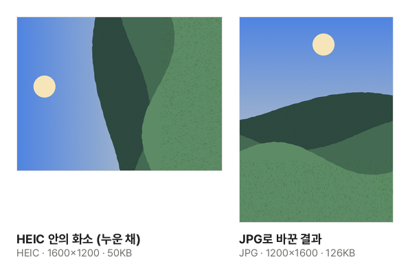

아이폰으로 찍은 사진을 윈도우 PC로 옮겼더니 `IMG_0001.HEIC` 같은 파일이 열리지 않거나, 제출 사이트가 "JPG·PNG만 올릴 수 있습니다"라며 받아 주지 않는 일이 많습니다. HEIC가 무엇인지, 어떻게 바꾸는지, 바꿀 때 무엇이 달라지는지 정리했습니다.

## HEIC는 무엇인가요?

HEIC는 아이폰·아이패드가 iOS 11(2017년)부터 기본으로 쓰는 사진 형식입니다. 동영상 압축 방식인 HEVC(H.265)로 사진을 담아, 같은 화질의 JPG보다 용량이 절반 정도로 작습니다. 휴대폰 저장 공간을 아끼는 데는 좋지만, 윈도우의 기본 사진 앱이나 여러 웹사이트·회사 프로그램은 아직 HEIC를 읽지 못합니다. HEVC에 특허 사용료가 걸려 있어 모든 프로그램이 기본으로 넣지 않기 때문입니다.

## 바꾸는 순서

1. [HEIC JPG 변환](/image/heic-to-jpg/) 도구를 엽니다.
2. "이미지 파일 선택"을 누르거나 HEIC 사진을 끌어다 놓습니다. 여러 장을 한 번에 넣을 수 있습니다.
3. 바꿀 형식을 고릅니다. 어디서나 열려야 하면 **JPG**가 알맞습니다.
4. "변환하기"를 누르고, 한 장이면 "다운로드", 여러 장이면 "모두 받기"로 ZIP 하나를 받습니다.

크롬·엣지·파이어폭스는 HEIC를 스스로 읽지 못해서, 이 도구는 HEIC를 여는 프로그램(libheif, 약 0.5MB)을 사이트에서 받아 브라우저 안에서 엽니다. Safari는 HEIC를 스스로 읽습니다. 어느 쪽이든 사진은 서버로 올라가지 않습니다.

## 세로 사진은 바로 선 채로 바뀝니다

세로로 들고 찍은 예시 사진을 이 도구로 바꾼 실제 결과입니다. 아이폰은 사진을 누운 채로 저장하고 "보여 줄 때 90° 돌려라"는 표시만 붙여 둡니다. 이 표시를 읽지 못하는 변환기를 쓰면 사진이 옆으로 누워 나옵니다. 이 도구는 표시대로 돌려 바로 선 사진으로 저장합니다. 같은 사진이 JPG로는 두 배 넘게 커지는 것도 볼 수 있습니다.

## 바꿀 때 사라지는 것

- **촬영 정보**: 사진을 다시 그려 저장하므로 찍은 위치(GPS)·날짜·기기 정보가 남지 않습니다. 위치가 빠져 인터넷에 올리기에는 안전하지만, 사진 앱에서 찍은 날짜순으로 정리되지 않을 수 있습니다.
- **라이브 포토의 움직임**: 라이브 포토는 HEIC 사진과 짧은 영상(MOV)이 따로 된 파일입니다. HEIC만 바꾸면 멈춘 사진 한 장이 됩니다. 한 파일에 여러 장이 든 HEIC는 사진 앱에 보이는 대표 사진 한 장만 바뀝니다.
- **HDR 밝기**: HDR 사진의 추가 밝기 정보와 10비트 색은 남지 않고 일반 화면용 8비트 사진이 됩니다. HDR 화면에서는 원본보다 덜 밝게 보일 수 있습니다.
- **넓은 색**: 아이폰 사진은 일반 화면보다 넓은 색 범위(Display P3)로 찍힙니다. 이 도구는 일반 화면 색으로 바꿔 저장해, 어느 화면에서나 비슷한 색으로 보입니다.

## 아이폰에서 처음부터 JPG로 받으려면

- **찍을 때부터**: 설정 → 카메라 → 포맷에서 **높은 호환성**을 고르면 다음부터 JPG로 찍힙니다. "고효율"이 HEIC입니다. 이미 찍은 사진은 바뀌지 않습니다.
- **PC로 옮길 때**: 설정 → 사진 → "Mac 또는 PC로 전송"에서 **자동**을 고르면 케이블로 옮길 때 JPG로 바꿔 옮깁니다. "원본 유지"를 고르면 HEIC 그대로 옮겨집니다.
- **보낼 때**: 메일이나 메신저로 보내면 대개 JPG로 바뀌어 전달됩니다. 다만 "원본"으로 보내는 기능을 쓰면 HEIC가 그대로 갈 수 있습니다.

높은 호환성으로 찍으면 사진 한 장이 두 배쯤 커집니다. 저장 공간이 넉넉하지 않다면 HEIC로 찍고 필요할 때만 바꾸는 편이 낫습니다.

## 바꾼 다음에

바꾼 사진의 용량을 더 줄이려면 [이미지 압축](/image/compress/)을 이어서 쓰세요. [이미지를 PDF로](/pdf/from-image/), [이미지 자르기·회전](/image/crop/), [이미지 모자이크](/image/mosaic/), [증명사진 만들기](/image/id-photo/)에는 바꾸지 않은 HEIC를 바로 넣어도 됩니다.
