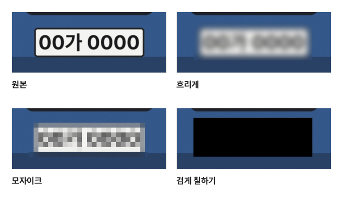

중고거래에 올릴 물건 사진에 택배 송장이 찍혀 있거나, 주차된 차 사진에 번호판과 연락처가 보이거나, 대화 캡처에 상대방 이름과 전화번호가 남아 있을 때가 있습니다. 이런 정보는 올리기 전에 가려야 합니다. 그런데 가리는 방법에 따라 "가린 것처럼 보이기만 하는" 경우가 있어서, 무엇을 가리는지에 맞춰 방법을 골라야 합니다.

## 세 가지 방법의 차이

[이미지 모자이크](/image/mosaic/)에서는 가릴 곳마다 세 가지 중 하나를 고릅니다.

- **흐리게**: 가릴 곳의 화소를 이웃 화소와 부드럽게 섞습니다. 보기에 자연스럽지만 원래 모양이 흐릿하게 남습니다
- **모자이크**: 가릴 곳을 네모 칸으로 나누고 칸마다 그 안 화소의 평균 색 하나로 칠합니다. 칸이 클수록 남는 정보가 적습니다
- **검게 칠하기**: 가릴 곳의 화소를 모두 검은색으로 바꿉니다. 원래 화소가 하나도 남지 않습니다

견본 사진의 번호판을 이 도구로 같은 세기(기본값 5)로 가린 실제 결과입니다. 흐리게는 글자 수와 모양이 그대로 비칩니다.

## 흐림과 작은 모자이크는 되살릴 수 있다

흐림은 화소를 지우는 것이 아니라 정해진 규칙으로 섞는 것입니다. 섞는 규칙을 짐작할 수 있으면 거꾸로 계산해 원래 모습에 가깝게 되돌릴 수 있고, 사진을 선명하게 만드는 프로그램이 바로 이런 계산을 합니다. 특히 글자는 쓰인 글꼴과 크기가 정해져 있어 되살리기 쉬운 편입니다.

모자이크도 칸이 작으면 안전하지 않습니다. 화면 캡처처럼 글꼴을 알 수 있는 글자는, 후보가 되는 글자를 같은 방식으로 모자이크해 보고 무늬가 같은 것을 찾는 방법으로 알아낼 수 있습니다. 모자이크된 비밀번호를 이렇게 읽어 내는 공개 도구도 있습니다. 칸 하나가 글자 하나보다 작으면 위험하다고 생각하세요.

그래서 다음처럼 고르는 것이 좋습니다.

| 가릴 것                                    | 알맞은 방법                                       |
| ------------------------------------------ | ------------------------------------------------- |
| 번호판, 전화번호, 주민등록번호, 계좌, 주소 | 검게 칠하기                                       |
| 송장·영수증의 이름과 바코드·QR 코드        | 검게 칠하기 (바코드에도 주문 정보가 담길 수 있음) |
| 함께 찍힌 사람 얼굴                        | 칸이 큰 모자이크 (세기를 높게) 또는 검게 칠하기   |
| 꼭 숨길 필요는 없고 눈에 덜 띄게만 할 것   | 흐리게                                            |

모자이크를 쓸 때는 가릴 곳을 글자보다 넉넉하게 그리고 세기를 높이세요. 이 도구는 칸 크기를 가릴 곳의 짧은 변에 맞춰 정하므로(세기 5면 짧은 변의 1/8), 고른 곳의 실제 칸 크기가 세기 막대 옆에 화소로 보입니다.

## 가린 사진을 올리기 전에 확인할 것

- **결과 파일을 올리기**: 가린 결과는 새 파일로 받습니다. 고른 원본 파일은 그대로이니 올릴 때 이름 끝에 "\_모자이크"가 붙은 파일을 고르세요
- **잘라 낸 부분이 남지 않는지**: 2023년에 일부 휴대폰의 사진 편집 기능과 캡처 프로그램이 잘라 낸 부분을 파일 끝에 그대로 남겨, 잘린 내용을 되살릴 수 있던 문제가 알려졌습니다. 이 도구는 사진을 원래 크기로 새로 그려 저장하므로 가린 곳에는 바꾼 화소만 들어 있고, 원본에 덧붙은 자료는 옮기지 않습니다
- **촬영 정보**: 휴대폰 사진에는 찍은 위치가 들어 있을 수 있습니다. 이 도구는 다시 그려 저장하므로 촬영 위치·날짜·기기 정보가 결과에 남지 않습니다. 가릴 곳 없이 위치만 지우려면 [사진 위치 정보 지우기](/image/remove-location/)를 쓰세요
- **사진 속 다른 단서**: 유리나 거울에 비친 글자, 뒤쪽 간판과 건물 이름, 택배 상자 옆면의 다른 송장도 살펴보세요. 한 곳을 가려도 다른 곳에서 같은 정보가 보일 수 있습니다

얼굴이나 번호판을 자동으로 찾아 주지는 않습니다. 사진마다 가려야 할 곳이 달라 직접 확인하며 그리는 편이 빠뜨리지 않습니다. PDF 문서 속 개인정보는 [PDF 가리기](/pdf/redact/)로 가리면 가린 글자를 파일에서 지울 수 있습니다.

사진을 열고, 가리고, 저장하는 모든 과정은 이 브라우저 안에서 이루어지고 사진은 어디에도 올라가지 않습니다.
