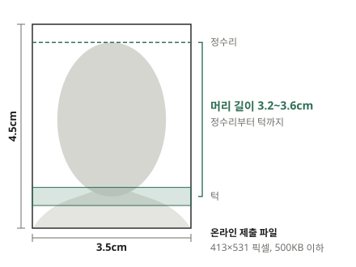

여권을 온라인으로 다시 신청하거나 지원서에 사진을 넣을 때, 사진관에서 받은 파일이나 집에서 찍은 사진을 규격에 맞춰야 할 때가 있습니다. 이 글에서는 여권·주민등록증 사진의 규격이 무엇이고, 사진을 그 규격에 맞게 자르는 방법을 설명합니다.

## 사진 규격

외교부 여권안내에 적힌 여권 사진 규격은 다음과 같습니다.

- 크기: 가로 3.5cm × 세로 4.5cm
- 머리 길이: 정수리부터 턱까지 3.2~3.6cm
- 배경: 흰색
- 배경을 지우거나 합성한 사진, 지나치게 보정한 사진은 받지 않습니다

주민등록증 사진도 크기가 3.5×4.5cm로 같고, 6개월 안에 찍은 정면 상반신 사진이어야 합니다. 시청·주민센터 안내에서도 여권 규격으로 찍은 사진을 주민등록증에 쓸 수 있다고 합니다. 그래서 여권 규격에 맞추면 두 곳에 모두 쓸 수 있습니다.

크기보다 자주 틀리는 것이 머리 길이입니다. 칸 안에서 얼굴이 너무 작거나 크면 크기가 맞아도 다시 찍으라는 안내를 받을 수 있습니다. 머리 길이에는 머리카락까지 들어가므로, 머리 위가 잘리지 않은 사진이라야 잴 수 있습니다.

## 온라인으로 낼 때의 파일 크기

여권을 온라인으로 신청할 때는 사진을 파일로 올립니다. 여권안내에 적힌 파일 규격은 413×531 픽셀, 500KB 이하의 JPG 또는 PNG입니다. 413×531 픽셀은 3.5×4.5cm를 300 DPI로 인쇄했을 때의 크기라서, 이 파일을 인화해도 흐릿하지 않습니다.

휴대폰으로 찍은 사진은 이보다 훨씬 크므로 줄이면 됩니다. 반대로 사진이 작아 얼굴 부분을 잘라 내면 413×531보다 작아지는 경우에는 늘려야 해서 흐릿해집니다. 얼굴이 화면에 크게 나오도록 찍은 사진을 쓰세요.

## 집에서 찍을 때

규격에 맞추는 것은 자르기로 할 수 있지만, 배경·조명·자세는 찍을 때 정해집니다. 나중에 고칠 수 없으니 찍을 때 챙깁니다.

- **흰 벽 앞에서**: 무늬나 물건이 없는 흰 벽이나 큰 흰 종이 앞에 섭니다. 벽에서 조금 떨어져야 뒤에 그림자가 덜 생깁니다
- **빛은 앞에서**: 창을 마주 보고 서면 얼굴에 고르게 빛이 듭니다. 옆에서 빛이 오면 얼굴 한쪽이 어두워집니다
- **카메라는 눈높이, 조금 떨어져서**: 휴대폰을 얼굴 가까이 대면 코가 커 보이고 얼굴 모양이 바뀝니다. 1m쯤 떨어져 2배 확대로 찍으면 실제 얼굴에 가깝게 나옵니다
- **정면을 보고, 머리 위와 어깨까지**: 고개를 기울이지 말고 카메라를 똑바로 봅니다. 나중에 자를 수 있게 머리 위와 어깨가 넉넉히 나오게 찍습니다

## 사진을 규격에 맞게 자르기

[증명사진 만들기](/image/id-photo/)에 사진을 넣으면 얼굴을 찾아 머리 길이가 3.4cm(기준의 가운데)가 되도록 자르고, 두 눈이 수평이 되게 기울기를 바로잡습니다. 결과는 413×531 JPG로 받습니다. 사진은 서버에 올라가지 않고 브라우저 안에서만 처리됩니다.

1. 사진을 넣고, 처음 쓸 때는 "데이터 받기"로 얼굴 찾기 데이터를 받습니다. 받지 않아도 칸을 직접 맞출 수 있습니다
2. 미리보기에서 머리 끝이 점선에, 턱이 초록 띠 안에 왔는지 봅니다
3. 어긋났으면 사진을 끌거나 "크게"·"작게"와 방향 버튼으로 맞추고 "JPG 다운로드"를 누릅니다

이 도구는 자르기·크기·기울기만 바꿉니다. 배경을 흰색으로 바꾸거나 얼굴을 보정하지 않습니다. 여권 규정이 그런 사진을 받지 않기 때문입니다.

## 이럴 때는

- **"정수리를 찾지 못해 어림했다"고 나올 때**: 배경에 무늬가 있거나 머리카락이 배경과 비슷한 색이면 정수리를 사진에서 찾지 못하고 얼굴 비율로 어림합니다. 미리보기에서 머리 끝이 점선에 맞는지 직접 보고 고칩니다
- **"배경이 흰색이 아닌 것 같다"고 나올 때**: 사진 위쪽 귀퉁이가 흰색이 아니면 알려 줍니다. 회색 벽이나 그늘진 곳에서 찍었다면 흰 벽 앞에서 다시 찍는 것이 확실합니다
- **"원본이 작아 늘린다"고 나올 때**: 얼굴 부분이 413×531 픽셀보다 작다는 뜻입니다. 더 가까이(또는 확대해서) 찍은 사진을 쓰세요

화면의 확인 결과는 참고용입니다. 받아 주는지는 접수하는 기관이 정하므로, 낼 곳의 안내를 함께 확인하세요.
