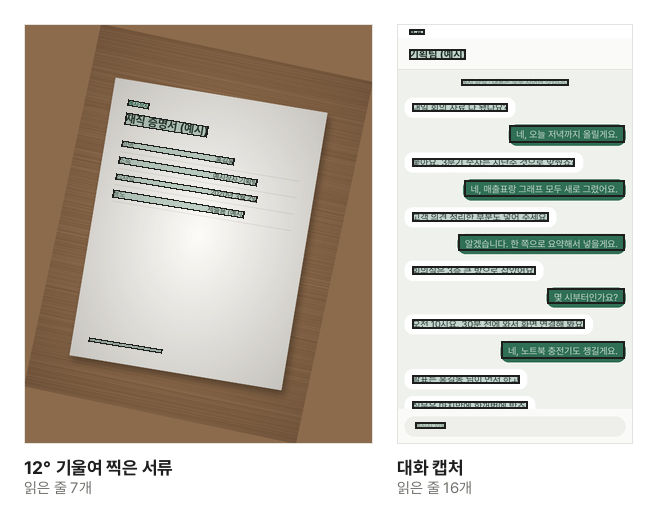

영수증이나 안내문을 찍은 사진, 대화 캡처 속 글자는 화면에서는 글자로 보여도 컴퓨터에게는 색깔 점(화소)의 모임일 뿐입니다. 그래서 고르거나 복사할 수 없습니다. 글자 인식(OCR)은 이 점들 속에서 글자 모양을 찾아 진짜 글자로 바꿉니다. 다시 타자하지 않고 이름·전화번호·문장을 옮길 수 있습니다.

## 글자를 뽑는 순서

1. [이미지 글자 추출](/image/ocr/) 도구를 엽니다.
2. "이미지 파일 선택"을 누르거나 이미지를 화면으로 끌어다 놓습니다. 여러 장을 한 번에 넣어도 됩니다.
3. 인식할 언어(한국어·영어)를 고릅니다.
4. 처음 쓸 때는 "데이터 받기"를 누릅니다. 인식 엔진과 언어 데이터(한국어+영어 약 7MB)를 한 번 받아 이 브라우저에 보관합니다. [PDF 글자 인식](/pdf/ocr/)에서 이미 받았다면 다시 받지 않습니다.
5. "글자 인식"을 누릅니다. 이미지마다 읽은 글자가 옆 칸에 나옵니다.
6. 틀린 글자는 칸에서 바로 고치고, "모두 복사"나 "TXT 다운로드"로 가져갑니다.

## 글자 인식은 줄 단위로 읽습니다

인식 엔진은 먼저 이미지에서 글자 줄이 어디 있는지 찾고, 줄마다 글자를 읽습니다. 도구는 읽은 줄을 이미지 위에 상자로 표시하므로, 빠진 줄이 있는지 한눈에 확인할 수 있습니다.

예시 서류 사진을 12° 기울여 넣은 것과 대화 캡처를 읽은 실제 결과입니다. 줄을 찾기 전에 하는 일이 두 가지 있습니다.

- **기운 글자 줄을 바로 세웁니다**: 줄이 기울어 있으면 엔진이 한 줄을 여러 줄로 잘못 나눕니다. 도구가 기울기를 재어 20° 안쪽이면 바로 세운 뒤 읽습니다. 옆으로 눕거나 뒤집힌 이미지는 거의 읽지 못했을 때 돌려 가며 다시 읽습니다.
- **바탕이 다른 곳을 따로 봅니다**: 엔진은 밝은 바탕의 어두운 글자를 기준으로 읽어서, 초록·파랑 말풍선 속 흰 글자나 어두운 막대 위 글자는 줄째 건너뛰곤 합니다. 바탕이 섞인 이미지는 바탕과 다른 곳만 다시 그려 한 번 더 읽고, 처음에 놓친 줄만 더합니다.

## 잘 읽히게 찍는 요령

인식이 틀리는 원인은 대부분 사진 자체에 있습니다. 찍을 때 조금만 신경 쓰면 결과가 크게 좋아집니다.

- **밝기**: 그림자가 글자를 반쯤 덮거나 형광등·플래시가 반사되어 하얗게 날아간 곳은 읽지 못합니다. 창가처럼 고르게 밝은 곳에서, 손이나 휴대폰 그림자가 지지 않게 찍으세요.
- **정면에서 찍기**: 살짝 기운 것은 바로잡지만, 비스듬히 찍어 종이가 사다리꼴로 보이면 아래위 글자 크기가 달라져 틀리기 쉽습니다. 종이와 휴대폰을 나란하게 두세요.
- **글자 크기**: 글자가 너무 작게 찍히면 획이 뭉개져, 도구가 키워서 읽어도 되살아나지 않습니다. 필요한 부분이 화면을 채우도록 가까이 찍거나, 화면 캡처는 확대한 상태로 찍으세요. 넓게 찍었다면 [이미지 자르기·회전](/image/crop/)으로 필요한 부분만 잘라 넣는 것도 방법입니다.
- **흔들림**: 흔들려 번진 사진은 사람 눈에는 읽혀도 엔진에는 다른 글자로 보입니다. 초점이 글자에 맞았는지 확인하세요.

## 언어는 문서에 맞게

언어를 고르면 그 언어의 글자 모양과 낱말을 기준으로 읽습니다. 한국어와 영어를 함께 고르면 섞인 문서도 읽지만, 한글 낱말 하나가 비슷하게 생긴 영문자 몇 개로 읽히는 실수가 가끔 생깁니다. 영어만 있는 문서는 영어만, 한글 문서는 한국어만 고르면 더 정확하고 빠릅니다.

## 잘 안 되는 것

- **손글씨**: 인쇄된 글자를 읽는 엔진이라 손글씨는 거의 읽지 못합니다.
- **세로쓰기**: 가로로 쓴 글만 읽습니다.
- **한자·일본어 등**: 한국어와 영어만 지원합니다. 한자가 섞인 문장은 그 글자가 엉뚱하게 읽힙니다.
- **꾸민 글꼴·표**: 손글씨처럼 꾸민 글꼴, 칸이 촘촘한 표는 틀리기 쉽습니다. 표는 줄마다 옮기고 칸 사이는 공백으로 띄웁니다.

틀린 글자는 화면에 따로 표시되지 않으니, 숫자·이름처럼 중요한 내용은 이미지와 견주어 확인하세요.

## 결과 가져가기

여러 장을 읽으면 "모두 복사"와 "TXT 다운로드"가 장마다 `--- 파일 이름 ---` 머리 줄을 붙여 하나로 합칩니다. TXT는 윈도우 메모장에서도 줄이 바뀌고 한글이 깨지지 않게 저장합니다. 한 장만 가져가려면 그 이미지 옆의 "복사"를 누르세요.

원래 모습을 그대로 둔 채 글자 찾기·복사가 되는 PDF가 필요하다면, [이미지를 PDF로](/pdf/from-image/)로 PDF를 만든 뒤 [PDF 글자 인식](/pdf/ocr/)을 쓰세요. 그림 위에 보이지 않는 글자가 겹쳐 들어갑니다.

## 왜 업로드하지 않나요?

글자를 뽑으려는 사진에는 영수증·명함·대화처럼 남에게 보이기 싫은 내용이 많습니다. 이 도구는 인식 엔진을 브라우저 안에서 돌려, 이미지와 읽은 글자가 기기를 떠나지 않습니다. 받는 것은 누구에게나 같은 공개 엔진과 언어 데이터뿐입니다.
