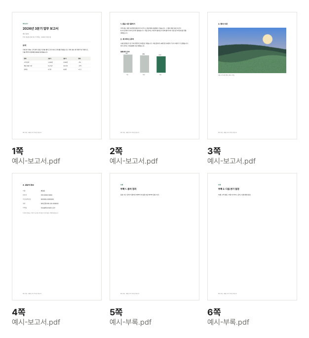

지원서·증빙 서류·보고서처럼 여러 PDF를 하나로 묶어서 내야 할 때가 있습니다. 파일을 하나씩 따로 첨부하면 받는 사람이 열어 보기 번거롭고, 제출 시스템이 파일 하나만 받기도 합니다. 이 글에서는 PDF 파일들을 원하는 순서대로 하나로 합치는 방법을 설명합니다.

## 합치는 순서

1. [PDF 합치기](/pdf/merge/) 도구를 엽니다.
2. "PDF 파일 선택"을 누르고 합칠 파일들을 한꺼번에 고릅니다. 화면으로 끌어다 놓아도 됩니다.
3. 목록에서 순서를 확인합니다. 위에 있는 파일이 앞쪽에 들어갑니다.
4. "미리보기"로 합쳐질 순서를 한 번 더 확인합니다.
5. "PDF 합치기"를 누르고, 완료되면 "다운로드"로 받습니다.

## 파일 순서 바꾸기

- 줄을 **끌어서** 원하는 자리에 놓습니다.
- 또는 줄 오른쪽의 **↑ ↓** 버튼으로 한 칸씩 옮깁니다. 키보드로도 옮길 수 있습니다.
- 잘못 넣은 파일은 **×** 로 뺍니다.
- 빠뜨린 파일은 "파일 추가"를 누르거나 다시 끌어다 놓으면 목록 끝에 붙습니다.

예시 보고서(4쪽)와 부록(2쪽)을 이 순서로 넣어 합친 실제 결과입니다. 목록 위의 파일이 앞에 오고, 파일마다 쪽 순서는 그대로 이어집니다.

## 쪽 단위로 고르기

파일 왼쪽의 **▸**를 누르면 그 파일의 쪽들이 펼쳐집니다.

- 쪽을 끌거나 **◀ ▶** 로 파일 안의 쪽 순서를 바꿉니다.
- 표지나 빈 쪽처럼 필요 없는 쪽은 **제외**합니다. 제외한 쪽은 "복구"로 다시 넣을 수 있습니다.

원본 파일은 바뀌지 않으니 마음 편히 고쳐 보세요. 쪽을 더 자유롭게 섞거나 지우려면 먼저 합친 뒤 [PDF 페이지 정리](/pdf/organize/)를 쓰는 방법도 있습니다.

## 암호가 걸린 PDF

암호가 걸린 파일은 목록에서 그 파일의 암호를 입력하면 합칠 수 있습니다. 합친 파일에는 암호가 걸리지 않습니다. 다시 암호를 걸어 보내려면 [PDF 암호 걸기](/pdf/protect/)를 쓰세요. 입력한 암호는 이 기기 안에서만 쓰이고 어디에도 전송되지 않습니다.

## 자주 생기는 문제

**합친 파일이 너무 큽니다.** 합친 파일의 크기는 원래 파일들을 더한 것과 비슷합니다. 스캔본이 섞여 있으면 금방 커지는데, 이럴 때는 합친 뒤 [PDF 압축](/pdf/compress/)으로 줄이세요.

**쪽 크기가 제각각입니다.** A4와 Letter처럼 크기가 다른 PDF를 합치면 쪽마다 원래 크기를 그대로 지닙니다. 인쇄할 때는 프린터 설정의 "용지에 맞춤"을 쓰면 됩니다.

**화질이 떨어질까요?** 아니요. 쪽을 다시 그리지 않고 원본 PDF의 내용을 그대로 옮겨 담기 때문에 글자와 사진이 원본과 같습니다. 글자 검색·복사도 그대로 됩니다.

**휴대폰에서 느립니다.** 모든 파일을 기기 메모리에서 처리하므로, 수백 MB가 넘는 파일을 메모리가 적은 휴대폰에서 합치면 느리거나 실패할 수 있습니다. 그럴 때는 PC에서 해 보세요.

## 왜 업로드하지 않나요?

합치는 일은 파일 내용을 바꾸지 않고 순서대로 이어 붙이는 일이라, 요즘 브라우저만으로 충분히 빠르게 할 수 있습니다. 서버에 올릴 필요가 없으니 개인정보가 담긴 서류도 기기를 떠나지 않습니다.
