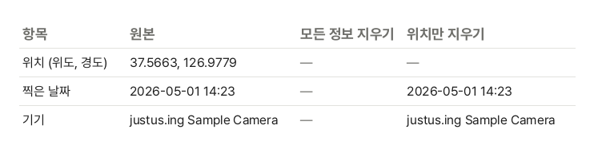

휴대폰으로 찍은 사진 파일에는 그림 말고도 "촬영 정보"(EXIF)가 들어 있습니다. 위치 서비스가 켜져 있으면 찍은 곳의 위도·경도까지 적혀 있어, 집에서 찍은 사진 한 장으로 집 위치가 드러날 수 있습니다. 화면에는 보이지 않아 모르고 보내기 쉽습니다.

## 사진 안에 이런 정보가 있습니다

| 정보        | 예                                             |
| ----------- | ---------------------------------------------- |
| 위치        | 찍은 곳의 위도·경도, 높이, 바라본 방향         |
| 찍은 날짜   | 찍은 날짜와 시각, 시간대                       |
| 기기        | 휴대폰·카메라 제조사와 모델, 렌즈              |
| 촬영 설정   | 노출 시간, 조리개, ISO, 플래시                 |
| 편집 기록   | 사진을 고친 프로그램, 고친 날짜 (XMP)          |
| 설명·저작권 | 사진에 붙인 설명, 지은이, 장소 이름 (IPTC·XMP) |

위도·경도는 지도 앱에 넣으면 건물까지 찾을 수 있을 만큼 정확합니다.

## 언제 함께 전달되나요?

많은 SNS와 메신저는 사진을 줄여 올리면서 위치 정보를 지웁니다. 하지만 서비스마다 다르고 바뀔 수도 있어 믿고 맡기기는 어렵습니다. 다음처럼 **파일을 그대로 전달하는 경우**에는 정보가 함께 갑니다.

- 메일에 사진을 첨부할 때
- 클라우드(드라이브)에 올려 공유 링크를 보낼 때
- 메신저에서 "원본으로 보내기"·"파일로 보내기"를 쓸 때
- 블로그·카페·중고 거래 사이트 중 원본 파일을 그대로 두는 곳에 올릴 때

## 내 사진에 위치가 있는지 확인하기

- **아이폰**: 사진 앱에서 사진을 위로 쓸어 올리면 지도에 찍은 곳이 보입니다
- **안드로이드**: 갤러리나 Google 포토에서 사진을 위로 밀면 정보에 위치가 보입니다
- **이 도구**: [사진 위치 정보 지우기](/image/remove-location/)에 사진을 넣으면 목록에 사진마다 위치(위도·경도), 찍은 날짜, 기기가 바로 나옵니다

## 지우는 순서

1. [사진 위치 정보 지우기](/image/remove-location/) 도구를 엽니다.
2. "이미지 파일 선택"을 누르거나 사진을 화면으로 끌어다 놓습니다. 여러 장을 한 번에 넣을 수 있습니다.
3. 지울 정보를 고릅니다. 남에게 보낼 사진이면 "모든 정보 지우기"를, 내 사진 앱에서 날짜순 정리가 필요하면 "위치만 지우기"를 고릅니다.
4. "정보 지우기"를 누르고, 한 장이면 "다운로드", 여러 장이면 "모두 받기"로 ZIP 하나로 받습니다.

위치를 넣어 둔 견본 사진을 이 도구로 지운 실제 결과를 파일에서 직접 읽은 것입니다. "위치만 지우기"는 위치만 비우고 찍은 날짜와 기기를 남깁니다.

## 화질은 그대로입니다

사진을 다시 저장하면 JPG는 그때마다 조금씩 화질이 떨어집니다. 이 도구는 사진을 다시 저장하지 않고 파일 안의 정보 부분만 떼어 내므로 그림 자료가 한 바이트도 바뀌지 않습니다. 모든 정보를 지울 때도 휴대폰 사진이 눕지 않게 방향 정보 한 칸은 남깁니다. 아이폰 HEIC 사진도 HEIC 그대로 두고 정보 칸만 그 자리에서 비우므로 파일 크기까지 같습니다.

움직이는 사진(모션 포토)은 사진 뒤에 짧은 영상이 붙어 있는데, 여기에도 촬영 정보가 있을 수 있어 영상 부분도 함께 뺍니다. 지운 뒤에는 멈춘 사진만 남습니다. 안드로이드의 HDR 사진(Ultra HDR)도 밝기 정보를 사진 뒤에 붙여 두는데, 같은 이유로 빠져서 일반 사진으로 보입니다. 도구는 이런 사진을 넣으면 지우기 전에 알려 줍니다.

## 앞으로 위치가 남지 않게 하려면

- **아이폰**: 설정 → 개인정보 보호 및 보안 → 위치 서비스 → 카메라를 "안 함"으로 바꿉니다. 이미 찍은 사진은 사진 앱의 공유 화면 위쪽 "옵션"에서 "위치"를 끄고 보내도 됩니다
- **안드로이드**: 카메라 앱 설정에서 "위치 태그"(삼성)나 "위치 저장"(구글 픽셀)을 끕니다

기기와 버전에 따라 메뉴 이름이 조금 다를 수 있습니다. 위치를 끄면 사진 앱의 "장소별 보기"에 새 사진이 나오지 않으니, 필요할 때만 보내기 전에 지우는 방법도 좋습니다.

## 지워지지 않는 것

사진에 찍힌 것 자체는 지우지 못합니다. 창밖 풍경, 간판, 택배 상자의 주소, 차 번호판처럼 그림 속에 보이는 것으로도 장소를 알 수 있으니, 올리기 전에 사진 안도 한번 살펴보세요.
