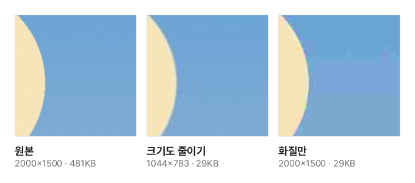

온라인 민원, 입사 지원서, 학교 과제 제출 화면에는 "사진은 200KB 이하", "첨부 파일은 1MB 이하" 같은 조건이 자주 붙습니다. 요즘 휴대폰 사진은 한 장에 3~8MB라 그대로는 올라가지 않습니다. 무작정 압축을 여러 번 하기보다, 용량이 무엇으로 정해지는지 알고 한 번에 맞추는 편이 깨끗합니다.

## 맞추는 순서

1. [이미지 용량 맞추기](/image/target-size/) 도구를 엽니다.
2. "이미지 파일 선택"을 누르거나 사진을 화면으로 끌어다 놓습니다. 여러 장을 한 번에 넣을 수 있습니다.
3. 목표 용량을 고릅니다. 목록에 없는 값은 "직접 입력"을 고르고 숫자와 단위를 적습니다.
4. "용량 맞추기"를 누릅니다. 목록에 이미지마다 줄어든 용량, 가로·세로 크기, 쓴 화질이 보입니다.
5. 한 장이면 "다운로드", 여러 장이면 "모두 받기"로 ZIP 하나를 받습니다.

## 용량은 화질과 화소 수로 정해진다

사진(JPG) 파일의 용량을 좌우하는 것은 두 가지입니다.

- **화질**: JPG는 눈이 잘 알아채지 못하는 세부를 덜어 내서 작게 저장합니다. 덜어 내는 정도가 화질입니다. 휴대폰은 보통 화질을 아주 높게 저장하므로, 90% 안팎으로만 낮춰도 용량이 크게 줄어듭니다.
- **화소 수**: 가로×세로 화소가 많을수록 저장할 내용이 많습니다. 가로·세로를 절반으로 줄이면 화소는 4분의 1이 되고 용량도 비슷하게 줄어듭니다.

그래서 도구는 먼저 화질 92%로 저장해 보고, 넘으면 화질을 낮춰 가며 목표 아래로 들어가는 **가장 높은 화질**을 찾습니다. 가장 높은 화질을 고르는 까닭은, 목표 아래이기만 하면 화질이 높을수록 보기 좋기 때문입니다.

## 화질만 낮출까, 크기도 줄일까

목표가 아주 작으면 화질만으로는 한계가 있습니다. 화질을 20% 안팎까지 낮추면 JPG가 사진을 작은 네모로 나눠 저장하는 방식이 드러나, 하늘 같은 매끈한 곳에 네모 얼룩이 생기고 잔 무늬가 뭉개집니다.

견본 사진을 이 도구로 30KB에 맞춘 실제 결과입니다. 두 파일은 용량이 같지만, 크기를 1044×783으로 줄인 쪽은 화질 74%로 저장되어 깨끗하고, 크기를 그대로 둔 쪽은 화질이 16%까지 내려가 하늘에 얼룩이 보입니다. 같은 사진을 20KB로 맞추면 크기를 그대로 두고는 가장 낮은 화질로도 23KB까지만 줄어 맞출 수 없습니다. 그래서 기본 설정인 **필요하면 크기도 줄이기**는 화질을 60%까지만 낮추고, 그래도 넘으면 가로·세로를 줄여 다시 찾습니다.

반대로 가로·세로 픽셀이 정해진 경우도 있습니다. 여권 온라인 신청 사진(413×531)처럼 크기 규정이 따로 있으면 **크기는 그대로, 화질만**을 고르세요. 이때는 화질을 10%까지 낮추고, 그래도 넘으면 맞추지 못했다고 알려 줍니다. 413×531처럼 작은 사진은 대개 화질을 많이 낮추지 않아도 맞습니다.

## 1KB는 1,000바이트일까, 1,024바이트일까

용량 단위는 세는 방법이 두 가지입니다. 1KB를 1,000바이트로 세기도 하고(맥의 Finder 등), 1,024바이트로 세기도 합니다(윈도 탐색기 등). 제출 사이트가 어느 쪽으로 재는지는 알 수 없습니다.

이 도구는 **1KB = 1,000바이트, 1MB = 1,000,000바이트**로 맞춥니다. 더 엄격한 쪽이라 어느 방법으로 재도 넘지 않습니다. 대신 1,024로 세는 화면에서는 결과가 목표보다 조금 작게 보입니다. 200KB에 맞춘 사진이 탐색기에서 195KB 안팎으로 보이는 것이 정상입니다.

## 화면 캡처·PNG는 어떻게 하나

화면 캡처나 그림처럼 PNG로 된 이미지는 화질이라는 개념이 없어 용량을 줄이는 방법이 다릅니다.

- **JPG로 저장 (추천)**: 대부분의 제출 화면이 JPG를 받으므로 기본값입니다. 다만 JPG에는 투명이 없어 투명한 곳은 흰색이 되고, 목록에 "투명한 곳은 흰색"이라고 따로 알려 줍니다.
- **원래 형식 그대로**: PNG는 쓰는 색의 수를 256색부터 차례로 줄여 맞추고 투명을 지킵니다. 사진을 PNG로 맞추면 JPG보다 훨씬 커서 작은 목표에는 맞지 않을 수 있습니다.

## 알아 두면 좋은 점

- **원본은 따로 두세요.** 줄인 사진을 다시 줄이면 손실이 쌓여 점점 나빠집니다. 다른 목표가 필요하면 원본에서 다시 맞추세요.
- **이미 목표보다 작은 사진은 그대로 둡니다.** 다시 저장하면 화질만 나빠지기 때문입니다. 여러 장을 받을 때는 이런 사진도 원본 그대로 ZIP에 넣습니다.
- **위치 정보**: 다시 저장한 사진에는 촬영 위치·날짜 같은 정보가 남지 않습니다. 원본 그대로 둔 사진은 정보도 그대로이니, 지우려면 [사진 위치 정보 지우기](/image/remove-location/)를 함께 쓰세요.
- **파일은 올라가지 않습니다.** 화질을 찾는 반복까지 모두 브라우저 안에서 하고, 여러 장은 기기의 CPU 수에 맞춰 동시에 맞춥니다.
