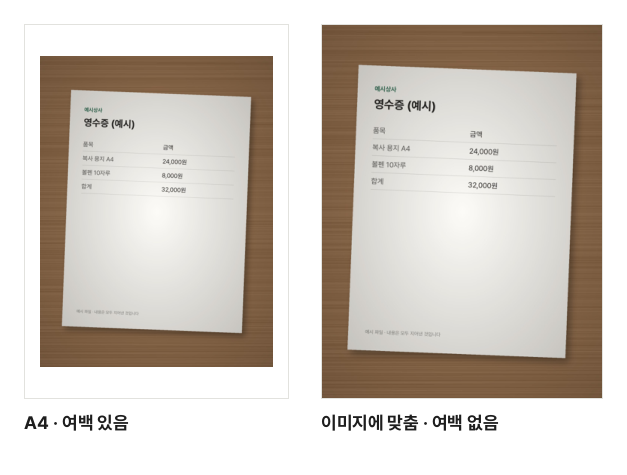

"주민등록등본을 PDF로 올려 주세요", "영수증은 PDF 한 파일로 제출하세요", "손으로 푼 과제를 스캔해서 내세요". 스캐너가 없어도 휴대폰 카메라로 충분합니다. 이 글에서는 찍은 사진을 받는 사람이 읽기 좋은 PDF 한 파일로 만드는 방법을 설명합니다.

## 잘 찍는 것이 절반입니다

PDF로 바꾼다고 사진이 더 선명해지지는 않습니다. 결과물의 품질은 거의 찍을 때 정해집니다.

- **밝은 곳에서 찍습니다.** 어두우면 휴대폰이 화면을 밝게 보정하면서 글자가 뭉개집니다. 창가의 자연광이 가장 좋습니다.
- **그림자를 피합니다.** 위에서 내려다보며 찍으면 휴대폰과 손 그림자가 종이에 드리워집니다. 조명을 등지지 말고, 몸을 살짝 비켜서 찍어 보세요.
- **반듯하게 찍습니다.** 휴대폰을 종이와 평행하게 들고 종이가 화면을 거의 채우게 맞춥니다. 비스듬히 찍으면 종이가 사다리꼴로 보이고 아래쪽 글자가 작아집니다.
- **어두운 바탕에 놓습니다.** 흰 종이를 흰 책상에 두면 경계가 잘 보이지 않습니다. 어두운 바탕 위에 놓으면 종이 모양이 또렷합니다.
- **플래시는 끕니다.** 반짝이는 종이나 코팅된 문서에 플래시를 쓰면 가운데가 하얗게 날아갑니다.
- **찍은 뒤 확대해 봅니다.** 가장 작은 글자가 읽히는지 바로 확인하고, 흐리면 그 자리에서 다시 찍는 것이 가장 빠릅니다.

휴대폰 카메라 앱의 문서 스캔 기능이나 사진 앱의 자르기로 종이 바깥을 잘라 두면 더 깔끔합니다.

## PDF로 만드는 순서

1. [이미지를 PDF로](/pdf/from-image/) 도구를 엽니다.
2. "이미지 파일 선택"을 누르고 사진들을 한꺼번에 고릅니다. 화면으로 끌어다 놓아도 됩니다.
3. 목록에서 순서를 맞춥니다. 위에서부터 한 장이 한 쪽이 됩니다.
4. 쪽 크기와 여백을 고르고 "PDF 만들기"를 누릅니다.
5. 완료되면 "다운로드"를 누릅니다. 파일 이름은 목록 맨 위 사진의 이름을 따릅니다.

휴대폰으로 세로로 찍은 사진이 PDF에서 옆으로 눕지 않을까 걱정하지 않아도 됩니다. 사진에 저장된 방향 정보를 읽어 화면에 보이는 방향 그대로 넣습니다.

## 여러 장의 순서 맞추기

- 줄을 **끌어서** 원하는 자리에 놓거나, **↑ ↓** 버튼으로 한 칸씩 옮깁니다.
- 잘못 고른 사진은 **×** 로 뺍니다. 빠뜨린 사진은 "이미지 추가"로 더 넣습니다.
- 사진은 찍은 순서와 다르게 골라지기도 하니, 만들기 전에 목록의 작은 그림으로 한 번 훑어보세요.

## 쪽 크기와 여백 고르기

| 쪽 크기       | 이럴 때                                    | 결과                                                                                                                |
| ------------- | ------------------------------------------ | ------------------------------------------------------------------------------------------------------------------- |
| A4            | 서류 제출, 받는 사람이 인쇄할 수 있을 때   | 모든 쪽이 A4 종이. 가로로 긴 사진은 종이도 가로로 놓습니다                                                          |
| Letter        | 미국식 종이 크기를 요구할 때               | A4와 같은 방식, 종이만 Letter                                                                                       |
| 이미지에 맞춤 | 그림·화면 캡처처럼 사진 자체가 결과물일 때 | 쪽 크기가 사진 크기를 따릅니다. "여백 없음"이면 둘레에 빈 곳이 없고, "여백 있음"이면 둘레에 약 12mm 여백이 붙습니다 |

서류를 찍은 사진이라면 **A4**가 무난합니다. 사진마다 크기가 조금씩 달라도 PDF에서는 모든 쪽이 같은 크기로 보여 정돈돼 보이고, 인쇄할 때도 종이에 맞습니다. 사진은 비율 그대로 가운데에 놓이고, 종이보다 작은 사진은 억지로 키우지 않습니다.

여백은 "여백 없음"과 "여백 있음"(약 12mm) 가운데 고릅니다. 인쇄할 문서라면 프린터가 종이 가장자리를 못 찍는 경우가 있어 "여백 있음"이 안전합니다. 화면으로만 볼 문서라면 "여백 없음"이 글자를 조금 더 크게 보여 줍니다.

같은 서류 사진으로 만든 실제 결과입니다. 왼쪽은 A4 종이에 맞춰 줄여 넣었고, 오른쪽은 쪽이 사진과 같은 크기입니다.

## 자주 생기는 문제

**PDF 용량이 너무 큽니다.** 휴대폰 사진은 한 장에 몇 MB씩이라 열 장만 넣어도 수십 MB가 됩니다. 이 도구는 화질을 지키려고 JPG·PNG를 되도록 다시 압축하지 않고 넣기 때문입니다. 세로로 찍어 방향 정보가 붙은 사진만 바로 세우면서 높은 화질로 한 번 다시 저장합니다. 제출 용량 제한에 걸리면 두 가지 방법이 있습니다.

- 만든 PDF를 [PDF 압축](/pdf/compress/)으로 줄입니다. 사진으로 된 PDF는 크게 줄어드는 경우가 많습니다. 서류 사진은 **보통**부터 해 보고 작은 글자가 읽히는지 확인하세요.
- 또는 사진을 먼저 [이미지 크기 조절](/image/resize/)이나 [이미지 압축](/image/compress/)으로 줄인 뒤 PDF를 만듭니다.

**"열 수 없는 이미지"라고 나옵니다.** 지원하지 않는 형식이거나 파일이 깨졌습니다. 아이폰의 HEIC 사진은 크롬·엣지에서도 그대로 넣을 수 있습니다 (HEIC를 여는 프로그램을 받아 브라우저 안에서 엽니다). 열 수 없는 사진은 빼고 PDF를 만듭니다.

**글자가 흐리게 보입니다.** PDF로 바꾸면서 흐려진 것이 아니라 원래 사진이 흐린 경우가 대부분입니다. 위의 찍는 요령대로 다시 찍는 것이 가장 확실합니다.

**종이가 비뚤게 들어갔습니다.** 이 도구는 사진을 바로 펴거나 자르지 않습니다. 사진 앱에서 자르고 돌린 뒤 다시 넣으세요.

## 서류 사진을 올리지 않아도 됩니다

등본·통장 사본·영수증에는 주소, 주민등록번호, 계좌번호 같은 개인정보가 담겨 있습니다. 이 도구는 브라우저 안에서 PDF를 만들기 때문에 사진이 기기 밖으로 나가지 않습니다. 사진 속 위치·카메라 같은 촬영 정보(EXIF)도 빼고 넣어, 받는 사람에게 찍은 장소가 전해지지 않습니다.
