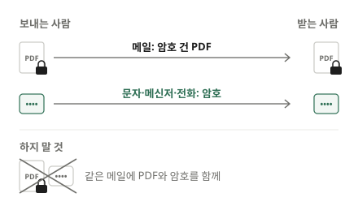

입사 서류, 급여 자료, 계약서처럼 주민등록번호나 계좌번호가 적힌 PDF를 메일로 보낼 일이 있습니다. 메일은 잘못된 주소로 가기도 하고, 받는 사람의 메일함이나 공유 폴더에 오래 남습니다. PDF에 열기 암호를 걸어 두면 파일이 엉뚱한 곳에 가더라도 암호를 모르는 사람은 내용을 볼 수 없습니다.

## 암호를 거는 순서

1. [PDF 암호 걸기](/pdf/protect/) 도구를 엽니다.
2. "PDF 파일 선택"을 누르거나 PDF를 화면으로 끌어다 놓습니다.
3. "새 암호"와 "암호 확인"에 같은 암호를 입력합니다. 두 칸이 다르면 "두 암호가 서로 다릅니다."라고 알려 주고 버튼이 눌리지 않습니다.
4. "암호 걸기"를 누릅니다.
5. 완료되면 "다운로드"를 누릅니다. 파일 이름 뒤에 "_암호"가 붙고, 이 PDF는 열 때 암호를 묻습니다.

보내기 전에 받은 파일을 직접 열어 보고, 암호를 묻는지와 암호를 넣으면 잘 열리는지 확인하세요.

## 암호는 파일과 다른 길로 알립니다

가장 흔한 실수는 **암호를 같은 메일 본문에 적는 것**입니다. 메일이 잘못 가면 파일과 암호가 함께 넘어가니 암호를 건 의미가 없습니다.

- 파일은 메일로, 암호는 **문자·메신저·전화**처럼 다른 길로 알립니다.
- 같은 사람과 자주 주고받는다면 미리 정해 둔 규칙(예: 받는 사람만 아는 정보)을 쓰는 방법도 있습니다. 다만 생년월일·전화번호처럼 남이 쉽게 알 수 있는 정보는 피하는 편이 좋습니다.
- 암호를 따로 보냈다는 사실만 메일에 적어 두면 받는 사람이 헷갈리지 않습니다.

## 좋은 암호 고르기

PDF 암호는 파일을 손에 넣은 사람이 몇 번이든 맞춰 볼 수 있습니다. 은행 앱처럼 몇 번 틀리면 잠기는 장치가 없으니, **길이**가 가장 중요합니다.

- **짧은 숫자는 피합니다.** 네 자리나 여섯 자리 숫자는 경우의 수가 적어 프로그램으로 금방 맞출 수 있습니다.
- **길게 만듭니다.** 서로 관계없는 낱말 서너 개를 이어 붙이면 외우기 쉬우면서도 길어집니다.
- **다른 곳에 쓰는 암호를 쓰지 않습니다.** 받는 사람에게 알려 주는 암호이니, 내 메일이나 은행 암호와 겹치면 안 됩니다.
- **파일마다 바꿉니다.** 한 번 알려 준 암호는 여러 사람에게 퍼질 수 있습니다.

## 어떤 방식으로 잠그나요?

PDF 표준이 정한 **AES-256** 암호화를 씁니다. 현재 PDF가 지원하는 방식 가운데 가장 강한 것으로, 암호 없이는 내용을 읽을 수 없게 파일 전체를 바꿔 저장합니다. 암호가 충분히 길다면 파일을 가진 사람도 사실상 열 수 없습니다.

이 도구는 **열기 암호**를 겁니다. 인쇄·글자 복사 같은 권한을 따로 고르는 설정은 없습니다. 암호는 누가 내용을 볼 수 있는지를 정하는 것이니, 암호를 알려 준 사람은 내용을 볼 수 있다고 생각하고 보내세요.

## 받는 사람은 어떻게 여나요?

따로 프로그램을 깔 필요는 없습니다. Adobe Acrobat Reader, 크롬·엣지·사파리 같은 브라우저, 휴대폰의 PDF 보기 앱 등 대부분의 프로그램이 파일을 열 때 암호 입력 창을 띄웁니다. 아주 오래된 PDF 프로그램은 AES-256을 모를 수 있으니, 받는 사람이 열지 못한다고 하면 프로그램을 최신으로 바꾸거나 브라우저로 열어 보라고 안내하세요.

## 자주 생기는 문제

**암호를 잊었습니다.** 그 PDF는 열 수 없습니다. 암호는 어디에도 저장되지 않아 저희도 되찾아 드릴 수 없습니다. 암호를 걸기 전의 원본 PDF를 내 기기에 보관해 두면, 다시 새 암호를 걸어 보낼 수 있습니다.

**이미 암호가 걸린 PDF의 암호를 바꾸고 싶습니다.** 파일을 열 때 지금 암호를 넣은 뒤 새 암호를 걸면 됩니다. 받은 PDF는 새 암호로만 열립니다.

**다른 도구로 고친 뒤 암호가 사라졌습니다.** [PDF 합치기](/pdf/merge/)나 [PDF 압축](/pdf/compress/) 같은 다른 도구의 결과에는 암호가 걸리지 않습니다. 여러 작업을 할 때는 다른 작업을 모두 마친 뒤 **마지막에** 암호를 거세요.

**전자 서명된 PDF라고 나옵니다.** 전자 서명이 들어간 PDF는 이 도구로 저장하면 서명이 더 이상 유효하지 않습니다. 서명이 중요한 문서는 원본을 보내야 합니다.

## 암호도 기기를 떠나지 않습니다

암호를 걸려고 서류를 다른 사이트에 올리면, 지키려던 개인정보를 처음 보는 서버에 먼저 맡기는 셈입니다. 이 도구는 브라우저 안에서 암호를 걸기 때문에 파일도, 입력한 암호도 기기 밖으로 나가지 않습니다.
