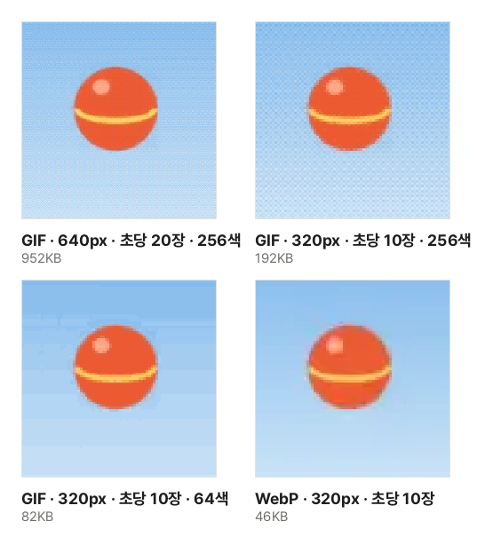

짧은 장면을 GIF로 만들었더니 몇 MB가 넘어 메신저나 게시판에 올라가지 않는 일이 흔합니다. GIF는 같은 길이의 동영상보다 훨씬 크게 만들어지는 형식이라, 무엇이 용량을 정하는지 알고 줄일 곳을 고르는 편이 화질을 덜 잃습니다.

## 만드는 순서

1. [동영상을 GIF로](/video/to-gif/) 도구를 엽니다.
2. "동영상 파일 선택"을 누르거나 동영상을 화면으로 끌어다 놓습니다.
3. 동영상을 재생하다 원하는 곳에서 멈추고 "지금 위치를 시작으로"·"지금 위치를 끝으로"로 구간을 정합니다.
4. 폭·초당 장면 수·색 수를 고르면 위쪽 막대에 결과 크기와 예상 용량이 바로 보입니다. 예상 용량을 보며 아래 순서대로 줄입니다.
5. "GIF 만들기"를 눌러 결과를 미리 보고 "GIF 받기"를 누릅니다.

## GIF가 동영상보다 큰 까닭

MP4 같은 동영상 형식은 앞뒤 장면에서 무엇이 어디로 움직였는지 예측해, 바뀐 부분도 아주 적은 정보로 담습니다. 1987년에 나온 GIF에는 그런 방법이 없습니다. 장면마다 화소를 그대로 적고, 글자 압축과 같은 방식(LZW)으로 줄일 뿐입니다. 게다가 한 파일에 256가지 색까지만 쓸 수 있어 사진 같은 장면은 색을 덜어 내야 합니다.

그래서 같은 장면이라도 차이가 큽니다. 이 사이트의 견본 동영상(640×360, 4초, MP4 33KB)을 같은 크기로 초당 20장 GIF로 만들면 952KB로, 동영상보다 약 29배 큽니다.

## 줄이는 순서

위 그림은 견본 동영상 4초를 이 도구로 설정만 바꿔 만든 실제 결과에서 같은 순간을 잘라 키운 것입니다.

1. **폭부터 줄입니다.** 폭을 반으로 줄이면 화소 수는 4분의 1이 됩니다. 견본은 640px에서 320px로 줄이자 952KB가 317KB가 되었습니다. 휴대폰 화면이나 댓글 칸에 보이는 크기는 대개 폭 320~480px이라, 원본 크기 그대로 둘 까닭이 거의 없습니다.
2. **초당 장면 수를 줄입니다.** 초당 20장을 10장으로 줄이면 317KB가 192KB가 되었습니다. 장면 수가 반이어도 용량이 반이 되지 않는 것은, 장면 사이가 멀어진 만큼 한 장면에서 바뀌는 곳이 넓어지기 때문입니다. 말하는 장면·화면 녹화는 초당 8~10장, 빠른 동작은 15장 안팎이면 충분합니다.
3. **구간을 짧게 잡습니다.** 용량은 길이에 거의 비례합니다. 반응 짤이라면 핵심 동작 1~3초면 충분하고, 시작과 끝을 같은 자세에서 자르면 반복할 때 끊김이 덜합니다.
4. **마지막으로 색 수를 줄입니다.** 256색에서 64색으로 줄이고 디더링을 끄자 192KB가 82KB가 되었지만, 그림처럼 하늘에 줄무늬(색 계단)가 생겼습니다. 단색 배경의 화면 녹화·그림은 64색 이하로도 깨끗하고, 하늘·피부처럼 색이 부드럽게 바뀌는 사진은 색을 남기는 편이 낫습니다.

## 디더링은 켤까, 끌까

색 수가 모자라면 부드럽게 바뀌는 곳이 계단처럼 끊겨 보입니다. 디더링은 가까운 두 색을 작은 점 무늬로 섞어 그 사이 색처럼 보이게 합니다. 그림의 256색 결과를 크게 보면 하늘에 보이는 잔 점이 디더링입니다. 화면 크기로 보면 계단이 사라져 매끄럽게 보이지만, 점 무늬는 압축이 잘 되지 않아 용량이 늘어납니다.

이 도구의 디더링은 자리마다 정해진 무늬를 쓰는 방식(순서 디더링)입니다. 화소 하나의 오차를 옆으로 퍼뜨리는 방식은 정지 사진에는 곱지만, 움직이는 그림에서는 장면마다 무늬가 달라져 자글거리고 용량도 커집니다.

## 움직임이 적을수록 작아진다

이 도구는 앞 장면과 색이 같은 화소를 비워 두어(투명) 앞 장면이 그대로 보이게 합니다. 그래서 배경이 멈춰 있고 일부만 움직이는 장면은 크게 줄고, 화면 전체가 움직이는 장면은 덜 줄어듭니다.

- 손으로 들고 찍어 화면 전체가 흔들리는 영상은 삼각대로 찍은 영상보다 훨씬 큽니다.
- 어두운 곳에서 찍어 자글자글한 잡음이 있는 영상도 장면마다 화소가 조금씩 달라 큽니다.
- 화면 녹화는 바뀐 곳만 담기므로 같은 크기의 촬영 영상보다 훨씬 작습니다.

## 움직이는 WebP라는 선택지

같은 설정을 움직이는 WebP로 만들면 46KB로, 같은 크기·장면 수의 GIF(192KB)보다 4분의 1 정도입니다. WebP는 동영상처럼 사진을 압축하고 색 수 제한도 없어 하늘의 줄무늬도 생기지 않습니다. 요즘 브라우저와 많은 앱에서 움직이지만, GIF 파일만 받는 게시판·프로그램도 아직 있으니 올릴 곳에서 받는지 먼저 확인하세요. Safari는 WebP로 저장하는 기능이 없어 이 도구에서도 GIF만 만들 수 있습니다.

## 자주 겪는 문제

- **예상 용량과 결과가 다릅니다**: 예상은 구간에서 장면 몇 개를 실제로 저장해 보고 늘려 잡은 값입니다. 중간에 장면이 크게 바뀌면 차이가 납니다. "GIF 만들기"로 만든 뒤 막대의 실제 용량을 보고, 크면 설정을 바꿔 다시 만드세요.
- **반복하지 않습니다**: 반복을 "한 번만"으로 골랐는지 봅니다.
- **동영상이 열리지 않습니다**: 이 도구는 브라우저의 동영상 재생 기능으로 장면을 읽습니다. 아이폰의 HEVC 영상은 Safari나 HEVC를 지원하는 기기에서 열리니 다른 브라우저로 해 보세요.
- **동영상의 한 장면만 사진으로 필요합니다**: [동영상 장면 캡처](/video/frame-capture/)로 원래 크기 그대로 JPG·PNG를 받는 편이 GIF보다 선명합니다.
