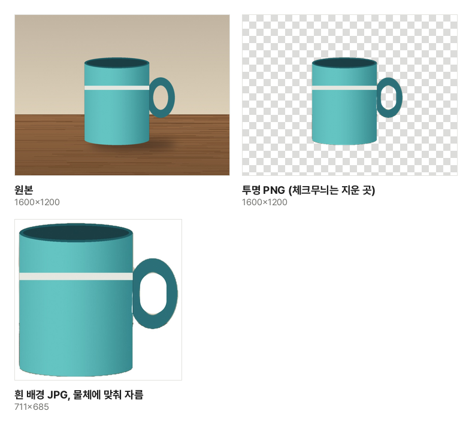

쇼핑몰에 올릴 상품 사진, 발표 자료에 얹을 사람 사진, 반려동물 스티커처럼 배경 없이 물체만 필요한 때가 있습니다. 예전에는 그림 프로그램에서 펜으로 테두리를 하나하나 따야 해서 '누끼 따기'라는 말이 생겼습니다. 지금은 물체를 알아보는 인식 모델이 이 일을 대신하지만, 원리를 알면 어떤 사진이 잘 되고 결과를 어떻게 고쳐야 하는지 쉽게 판단할 수 있습니다.

## 컴퓨터가 물체와 배경을 나누는 방법

[이미지 배경 제거](/image/remove-bg/)는 사진의 화소마다 "누른 물체에 속할 가능성"을 0부터 1까지의 값으로 매깁니다. 이 값을 모은 흑백 그림을 마스크라고 하고, 가능성이 높은 곳은 남기고 낮은 곳은 투명하게 지웁니다.

- **누른 곳을 기준으로 나눕니다**: 사진 가운데를 누른 것으로 시작해 가운데 물체를 남깁니다. 다른 물체도 남기려면 그 물체를 누르면 되고, 누른 곳마다 나눈 결과를 모두 합칩니다
- **줄인 사진으로 나누고 원본에 씌웁니다**: 모델은 사진을 작게 줄여 봅니다. 나눈 마스크를 원본 크기로 늘려 원본 사진에 씌우므로, 남은 부분의 화소와 크기는 원본 그대로입니다
- **경계는 화소 몇 개 폭의 띠로 정해집니다**: 줄인 사진에서 나누기 때문에 경계가 원본에서 몇 화소쯤 어긋날 수 있습니다. 아래 "가장자리"에서 이 띠를 좁히거나 넓힙니다

견본 사진(탁자 위 머그잔)을 이 도구로 처리한 실제 결과입니다. 가운데 몸통은 저절로 남았고, 손잡이는 한 번 더 눌러 더했습니다. 손잡이 고리 안쪽은 벽이 비치는 곳이라 함께 남아서 "지우개"로 지웠습니다.

## 잘 되는 사진, 어려운 사진

잘 되는 사진

- 남길 물체가 사진에서 크게 나온 사진
- 물체와 배경의 색·밝기가 다른 사진 (흰 벽 앞의 어두운 옷, 밝은 탁자 위의 진한 그릇)
- 테두리가 분명한 물체: 사람, 그릇·신발·가방 같은 상품, 앉아 있는 동물, 화분

어려운 사진

- **머리카락·털 끝**: 가는 머리카락은 배경과 섞여 한 올씩 반투명하게 나눠야 하는데, 이 도구는 경계를 찾는 방식이라 끝이 뭉개지거나 조금 잘립니다
- **유리·비닐처럼 비치는 물체**: 물체 너머로 배경이 보여 모델이 물체로 보지 않습니다. 결과도 반투명하게 남기지 못하고 남기거나 지우는 것 중 하나가 됩니다
- **배경과 색이 같은 부분**: 흰 벽 앞의 흰 셔츠 어깨처럼 경계가 보이지 않는 곳은 함께 지워질 수 있습니다
- **구멍이 있는 물체**: 손잡이 고리, 의자 등받이 틈처럼 물체 안으로 배경이 보이는 곳은 물체로 묶여 남기 쉽습니다

찍을 때 배경을 단색으로 하고 물체와 배경 사이를 조금 띄우면(그림자가 덜 붙게) 결과가 훨씬 깔끔해집니다.

## 투명 PNG와 흰 배경 JPG, 무엇을 받을까

| 쓸 곳                                          | 받을 형식                    | 이유                                                          |
| ---------------------------------------------- | ---------------------------- | ------------------------------------------------------------- |
| PPT·한글 문서, 디자인 프로그램, 스티커         | 투명 PNG                     | 어떤 배경 위에 얹어도 네모 테두리가 보이지 않습니다           |
| 쇼핑몰·중고 거래 상품 사진                     | 흰 배경 JPG                  | 많은 쇼핑몰이 흰 배경을 권하고, JPG는 PNG보다 용량이 작습니다 |
| 정해진 색 배경이 필요한 곳 (지원서, 프로필 등) | "다른 색"으로 그 색을 깐 JPG | JPG는 투명한 곳을 담지 못해 배경색을 미리 칠해 둡니다         |

JPG에는 투명도가 없어서, 투명하게 지운 곳을 JPG로 저장하면 프로그램마다 검은색이나 흰색으로 채워집니다. 그래서 이 도구는 투명 배경이면 PNG, 색 배경이면 JPG로 저장합니다. "물체에 맞춰 자르기"를 고르면 남은 곳 둘레만 남겨, 상품이 사진 한가운데 크게 보이게 할 수 있습니다.

## 테두리를 깔끔하게 고치는 법

- **배경 조각이 남았을 때**: "지우개"를 고르고 남은 곳을 칠합니다. 붓 크기는 사진 긴 변에 대한 비율이라 큰 사진에서도 같은 느낌으로 칠해집니다
- **물체 일부가 잘렸을 때**: 그 부분이 따로 떨어진 물체(손잡이, 들고 있는 물건)라면 눌러서 더하고, 조금만 잘렸다면 "되살리기"로 칠합니다
- **테두리에 배경색이 얇게 남을 때**: "좁히기 · 넓히기"를 왼쪽으로 옮겨 경계를 안쪽으로 당깁니다. 반대로 물체 끝이 잘리면 오른쪽으로 옮깁니다
- **다른 배경에 얹으니 경계가 딱딱해 보일 때**: "부드럽게"를 올리면 경계가 몇 화소에 걸쳐 흐려져 새 배경과 자연스럽게 섞입니다. 너무 올리면 원래 배경색이 테두리에 비치므로 1~2 정도가 알맞습니다

다 고친 뒤에는 "원본 보기"로 빠진 곳이 없는지 견주고, 받은 PNG를 어두운 배경과 밝은 배경에 한 번씩 얹어 보세요. 한쪽에서만 보이는 얇은 테두리가 있으면 "좁히기"를 한 단계 더 합니다.

처음 쓸 때는 물체 나누기 엔진과 모델을 한 번 받아 이 브라우저에 보관합니다. 사진을 나누고 저장하는 모든 과정은 이 기기 안에서 이루어지고, 사진은 어디에도 올라가지 않습니다. 사람 얼굴을 여권 규격에 맞추려면 [증명사진 만들기](/image/id-photo/)를 쓰세요.
