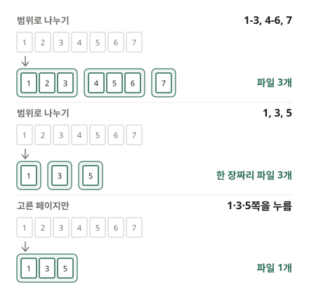

"재직증명서 1쪽만 올려 주세요", "보고서 중 3장만 보내 주세요"처럼 받는 쪽이 PDF의 일부만 원할 때가 있습니다. 파일 전체를 보내면 용량 제한에 걸리거나, 보여 주지 않아도 될 쪽까지 넘어갑니다. 이 글에서는 PDF에서 필요한 쪽만 따로 떼어 내는 방법과, 상황에 맞는 나누기 방법을 고르는 법을 설명합니다.

## 나누는 순서

1. [PDF 나누기](/pdf/split/) 도구를 엽니다.
2. "PDF 파일 선택"을 누르거나 PDF를 화면으로 끌어다 놓습니다.
3. 나누는 방법을 고릅니다. 휴대폰에서는 "범위", "한 장씩", "고른 쪽"으로 짧게 보입니다.
4. 쪽 격자에서 각 쪽이 몇 번째 파일로 가는지 확인하고 "PDF 나누기"를 누릅니다.
5. 완료되면 "다운로드"로 받습니다.

## 어떤 방법을 고를까요?

- **고른 페이지만**: 필요한 쪽 몇 장을 **파일 하나**로 내고 싶을 때. 쪽을 눌러 고르면 고른 쪽이 모여 한 파일이 됩니다. 2쪽과 7쪽과 10쪽처럼 떨어진 쪽을 한 파일에 담을 때 가장 편합니다. 쪽은 원래 순서대로 들어갑니다.
- **범위로 나누기**: 한 파일을 **여러 덩어리**로 나눌 때. 한 번에 스캔한 신청서 여러 건을 건마다 따로 떼거나, 교재를 장별로 나눌 때 씁니다.
- **한 장씩 나누기**: **모든 쪽**을 따로 떼어야 할 때. 한 쪽에 한 사람씩 담긴 급여명세서나 성적표를 사람마다 보낼 때 알맞습니다.

## 범위 적는 법

"범위로 나누기"에서는 쉼표로 구분한 범위마다 파일이 하나씩 생깁니다.

- `1-3` → 1~3쪽이 든 파일 하나. `1~3`으로 적어도 됩니다.
- `7` → 7쪽 한 장짜리 파일 하나.
- `5-` → 5쪽부터 끝까지, `-3` → 처음부터 3쪽까지.
- `1-3, 4-6, 7` → 파일 세 개.

헷갈리기 쉬운 점이 있습니다. `1, 3, 5`라고 적으면 1·3·5쪽이 든 파일 하나가 아니라 **한 장짜리 파일 세 개**가 됩니다. 떨어진 쪽을 한 파일에 모으려면 "고른 페이지만"을 쓰세요. 범위끼리 겹쳐도 되고, 어느 범위에도 들지 않은 쪽은 결과에 들어가지 않습니다.

여기서 쪽 번호는 PDF 파일 안에서 몇 번째 쪽인지입니다. 표지나 목차가 있는 문서는 쪽 아래에 인쇄된 번호와 다를 수 있으니, 격자의 썸네일로 확인하고 적으세요.

## 여러 파일은 ZIP 하나로

결과가 여러 개면 파일마다 따로 내려받지 않고 **ZIP 파일 하나**로 받습니다. 압축을 풀면 "원래이름_1-3.pdf"처럼 범위가 붙은 PDF가 나옵니다. "한 장씩 나누기"는 파일 이름 뒤에 쪽 번호가 붙고, "고른 페이지만"은 결과가 하나라 ZIP 없이 PDF로 바로 받습니다.

## 자주 생기는 문제

**"○쪽은 없습니다"라고 나옵니다.** 적은 범위가 PDF의 쪽 수를 넘었습니다. 안내에 나온 전체 쪽 수를 보고 범위를 고치세요.

**나눈 파일도 크기가 큽니다.** 스캔본은 쪽 하나하나가 사진이라 몇 쪽만 떼어도 클 수 있습니다. 용량 제한이 있으면 [PDF 압축](/pdf/compress/)으로 한 번 더 줄이세요.

**쪽 순서도 바꾸고 싶습니다.** 나누기는 원래 순서를 따릅니다. 순서를 바꾸거나 쪽을 빼려면 [PDF 페이지 정리](/pdf/organize/)를, 다른 PDF와 이어 붙이려면 [PDF 합치기](/pdf/merge/)를 쓰세요.

**암호가 걸린 PDF입니다.** 열 때 암호를 입력하면 나눌 수 있습니다. 나눈 파일에는 암호가 걸리지 않으니, 다시 걸어서 보내려면 [PDF 암호 걸기](/pdf/protect/)를 쓰세요.

**화질이 떨어질까요?** 아니요. 쪽을 다시 그리지 않고 원본 내용을 그대로 옮겨 담기 때문에 글자와 사진이 원본과 같습니다.

## 왜 업로드하지 않나요?

제출용 서류에서 필요한 쪽만 떼는 일인데, 그 서류 전체를 남의 서버에 올릴 이유가 없습니다. 이 도구는 브라우저 안에서만 나누기 때문에 PDF가 기기를 떠나지 않습니다.
