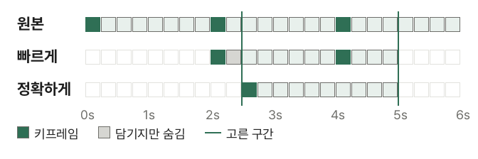

긴 녹화에서 필요한 부분만 남기고 싶을 때, 편집 프로그램을 깔지 않아도 브라우저에서 바로 자를 수 있습니다. 그런데 어떤 프로그램으로 자르면 몇 초 만에 끝나고, 어떤 프로그램은 동영상 길이만큼 걸립니다. 빠르게 자른 영상이 고른 곳보다 조금 앞에서 시작하는 일도 있습니다. 모두 **키프레임** 때문입니다.

## 자르는 순서

1. [동영상 자르기](/video/trim/) 도구를 엽니다.
2. "동영상 파일 선택"을 누르거나 동영상을 화면으로 끌어다 놓습니다.
3. 미리보기를 보며 막대 양쪽의 손잡이를 끌어 남길 구간을 고릅니다. 재생하다가 "지금 위치를 시작으로"·"지금 위치를 끝으로"를 눌러도 되고, 시간을 숫자로 적어도 됩니다 (예: 1:05.5).
4. "고른 구간 재생"으로 확인하고 자르는 방법을 고릅니다.
5. "자르기"를 누르고 "받기"를 누릅니다.

## 키프레임이란?

동영상은 장면마다 그림을 통째로 저장하지 않습니다. 몇 초마다 한 장만 통째로 저장하고(**키프레임**), 그 사이 장면은 "앞 장면에서 무엇이 바뀌었는지"만 적습니다. 그래서 중간 장면을 보려면 앞의 키프레임부터 차례로 풀어야 합니다. 휴대폰 동영상은 보통 1~2초마다 키프레임이 있고, 화면 녹화나 인터넷에서 받은 영상은 5~10초 간격인 경우도 있습니다.

## 빠르게 자르기 (다시 인코딩 없음)

동영상 데이터를 풀지 않고 필요한 부분만 그대로 옮깁니다. 시작점이 키프레임 사이에 있으면 그 장면만으로는 풀 수 없으므로, **바로 앞의 키프레임부터 담고** "고른 시점부터 재생하라"는 표시(MP4·MOV의 편집 목록)를 파일에 적습니다. 위 그림의 회색 칸이 담기지만 보이지 않는 부분입니다.

- 화질이 원본과 똑같고, 몇 분짜리 영상도 몇 초면 끝납니다
- 브라우저의 동영상 인코더가 필요 없어 대부분의 브라우저에서 됩니다
- 대부분의 플레이어(브라우저, 휴대폰, QuickTime, VLC 등)는 고른 시점부터 보여 줍니다. 편집 목록을 읽지 않는 일부 편집 프로그램은 앞의 키프레임부터(몇 초 안) 보여 줄 수 있습니다

## 정확하게 자르기 (다시 인코딩)

고른 구간의 장면을 모두 풀어서 다시 저장합니다. 시작 장면이 새 키프레임이 되므로 **어느 프로그램에서나 정확히 고른 곳에서 시작**합니다. 대신 장면을 모두 다시 저장하므로 동영상 길이만큼 시간이 걸리고, 화질이 아주 조금 바뀔 수 있습니다. 소리는 다시 인코딩하지 않고 옮깁니다.

## 무엇을 고를까요?

- 메신저로 보내거나 SNS에 올릴 영상, 보관할 영상: **빠르게**로 충분합니다
- 편집 프로그램에 넣어 다른 영상과 이어 붙일 영상, 첫 장면이 꼭 맞아야 하는 영상: **정확하게**
- 정확하게를 고를 수 없으면 이 브라우저가 그 코덱을 다시 저장하지 못하는 것입니다. 크롬이나 엣지에서 열어 보세요

## 자른 다음에

- 용량이 여전히 크면 [동영상 용량 줄이기](/video/compress/)로 해상도를 낮추세요. 먼저 자르면 줄이는 시간도 짧아집니다
- 고른 구간의 소리만 필요하면, 자른 파일을 [동영상 소리 추출](/video/extract-audio/)에 넣으세요

동영상은 서버로 올라가지 않고 이 브라우저 안에서만 처리됩니다. 큰 파일도 파일 전체를 한 번에 읽지 않고 필요한 부분만 읽습니다.
