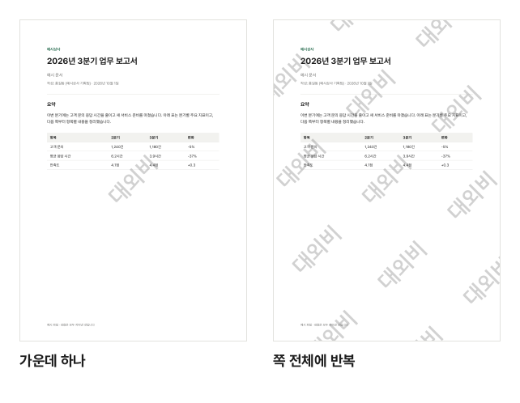

견적서나 내부 문서를 밖으로 보낼 때 "대외비", 신분증 사본을 낼 때 "○○ 제출용", 초안을 돌릴 때 "검토용"처럼 문서 위에 글자를 크게 겹쳐 두면 용도가 분명해지고 다른 곳에 쓰이는 일을 줄일 수 있습니다. 이 글에서는 PDF의 모든 쪽에 글자 워터마크를 넣는 방법을 설명합니다.

## 넣는 순서

1. [PDF 워터마크 넣기](/pdf/watermark/) 도구를 엽니다.
2. "PDF 파일 선택"을 누르거나 PDF를 끌어다 놓습니다.
3. "넣을 글자"에 워터마크로 쓸 글자를 적습니다.
4. 아래 글꼴 목록에서 글꼴을 고릅니다. 처음 쓰는 글꼴은 "받기"를 누릅니다.
5. 배치·기울기·크기·진하기·색을 고르면 쪽 미리보기에 바로 보입니다.
6. "워터마크 넣기"를 누르고 "다운로드"로 받습니다.

## 글꼴은 왜 받나요?

PDF에 한글을 넣으려면 한글 글꼴 파일이 있어야 합니다. 그래서 처음 한 번 글꼴을 받습니다.

- 글꼴은 한 개에 0.1~2.3MB입니다. 받기 전에 목록에 크기가 보입니다.
- 받은 글꼴은 **이 브라우저에 보관**되어 다음에 들어오면 받지 않고 바로 고를 수 있습니다.
- 다른 브라우저나 다른 기기, 시크릿 창에서는 다시 받아야 하고, 브라우저 데이터를 지우면 사라집니다. 지워진 경우에는 목록에 다시 받으라는 안내가 나옵니다.
- PDF에는 글꼴 전체가 아니라 **워터마크에 쓴 글자만** 들어갑니다. 그래서 결과 파일은 보통 수십 KB 정도만 커집니다.

회사 글꼴처럼 갖고 있는 글꼴을 쓰려면 목록 맨 아래 "내 글꼴 올리기"로 TTF·OTF·WOFF 파일을 고르면 됩니다. 올린 글꼴은 그 페이지에서만 쓰고 보관하지 않습니다.

## 어떤 모양이 좋을까요?

| 설정   | 고를 수 있는 것        | 이럴 때                                          |
| ------ | ---------------------- | ------------------------------------------------ |
| 배치   | 가운데 하나            | 문서를 읽기 편하게 두면서 용도만 표시할 때       |
| 배치   | 쪽 전체에 반복         | 화면 캡처나 일부만 잘라 쓰는 것까지 막고 싶을 때 |
| 기울기 | 비스듬히 / 가로        | 비스듬히가 본문 글자와 덜 겹쳐 보입니다          |
| 진하기 | 연하게 / 보통 / 진하게 | 인쇄할 문서는 연하게, 화면용은 보통이 무난합니다 |

색은 회색이 가장 무난하고, 눈에 잘 띄어야 하면 빨강을 고릅니다.

예시 보고서에 "대외비"를 넣은 실제 결과입니다 (기울기·크기·진하기는 처음 값). 반복은 쪽의 어느 부분을 잘라 가도 글자가 남지만, 본문은 조금 더 읽기 불편해집니다.

## 워터마크를 지우기 어렵게 하려면

워터마크는 쪽 위에 글자로 겹쳐 넣는 것이라, PDF 편집 프로그램을 쓰면 지울 수도 있습니다. 더 확실하게 하려면 이렇게 할 수 있습니다.

- **쪽 전체에 반복**으로 넣으면 일부를 지우거나 잘라 내기 어렵습니다.
- 워터마크를 넣은 뒤 [PDF 암호 걸기](/pdf/protect/)로 암호를 걸어 보내면, 받는 사람 말고는 열 수 없습니다.
- 받는 사람이나 날짜를 함께 적으면(예: "OO은행 제출용 2026.10") 다른 곳에 쓰였을 때 출처를 알 수 있습니다.

원본 파일은 바뀌지 않으니, 워터마크 없는 원본은 따로 잘 보관하세요.

## 쪽 번호도 넣고 싶다면

여러 쪽 문서라면 [PDF 쪽 번호 넣기](/pdf/page-numbers/)로 번호를 함께 넣을 수 있습니다. 워터마크를 넣은 파일을 그대로 쪽 번호 도구에 넣으면 됩니다.

## 파일은 안전한가요?

PDF와 글꼴 모두 브라우저 안에서만 다루고, PDF는 어디로도 전송되지 않습니다. 글꼴을 받을 때도 이 사이트의 공개 글꼴 파일만 받을 뿐, 내 문서에 관한 정보는 함께 보내지 않습니다.
